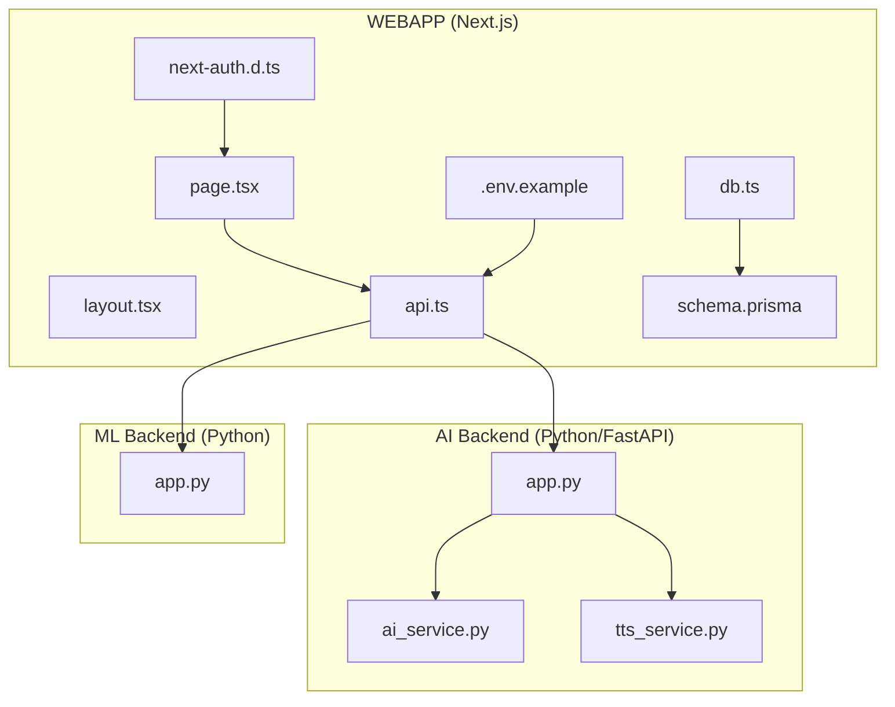
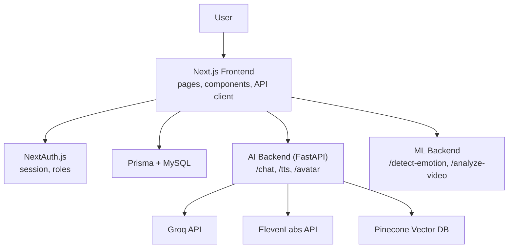
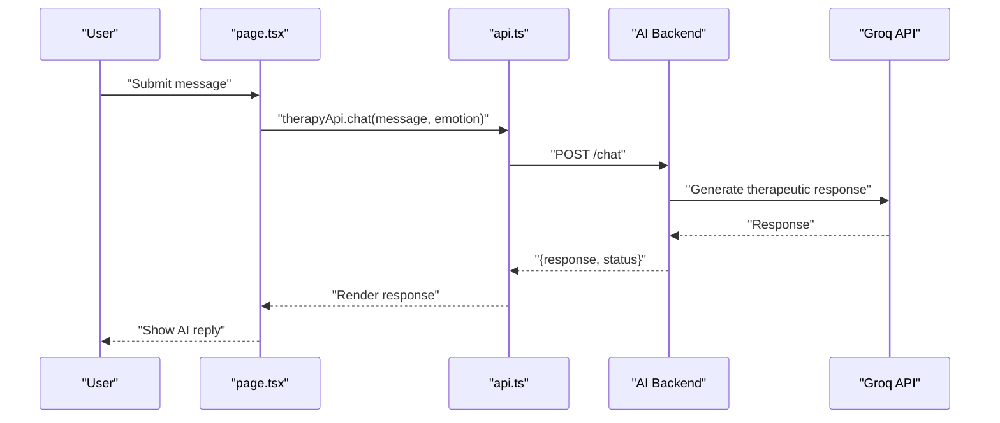
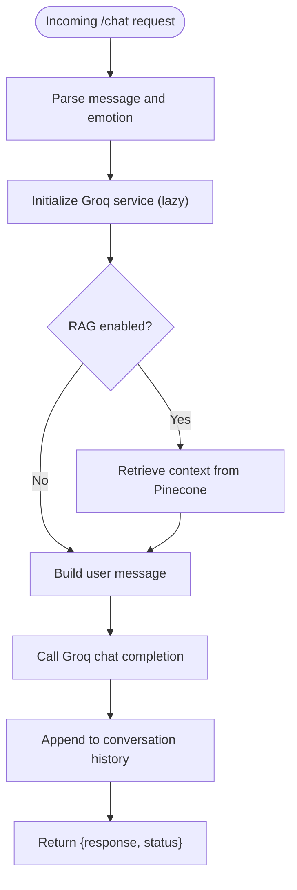
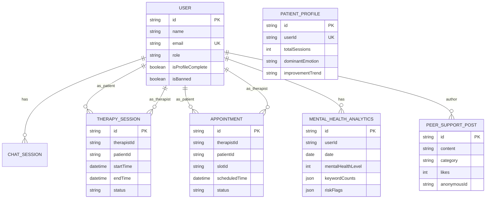
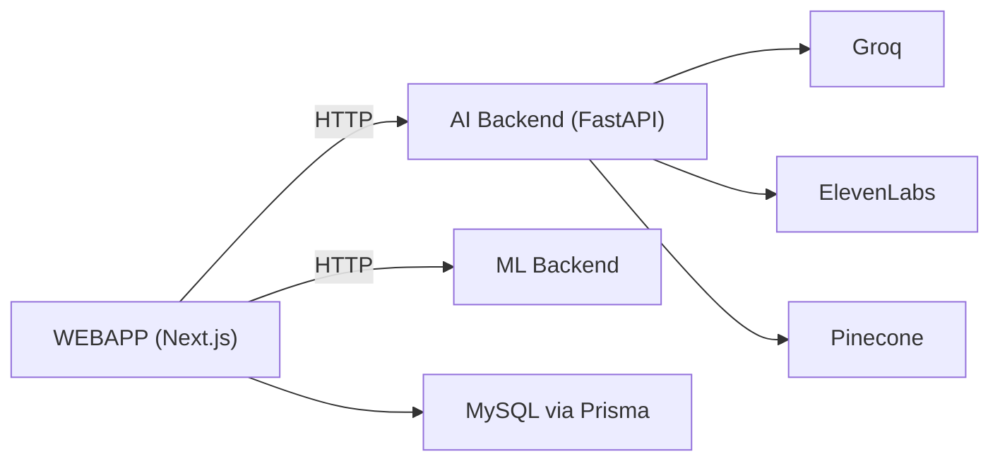

# Project Overview

<cite>
**Referenced Files in This Document**
- [README.md](file://README.md)
- [package.json](file://WEBAPP/package.json)
- [layout.tsx](file://WEBAPP/src/app/layout.tsx)
- [page.tsx](file://WEBAPP/src/app/page.tsx)
- [api.ts](file://WEBAPP/src/lib/api.ts)
- [db.ts](file://WEBAPP/src/lib/db.ts)
- [schema.prisma](file://WEBAPP/prisma/schema.prisma)
- [next-auth.d.ts](file://WEBAPP/src/types/next-auth.d.ts)
- [.env.example](file://WEBAPP/.env.example)
- [app.py](file://ai-backend/app.py)
- [ai_service.py](file://ai-backend/services/ai_service.py)
- [tts_service.py](file://ai-backend/services/tts_service.py)
</cite>

## Table of Contents
1. [Introduction](#introduction)
2. [Project Structure](#project-structure)
3. [Core Components](#core-components)
4. [Architecture Overview](#architecture-overview)
5. [Detailed Component Analysis](#detailed-component-analysis)
6. [Dependency Analysis](#dependency-analysis)
7. [Performance Considerations](#performance-considerations)
8. [Troubleshooting Guide](#troubleshooting-guide)
9. [Conclusion](#conclusion)
10. [Appendices](#appendices)

## Introduction
MindBridge AI is a dual-platform mental health support system designed to deliver accessible, scalable, and compassionate care. The platform combines AI-powered therapy with human professional integration, enabling users to engage in therapeutic conversations, receive emotion-aware AI responses, book appointments with verified therapists, and participate in anonymous peer support. It leverages a modern full-stack architecture: a Next.js frontend and Python-based AI/ML backend services, integrated with robust data persistence, secure authentication, and analytics.

The platform’s core value proposition lies in bridging immediate, low-barrier AI support with structured, professional care pathways. By integrating RAG-enhanced AI therapy, real-time speech synthesis, and comprehensive analytics, MindBridge aims to normalize mental health support and make it available around the clock.

## Project Structure
MindBridge is organized into three primary areas:
- WEBAPP: Next.js frontend application containing pages, components, APIs, UI primitives, and authentication.
- ai-backend: Python FastAPI service providing AI therapy, text-to-speech, and avatar generation capabilities.
- ml-backend: Machine learning backend for emotion detection and video analysis (referenced in frontend APIs).

**Diagram sources**
- [layout.tsx](file://WEBAPP/src/app/layout.tsx#L1-L55)
- [page.tsx](file://WEBAPP/src/app/page.tsx#L1-L381)
- [api.ts](file://WEBAPP/src/lib/api.ts#L1-L142)
- [db.ts](file://WEBAPP/src/lib/db.ts#L1-L15)
- [schema.prisma](file://WEBAPP/prisma/schema.prisma#L1-L330)
- [next-auth.d.ts](file://WEBAPP/src/types/next-auth.d.ts#L1-L28)
- [.env.example](file://WEBAPP/.env.example#L1-L16)
- [app.py](file://ai-backend/app.py#L1-L154)
- [ai_service.py](file://ai-backend/services/ai_service.py#L1-L293)
- [tts_service.py](file://ai-backend/services/tts_service.py#L1-L280)

**Section sources**
- [README.md](file://README.md#L1-L3)
- [package.json](file://WEBAPP/package.json#L1-L88)
- [layout.tsx](file://WEBAPP/src/app/layout.tsx#L1-L55)
- [page.tsx](file://WEBAPP/src/app/page.tsx#L1-L381)
- [api.ts](file://WEBAPP/src/lib/api.ts#L1-L142)
- [db.ts](file://WEBAPP/src/lib/db.ts#L1-L15)
- [schema.prisma](file://WEBAPP/prisma/schema.prisma#L1-L330)
- [next-auth.d.ts](file://WEBAPP/src/types/next-auth.d.ts#L1-L28)
- [.env.example](file://WEBAPP/.env.example#L1-L16)
- [app.py](file://ai-backend/app.py#L1-L154)
- [ai_service.py](file://ai-backend/services/ai_service.py#L1-L293)
- [tts_service.py](file://ai-backend/services/tts_service.py#L1-L280)

## Core Components
- Next.js Frontend
  - Routing and pages for patients, therapists, admins, and public landing.
  - UI primitives and components for chat, analytics, and session management.
  - Authentication via NextAuth.js with role-based access.
  - API client abstraction for AI and ML backend communication.

- AI Backend (FastAPI)
  - REST endpoints for therapy chat, text-to-speech, and avatar generation.
  - Groq integration for therapeutic responses with optional RAG augmentation.
  - ElevenLabs TTS with fallbacks and audio lifecycle management.

- ML Backend
  - Emotion detection and video analysis endpoints referenced by the frontend.

- Data Layer
  - Prisma ORM with MySQL for user profiles, therapy sessions, appointments, analytics, and peer support.

**Section sources**
- [page.tsx](file://WEBAPP/src/app/page.tsx#L1-L381)
- [api.ts](file://WEBAPP/src/lib/api.ts#L1-L142)
- [app.py](file://ai-backend/app.py#L1-L154)
- [ai_service.py](file://ai-backend/services/ai_service.py#L1-L293)
- [tts_service.py](file://ai-backend/services/tts_service.py#L1-L280)
- [schema.prisma](file://WEBAPP/prisma/schema.prisma#L1-L330)

## Architecture Overview
MindBridge employs a dual-service architecture:
- Web frontend (Next.js) handles user interactions, routing, and UI rendering.
- AI backend (FastAPI) provides AI therapy, TTS, and avatar generation.
- ML backend supports emotion detection and video analysis.
- Data persistence via Prisma and MySQL.

**Diagram sources**
- [page.tsx](file://WEBAPP/src/app/page.tsx#L1-L381)
- [api.ts](file://WEBAPP/src/lib/api.ts#L1-L142)
- [app.py](file://ai-backend/app.py#L1-L154)
- [ai_service.py](file://ai-backend/services/ai_service.py#L1-L293)
- [tts_service.py](file://ai-backend/services/tts_service.py#L1-L280)

## Detailed Component Analysis

### Next.js Frontend
- Pages and Routing
  - Public landing page highlights AI therapy, virtual sessions, analytics, peer support, and secure authentication.
  - Role-specific dashboards and navigation for patients, therapists, and admins.
- Authentication and Session Management
  - NextAuth.js integration with typed session/user/JWT to enforce role-based access.
- API Abstraction
  - Centralized API client for AI and ML backends with environment-driven base URLs.
- UI and Theming
  - Layout composes theme provider and session provider; responsive design with dark mode support.

**Diagram sources**
- [page.tsx](file://WEBAPP/src/app/page.tsx#L1-L381)
- [api.ts](file://WEBAPP/src/lib/api.ts#L75-L113)
- [app.py](file://ai-backend/app.py#L81-L94)
- [ai_service.py](file://ai-backend/services/ai_service.py#L131-L191)

**Section sources**
- [page.tsx](file://WEBAPP/src/app/page.tsx#L1-L381)
- [layout.tsx](file://WEBAPP/src/app/layout.tsx#L1-L55)
- [api.ts](file://WEBAPP/src/lib/api.ts#L1-L142)
- [next-auth.d.ts](file://WEBAPP/src/types/next-auth.d.ts#L1-L28)

### AI Backend Services
- FastAPI Application
  - Health checks, CORS configuration, and static audio/video serving.
  - Lazy-initialized services for Groq, TTS, and avatar generation.
- Therapy Chat Endpoint
  - Accepts user message and emotion; returns AI-generated therapeutic response.
- Text-to-Speech Endpoint
  - Converts text to speech via ElevenLabs with fallback to dummy audio.
- Avatar Generation Endpoint
  - Generates talking avatar videos from text prompts.

**Diagram sources**
- [app.py](file://ai-backend/app.py#L81-L94)
- [ai_service.py](file://ai-backend/services/ai_service.py#L131-L191)

**Section sources**
- [app.py](file://ai-backend/app.py#L1-L154)
- [ai_service.py](file://ai-backend/services/ai_service.py#L1-L293)
- [tts_service.py](file://ai-backend/services/tts_service.py#L1-L280)

### Data Model and Persistence
- Users and Roles
  - Users with roles: patient, therapist, admin; profile completeness tracking.
- Therapy and Appointments
  - Therapy sessions, availability slots, and appointments with status and scheduling.
- Analytics and Assessments
  - Daily mental health analytics, keyword detection, risk flags, and assessment sessions.
- Peer Support
  - Anonymous posts and replies with indexing for category and timestamps.
- Authentication and Sessions
  - NextAuth models for accounts, sessions, and verification tokens.

**Diagram sources**
- [schema.prisma](file://WEBAPP/prisma/schema.prisma#L1-L330)

**Section sources**
- [schema.prisma](file://WEBAPP/prisma/schema.prisma#L1-L330)
- [db.ts](file://WEBAPP/src/lib/db.ts#L1-L15)

## Dependency Analysis
- Frontend Dependencies
  - Next.js, React, NextAuth.js, Prisma, TailwindCSS, Radix UI, Stripe, and related libraries.
- Backend Dependencies
  - FastAPI, Uvicorn, Groq SDK, ElevenLabs HTTP client, Pinecone vector store (optional), and environment configuration.
- External Integrations
  - Groq for AI therapy responses.
  - ElevenLabs for text-to-speech.
  - Pinecone for RAG retrieval.
  - MySQL via Prisma for persistent storage.

**Diagram sources**
- [package.json](file://WEBAPP/package.json#L15-L86)
- [app.py](file://ai-backend/app.py#L1-L154)
- [ai_service.py](file://ai-backend/services/ai_service.py#L1-L293)
- [tts_service.py](file://ai-backend/services/tts_service.py#L1-L280)
- [schema.prisma](file://WEBAPP/prisma/schema.prisma#L1-L330)

**Section sources**
- [package.json](file://WEBAPP/package.json#L1-L88)
- [app.py](file://ai-backend/app.py#L1-L154)
- [ai_service.py](file://ai-backend/services/ai_service.py#L1-L293)
- [tts_service.py](file://ai-backend/services/tts_service.py#L1-L280)
- [schema.prisma](file://WEBAPP/prisma/schema.prisma#L1-L330)

## Performance Considerations
- AI Backend
  - Lazy initialization of services reduces cold-start overhead.
  - Asynchronous execution for external API calls minimizes latency.
  - RAG retrieval is guarded and falls back gracefully when unavailable.
- Speech and Media
  - Audio file cleanup prevents disk bloat; unique filenames avoid caching conflicts.
- Frontend
  - Environment-driven base URLs enable easy scaling and deployment separation.
  - Component-level theming and responsive design improve UX performance.

[No sources needed since this section provides general guidance]

## Troubleshooting Guide
- AI Backend
  - Verify environment variables for Groq and ElevenLabs keys.
  - Health endpoint helps confirm service availability.
  - TTS fallback ensures continuity when ElevenLabs is unavailable.
- Authentication
  - Ensure NEXTAUTH_URL and NEXTAUTH_SECRET are configured.
  - Role-based navigation indicates session state and permissions.
- Database
  - Prisma client logs queries in development; verify DATABASE_URL connectivity.
  - Seed script can initialize baseline data for development.

**Section sources**
- [app.py](file://ai-backend/app.py#L77-L79)
- [tts_service.py](file://ai-backend/services/tts_service.py#L12-L21)
- [.env.example](file://WEBAPP/.env.example#L6-L16)
- [db.ts](file://WEBAPP/src/lib/db.ts#L1-L15)

## Conclusion
MindBridge AI delivers a comprehensive, scalable mental health platform that harmonizes AI-driven support with human professional care. Its dual architecture—Next.js frontend and Python AI/ML backends—enables rapid iteration, robust integrations, and a seamless user experience. With strong data modeling, secure authentication, and analytics, MindBridge positions itself as a modern digital therapeutics solution tailored for diverse user needs.

[No sources needed since this section summarizes without analyzing specific files]

## Appendices
- Target Audience
  - Patients seeking accessible, empathetic AI therapy and peer support.
  - Therapists managing schedules and patient analytics.
  - Administrators overseeing platform operations and compliance.
- Business Model
  - Freemium access to AI therapy with premium features and therapist appointments.
  - Optional subscription tiers for enhanced analytics and priority scheduling.
  - Professional integration with billing via Stripe and Google Calendar sync.

[No sources needed since this section provides general guidance]