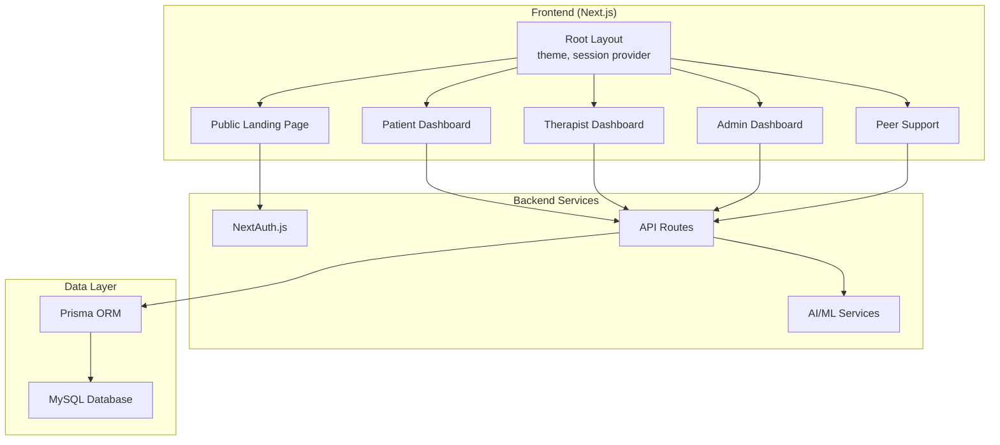
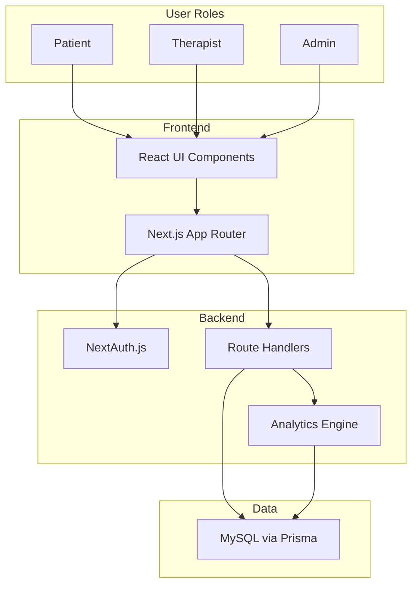
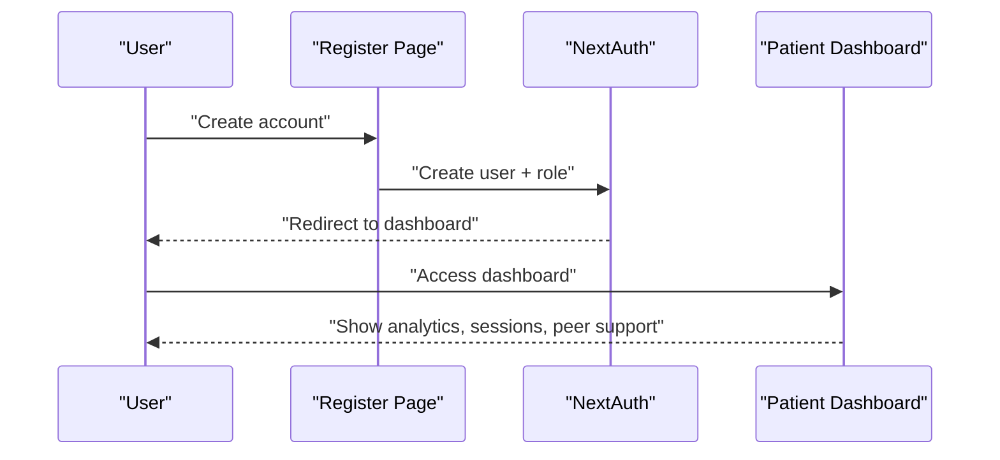
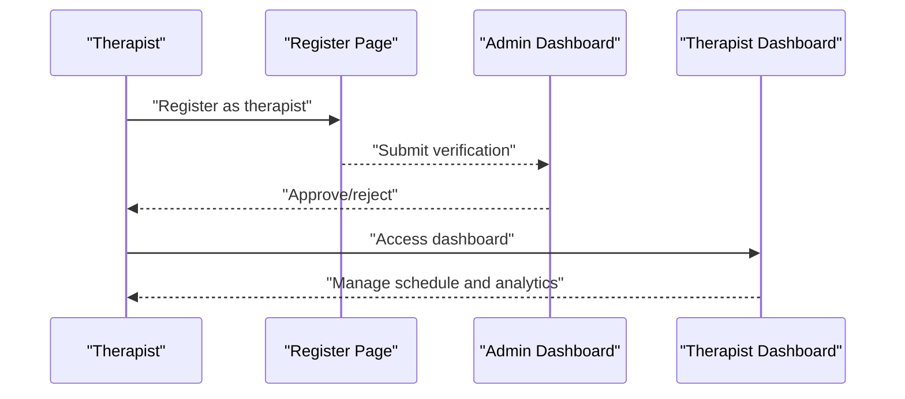
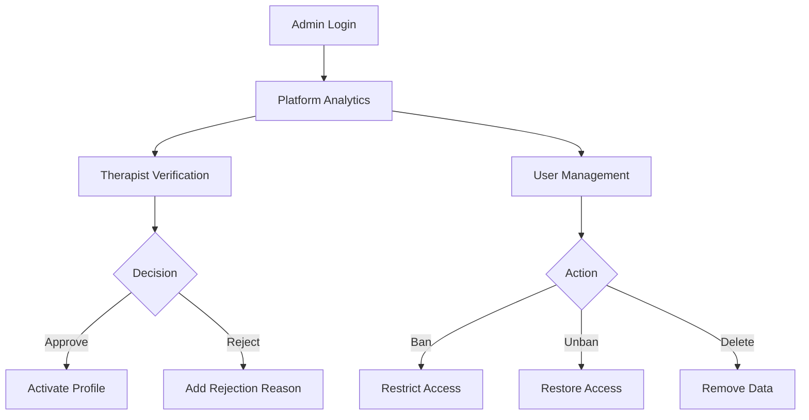
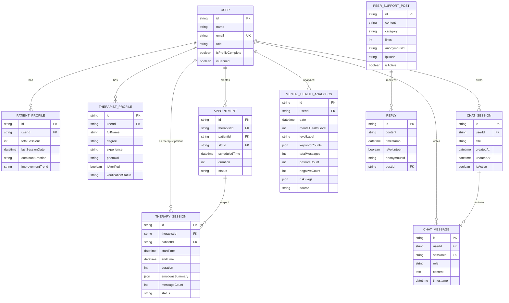

# Target Audience

<cite>
**Referenced Files in This Document**
- [README.md](file://README.md)
- [layout.tsx](file://WEBAPP/src/app/layout.tsx)
- [page.tsx](file://WEBAPP/src/app/page.tsx)
- [signin/page.tsx](file://WEBAPP/src/app/auth/signin/page.tsx)
- [register/page.tsx](file://WEBAPP/src/app/auth/register/page.tsx)
- [patient-dashboard/page.tsx](file://WEBAPP/src/app/patient/dashboard/page.tsx)
- [therapist-dashboard/page.tsx](file://WEBAPP/src/app/therapist/dashboard/page.tsx)
- [admin-dashboard/page.tsx](file://WEBAPP/src/app/admin/dashboard/page.tsx)
- [peer-support/page.tsx](file://WEBAPP/src/app/peer-support/page.tsx)
- [mentalHealthAnalytics.ts](file://WEBAPP/src/lib/mentalHealthAnalytics.ts)
- [MentalHealthAnalytics.tsx](file://WEBAPP/src/components/MentalHealthAnalytics.tsx)
- [schema.prisma](file://WEBAPP/prisma/schema.prisma)
</cite>

## Table of Contents
1. [Introduction](#introduction)
2. [Project Structure](#project-structure)
3. [Core Components](#core-components)
4. [Architecture Overview](#architecture-overview)
5. [Detailed Component Analysis](#detailed-component-analysis)
6. [Dependency Analysis](#dependency-analysis)
7. [Performance Considerations](#performance-considerations)
8. [Troubleshooting Guide](#troubleshooting-guide)
9. [Conclusion](#conclusion)
10. [Appendices](#appendices)

## Introduction
MindBridge AI is a comprehensive mental health platform designed to deliver accessible, scalable, and inclusive care through AI-powered therapy, human-therapist coordination, and peer support. It targets three primary user groups:
- Individuals seeking mental health support (patients)
- Licensed therapists providing care
- Administrative staff managing platform operations

The platform’s positioning emphasizes:
- AI-first accessibility for immediate support and continuous engagement
- Human-therapist collaboration for personalized care
- Community-driven peer support for shared experiences
- Data-driven insights to track progress and detect risks

This document defines target personas, their needs and pain points, the platform’s value proposition, user journeys, success metrics, and inclusive design strategies.

## Project Structure
MindBridge is a Next.js application with a layered architecture:
- Frontend (Next.js app) with role-specific dashboards and UI components
- Backend services (Python FastAPI) for AI/ML and media processing
- Database (MySQL via Prisma) storing user profiles, therapy sessions, analytics, and peer support content
- Authentication and session management via NextAuth.js

**Diagram sources**
- [layout.tsx](file://WEBAPP/src/app/layout.tsx#L1-L55)
- [page.tsx](file://WEBAPP/src/app/page.tsx#L1-L381)
- [patient-dashboard/page.tsx](file://WEBAPP/src/app/patient/dashboard/page.tsx#L1-L800)
- [therapist-dashboard/page.tsx](file://WEBAPP/src/app/therapist/dashboard/page.tsx#L1-L800)
- [admin-dashboard/page.tsx](file://WEBAPP/src/app/admin/dashboard/page.tsx#L1-L510)
- [peer-support/page.tsx](file://WEBAPP/src/app/peer-support/page.tsx#L1-L523)
- [schema.prisma](file://WEBAPP/prisma/schema.prisma#L1-L330)

**Section sources**
- [README.md](file://README.md#L1-L3)
- [layout.tsx](file://WEBAPP/src/app/layout.tsx#L1-L55)
- [page.tsx](file://WEBAPP/src/app/page.tsx#L1-L381)
- [schema.prisma](file://WEBAPP/prisma/schema.prisma#L1-L330)

## Core Components
- Role-based dashboards:
  - Patient dashboard for therapy sessions, analytics, appointments, and peer support
  - Therapist dashboard for patient management, schedule, and analytics
  - Admin dashboard for analytics, therapist verification, and user moderation
- AI/ML analytics engine for keyword-based mental health insights and risk detection
- Peer support community for anonymous, safe, and supportive discussions
- Authentication and profile management with role-based access control

Key capabilities:
- Secure authentication (email/password and Google OAuth)
- Session lifecycle management and incognito detection
- Real-time analytics and risk flags
- Anonymous peer forums with moderation tools

**Section sources**
- [page.tsx](file://WEBAPP/src/app/page.tsx#L190-L311)
- [signin/page.tsx](file://WEBAPP/src/app/auth/signin/page.tsx#L1-L257)
- [register/page.tsx](file://WEBAPP/src/app/auth/register/page.tsx#L1-L266)
- [patient-dashboard/page.tsx](file://WEBAPP/src/app/patient/dashboard/page.tsx#L1-L800)
- [therapist-dashboard/page.tsx](file://WEBAPP/src/app/therapist/dashboard/page.tsx#L1-L800)
- [admin-dashboard/page.tsx](file://WEBAPP/src/app/admin/dashboard/page.tsx#L1-L510)
- [peer-support/page.tsx](file://WEBAPP/src/app/peer-support/page.tsx#L1-L523)
- [mentalHealthAnalytics.ts](file://WEBAPP/src/lib/mentalHealthAnalytics.ts#L1-L884)
- [MentalHealthAnalytics.tsx](file://WEBAPP/src/components/MentalHealthAnalytics.tsx#L1-L942)
- [schema.prisma](file://WEBAPP/prisma/schema.prisma#L1-L330)

## Architecture Overview
MindBridge integrates frontend dashboards, backend APIs, AI/ML services, and a relational database. The architecture supports:
- Scalable user roles with secure access
- Persistent storage of sessions, analytics, and community content
- Real-time and batch analytics for insights and risk flags
- Anonymous peer support with moderation and reporting

**Diagram sources**
- [layout.tsx](file://WEBAPP/src/app/layout.tsx#L1-L55)
- [page.tsx](file://WEBAPP/src/app/page.tsx#L1-L381)
- [signin/page.tsx](file://WEBAPP/src/app/auth/signin/page.tsx#L1-L257)
- [register/page.tsx](file://WEBAPP/src/app/auth/register/page.tsx#L1-L266)
- [patient-dashboard/page.tsx](file://WEBAPP/src/app/patient/dashboard/page.tsx#L1-L800)
- [therapist-dashboard/page.tsx](file://WEBAPP/src/app/therapist/dashboard/page.tsx#L1-L800)
- [admin-dashboard/page.tsx](file://WEBAPP/src/app/admin/dashboard/page.tsx#L1-L510)
- [peer-support/page.tsx](file://WEBAPP/src/app/peer-support/page.tsx#L1-L523)
- [mentalHealthAnalytics.ts](file://WEBAPP/src/lib/mentalHealthAnalytics.ts#L1-L884)
- [schema.prisma](file://WEBAPP/prisma/schema.prisma#L1-L330)

## Detailed Component Analysis

### Personas and User Needs

#### Patient (Individuals Seeking Mental Health Support)
- Needs
  - Immediate, accessible mental health support
  - Personalized insights into mood, stress, and progress
  - Flexible therapy sessions (AI chat and voice)
  - Anonymous peer support and community connection
  - Simple appointment booking with verified therapists
- Pain Points
  - Long wait times for human therapy
  - Stigma around seeking help
  - Difficulty tracking progress consistently
  - Lack of 24/7 support during crises
- Expectations
  - Confidential, nonjudgmental support
  - Clear analytics and actionable insights
  - Easy-to-use interface across devices
  - Option for human therapy when needed

#### Licensed Therapist
- Needs
  - Efficient patient management and scheduling
  - Access to analytics and session summaries
  - Tools to monitor patient trends and risks
  - Verified therapist profiles and compliance workflows
- Pain Points
  - Administrative overhead and manual record-keeping
  - Limited visibility into patient progress between sessions
  - Manual verification and onboarding processes
- Expectations
  - Streamlined workflows and automation
  - Reliable analytics and risk alerts
  - Professional dashboard with privacy controls

#### Administrative Staff
- Needs
  - Platform analytics and operational oversight
  - Therapist verification and approval workflows
  - User moderation and safety enforcement
  - Reporting and compliance tools
- Pain Points
  - Manual oversight across roles and data silos
  - Managing anonymous content responsibly
  - Ensuring timely verification and bans
- Expectations
  - Centralized dashboard with filters and actions
  - Audit trails and transparency
  - Automated moderation aids with manual override

### Platform Positioning and Value Proposition
MindBridge positions itself as an AI-powered mental health companion that complements traditional care with:
- AI-first accessibility for immediate support
- Human-therapist coordination for personalized care
- Community-driven peer support for shared experiences
- Data-driven insights to track progress and detect risks early

It addresses gaps in traditional care delivery by removing barriers to entry, enabling continuous engagement, and providing scalable analytics.

**Section sources**
- [page.tsx](file://WEBAPP/src/app/page.tsx#L241-L276)
- [page.tsx](file://WEBAPP/src/app/page.tsx#L190-L311)

### User Journeys and Typical Use Cases

#### Patient Journey
- Onboarding: Register with email or Google, complete profile, select role “Patient”
- Engagement: Start AI therapy sessions, review analytics, participate in peer support
- Care Coordination: Book appointments with verified therapists, receive reminders
- Monitoring: Track weekly goals, mood trends, and risk flags

**Diagram sources**
- [register/page.tsx](file://WEBAPP/src/app/auth/register/page.tsx#L1-L266)
- [signin/page.tsx](file://WEBAPP/src/app/auth/signin/page.tsx#L1-L257)
- [patient-dashboard/page.tsx](file://WEBAPP/src/app/patient/dashboard/page.tsx#L1-L800)

#### Therapist Journey
- Onboarding: Register as “Therapist,” complete profile, upload verification documents
- Verification: Admin review and approval
- Practice: Manage schedule, view patient analytics, conduct sessions
- Reporting: Export session reports and monitor trends

**Diagram sources**
- [register/page.tsx](file://WEBAPP/src/app/auth/register/page.tsx#L1-L266)
- [admin-dashboard/page.tsx](file://WEBAPP/src/app/admin/dashboard/page.tsx#L1-L510)
- [therapist-dashboard/page.tsx](file://WEBAPP/src/app/therapist/dashboard/page.tsx#L1-L800)

#### Admin Journey
- Oversight: Review platform analytics, manage therapist verification, moderate users
- Actions: Approve/reject therapists, ban users, enforce policies
- Reporting: Generate compliance and operational reports

**Diagram sources**
- [admin-dashboard/page.tsx](file://WEBAPP/src/app/admin/dashboard/page.tsx#L1-L510)

### Success Metrics
- Patient
  - Completion rate of weekly therapy goals
  - Average session duration and frequency
  - Improvement score derived from analytics
  - Peer support participation and sentiment
- Therapist
  - Number of confirmed appointments and sessions
  - Patient improvement trends and risk flags
  - Schedule utilization and no-show rates
- Admin
  - Verification turnaround time
  - Reported content resolution rate
  - Active users and platform growth

### Accessibility, Cultural Sensitivity, and Inclusive Design
- Accessibility
  - Dark/light mode toggle and responsive UI
  - Keyboard navigation and screen reader compatibility
  - Clear contrast and readable typography
- Cultural Sensitivity
  - Neutral language and inclusive imagery
  - Respectful framing of sensitive topics
  - Anonymous peer support with reporting tools
- Inclusive Design
  - Multi-language readiness and localization hooks
  - Gender-neutral and diverse representation
  - Crisis-aware messaging and escalation pathways

**Section sources**
- [layout.tsx](file://WEBAPP/src/app/layout.tsx#L1-L55)
- [page.tsx](file://WEBAPP/src/app/page.tsx#L288-L311)
- [peer-support/page.tsx](file://WEBAPP/src/app/peer-support/page.tsx#L500-L517)

### Onboarding, Support, and Community Building
- Onboarding
  - Role selection during registration
  - Profile completion prompts
  - Welcome flows and tooltips
- Support
  - Help sections in auth pages
  - Risk alerts and resource links in analytics
  - Peer support guidelines and reporting
- Community Building
  - Anonymous peer forums categorized by themes
  - Like and reply mechanisms to foster connection
  - Volunteer moderation indicators

**Section sources**
- [signin/page.tsx](file://WEBAPP/src/app/auth/signin/page.tsx#L242-L252)
- [MentalHealthAnalytics.tsx](file://WEBAPP/src/components/MentalHealthAnalytics.tsx#L380-L404)
- [peer-support/page.tsx](file://WEBAPP/src/app/peer-support/page.tsx#L500-L517)

## Dependency Analysis
MindBridge’s data model supports distinct roles and workflows:
- Users with roles (patient, therapist, admin)
- Patient and therapist profiles with verification
- Therapy sessions and appointments
- Chat sessions and messages
- Mental health analytics and assessments
- Peer support posts and replies

**Diagram sources**
- [schema.prisma](file://WEBAPP/prisma/schema.prisma#L1-L330)

**Section sources**
- [schema.prisma](file://WEBAPP/prisma/schema.prisma#L1-L330)

## Performance Considerations
- Optimize analytics computations with temporal decay and caching
- Paginate peer support posts and replies
- Use efficient indexing on timestamps and foreign keys
- Batch updates for session analytics and risk flags

## Troubleshooting Guide
- Authentication issues
  - Verify role selection and profile completion redirects
  - Check OTP and session management flows
- Analytics delays
  - Refresh analytics endpoint and validate message persistence
- Peer support moderation
  - Use reporting and filtering tools; ensure anonymous identifiers are consistent
- Admin verification
  - Confirm token-based access and rejection reasons logging

**Section sources**
- [signin/page.tsx](file://WEBAPP/src/app/auth/signin/page.tsx#L21-L66)
- [MentalHealthAnalytics.tsx](file://WEBAPP/src/components/MentalHealthAnalytics.tsx#L142-L160)
- [peer-support/page.tsx](file://WEBAPP/src/app/peer-support/page.tsx#L168-L193)
- [admin-dashboard/page.tsx](file://WEBAPP/src/app/admin/dashboard/page.tsx#L133-L147)

## Conclusion
MindBridge AI delivers a cohesive mental health ecosystem that empowers patients, supports therapists, and enables effective administration. By combining AI-driven insights, human care, and community support, it addresses critical gaps in traditional mental health delivery—accessibility, continuity, and inclusivity—while maintaining strong privacy and safety standards.

## Appendices
- Technology stack highlights visible on the landing page include Next.js, Groq LLaMA, Pinecone RAG, FastAPI, and MySQL/Prisma.

**Section sources**
- [page.tsx](file://WEBAPP/src/app/page.tsx#L313-L342)