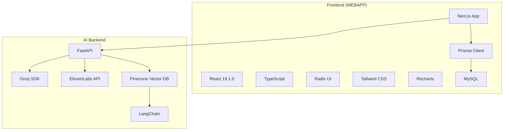
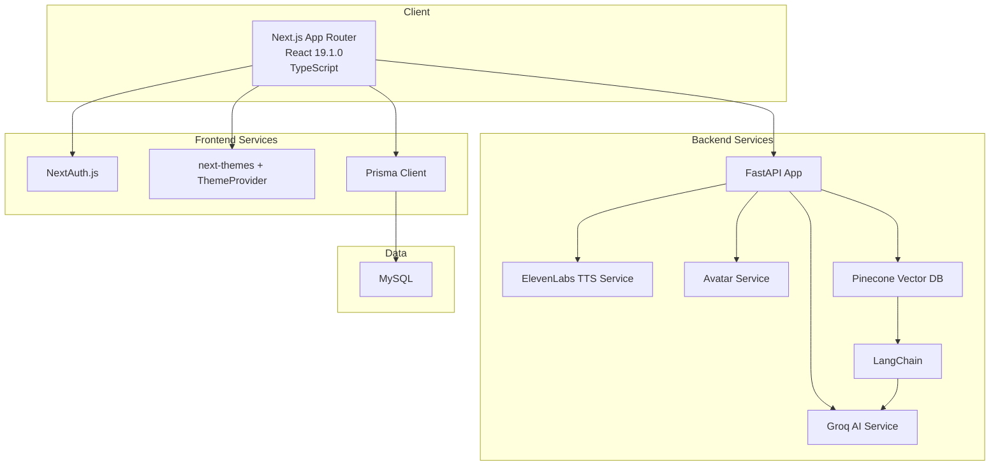
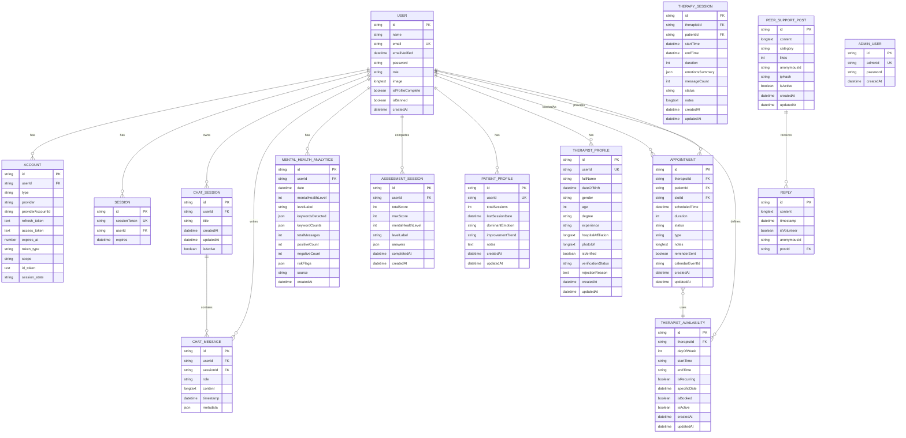
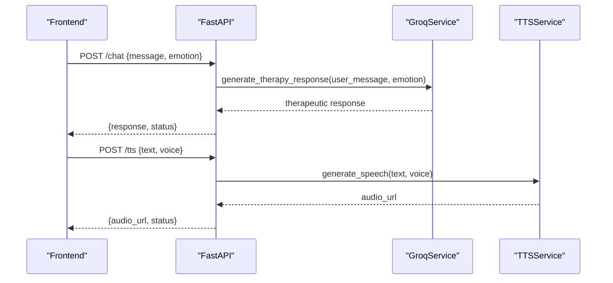
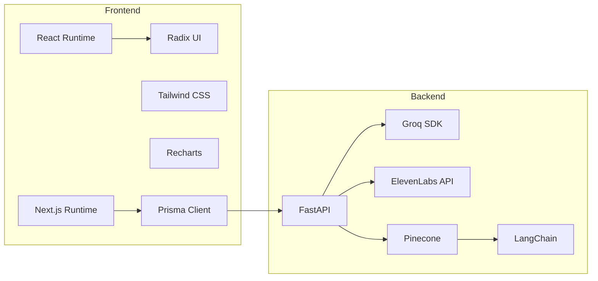

# Technology Stack

<cite>
**Referenced Files in This Document**
- [package.json](file://WEBAPP/package.json)
- [next.config.ts](file://WEBAPP/next.config.ts)
- [tsconfig.json](file://WEBAPP/tsconfig.json)
- [postcss.config.mjs](file://WEBAPP/postcss.config.mjs)
- [layout.tsx](file://WEBAPP/src/app/layout.tsx)
- [button.tsx](file://WEBAPP/src/components/ui/button.tsx)
- [db.ts](file://WEBAPP/src/lib/db.ts)
- [schema.prisma](file://WEBAPP/prisma/schema.prisma)
- [app.py](file://ai-backend/app.py)
- [config.py](file://ai-backend/config.py)
- [groq_ai_service.py](file://ai-backend/services/groq_ai_service.py)
- [tts_service.py](file://ai-backend/services/tts_service.py)
- [genAI_rag.py](file://ai-backend/rag/genAI_rag.py)
</cite>

## Table of Contents
1. [Introduction](#introduction)
2. [Project Structure](#project-structure)
3. [Core Components](#core-components)
4. [Architecture Overview](#architecture-overview)
5. [Detailed Component Analysis](#detailed-component-analysis)
6. [Dependency Analysis](#dependency-analysis)
7. [Performance Considerations](#performance-considerations)
8. [Troubleshooting Guide](#troubleshooting-guide)
9. [Conclusion](#conclusion)

## Introduction
This document provides a comprehensive technology stack overview for the MindBridge AI platform. It covers the frontend (Next.js, React, TypeScript, Radix UI, Tailwind CSS, Recharts), backend (FastAPI, Python 3.x), AI/ML integrations (Groq SDK, ElevenLabs API, Pinecone vector database, LangChain), databases (Prisma ORM with MySQL), development/build tools, and deployment considerations. It also includes version compatibility notes, upgrade paths, and rationale for technology choices.

## Project Structure
The repository is organized into three primary areas:
- WEBAPP: Next.js 15.5.2 frontend with React 19.1.0, TypeScript, Radix UI, Tailwind CSS, and Recharts.
- ai-backend: FastAPI Python backend integrating Groq, ElevenLabs, and Pinecone via LangChain.
- ml-backend: Separate machine learning backend (not covered in detail here).

**Diagram sources**
- [layout.tsx](file://WEBAPP/src/app/layout.tsx#L1-L55)
- [db.ts](file://WEBAPP/src/lib/db.ts#L1-L15)
- [schema.prisma](file://WEBAPP/prisma/schema.prisma#L1-L330)
- [app.py](file://ai-backend/app.py#L1-L154)
- [groq_ai_service.py](file://ai-backend/services/groq_ai_service.py#L1-L123)
- [tts_service.py](file://ai-backend/services/tts_service.py#L1-L280)
- [genAI_rag.py](file://ai-backend/rag/genAI_rag.py#L1-L76)

**Section sources**
- [package.json](file://WEBAPP/package.json#L1-L88)
- [next.config.ts](file://WEBAPP/next.config.ts#L1-L45)
- [tsconfig.json](file://WEBAPP/tsconfig.json#L1-L42)
- [postcss.config.mjs](file://WEBAPP/postcss.config.mjs#L1-L7)
- [layout.tsx](file://WEBAPP/src/app/layout.tsx#L1-L55)
- [db.ts](file://WEBAPP/src/lib/db.ts#L1-L15)
- [schema.prisma](file://WEBAPP/prisma/schema.prisma#L1-L330)
- [app.py](file://ai-backend/app.py#L1-L154)
- [config.py](file://ai-backend/config.py#L1-L49)
- [groq_ai_service.py](file://ai-backend/services/groq_ai_service.py#L1-L123)
- [tts_service.py](file://ai-backend/services/tts_service.py#L1-L280)
- [genAI_rag.py](file://ai-backend/rag/genAI_rag.py#L1-L76)

## Core Components
- Frontend framework and runtime: Next.js 15.5.2, React 19.1.0, TypeScript 5.x.
- UI primitives and design system: Radix UI for accessible, headless components; Tailwind CSS for utility-first styling; Recharts for data visualization.
- State and theming: Next-themes for theme switching; ThemeProvider wrapping the app.
- Authentication and persistence: NextAuth.js with Prisma adapter; Prisma Client for MySQL.
- Build and tooling: PostCSS with Tailwind plugin; ESLint; Tailwind v4 plugin; ts-node for seeding.

**Section sources**
- [package.json](file://WEBAPP/package.json#L15-L86)
- [layout.tsx](file://WEBAPP/src/app/layout.tsx#L1-L55)
- [db.ts](file://WEBAPP/src/lib/db.ts#L1-L15)
- [schema.prisma](file://WEBAPP/prisma/schema.prisma#L1-L330)
- [postcss.config.mjs](file://WEBAPP/postcss.config.mjs#L1-L7)
- [tsconfig.json](file://WEBAPP/tsconfig.json#L1-L42)

## Architecture Overview
The system follows a modern full-stack architecture:
- Web frontend built with Next.js App Router, TypeScript, and a component library based on Radix UI and Tailwind.
- Backend APIs implemented with FastAPI in Python, exposing endpoints for chat, text-to-speech, and avatar generation.
- AI/ML services integrated via Groq for conversational responses, ElevenLabs for TTS, and Pinecone with LangChain for retrieval-augmented generation (RAG).
- Data persistence handled by Prisma ORM targeting MySQL.

**Diagram sources**
- [layout.tsx](file://WEBAPP/src/app/layout.tsx#L1-L55)
- [db.ts](file://WEBAPP/src/lib/db.ts#L1-L15)
- [schema.prisma](file://WEBAPP/prisma/schema.prisma#L1-L330)
- [app.py](file://ai-backend/app.py#L1-L154)
- [groq_ai_service.py](file://ai-backend/services/groq_ai_service.py#L1-L123)
- [tts_service.py](file://ai-backend/services/tts_service.py#L1-L280)
- [genAI_rag.py](file://ai-backend/rag/genAI_rag.py#L1-L76)

## Detailed Component Analysis

### Frontend Stack (Next.js, React, TypeScript, Radix UI, Tailwind CSS, Recharts)
- Next.js 15.5.2: App Router-based pages with API routes, static exports, and optimized builds.
- React 19.1.0 and React DOM 19.1.0: Concurrent features and improved rendering.
- TypeScript 5.x: Strict compiler options, ESNext module resolution, and bundler-aware path mapping.
- Radix UI: Accessible, headless UI primitives (buttons, dialogs, tooltips, etc.) used across components.
- Tailwind CSS 4.x plugin: Utility-first styling with PostCSS pipeline.
- Recharts: Charting library for analytics dashboards.
- Theming and fonts: next-themes and Geist fonts integrated in the root layout.
- Prisma Client: Database access abstraction with environment-aware logging.

Key implementation references:
- Next.js configuration and headers for CORS and optimization.
- TypeScript compiler options and path aliases.
- Tailwind PostCSS configuration.
- Root layout composition and theme provider.
- Radix UI button component with variant sizing system.
- Prisma client initialization and environment logging.

**Section sources**
- [package.json](file://WEBAPP/package.json#L15-L86)
- [next.config.ts](file://WEBAPP/next.config.ts#L1-L45)
- [tsconfig.json](file://WEBAPP/tsconfig.json#L1-L42)
- [postcss.config.mjs](file://WEBAPP/postcss.config.mjs#L1-L7)
- [layout.tsx](file://WEBAPP/src/app/layout.tsx#L1-L55)
- [button.tsx](file://WEBAPP/src/components/ui/button.tsx#L1-L60)
- [db.ts](file://WEBAPP/src/lib/db.ts#L1-L15)
- [schema.prisma](file://WEBAPP/prisma/schema.prisma#L1-L330)

### Backend Stack (FastAPI, Python 3.x, AI/ML Integrations)
- FastAPI: Asynchronous web framework with automatic OpenAPI docs and dependency injection.
- Python 3.x: Runtime for AI/ML services and backend logic.
- Groq SDK: Used for therapeutic chat responses with a persistent conversation history.
- ElevenLabs API: Text-to-speech with fallback to dummy audio when API key is unavailable.
- Pinecone vector database: Vector store for RAG with LangChain integrations.
- LangChain: Retrieval and chain orchestration for question answering.

Core backend references:
- FastAPI app definition, CORS, static file mounting, and health endpoints.
- Configuration class for environment-driven settings.
- Groq service with system prompts and conversation history.
- TTS service with account checks, request retries, and fallback audio generation.
- RAG app using Flask and LangChain with Pinecone retriever and Groq LLM.

**Section sources**
- [app.py](file://ai-backend/app.py#L1-L154)
- [config.py](file://ai-backend/config.py#L1-L49)
- [groq_ai_service.py](file://ai-backend/services/groq_ai_service.py#L1-L123)
- [tts_service.py](file://ai-backend/services/tts_service.py#L1-L280)
- [genAI_rag.py](file://ai-backend/rag/genAI_rag.py#L1-L76)

### Database Technologies (Prisma ORM and MySQL)
- Prisma Client: Generated client for type-safe database operations.
- MySQL: Provider configured in Prisma schema with comprehensive domain models for users, sessions, chats, therapy sessions, appointments, analytics, and profiles.
- Environment configuration: DATABASE_URL sourced from environment variables.

**Diagram sources**
- [schema.prisma](file://WEBAPP/prisma/schema.prisma#L1-L330)

**Section sources**
- [schema.prisma](file://WEBAPP/prisma/schema.prisma#L1-L330)
- [db.ts](file://WEBAPP/src/lib/db.ts#L1-L15)

### AI/ML Integration (Groq, ElevenLabs, Pinecone, LangChain)
- Groq: Chat completions for therapeutic responses with a system prompt and maintained conversation history.
- ElevenLabs: TTS with account validation, request handling, and robust fallback audio generation when API limits or keys are unavailable.
- Pinecone: Vector store for RAG with LangChain retriever and Groq LLM for question answering.
- LangChain: Prompt templates, retrieval chains, and document combination chains.

**Diagram sources**
- [app.py](file://ai-backend/app.py#L81-L108)
- [groq_ai_service.py](file://ai-backend/services/groq_ai_service.py#L81-L111)
- [tts_service.py](file://ai-backend/services/tts_service.py#L53-L144)

**Section sources**
- [groq_ai_service.py](file://ai-backend/services/groq_ai_service.py#L1-L123)
- [tts_service.py](file://ai-backend/services/tts_service.py#L1-L280)
- [genAI_rag.py](file://ai-backend/rag/genAI_rag.py#L1-L76)

### Development Tools, Build Tools, and Deployment Technologies
- Build and linting: Next build/start/develop scripts; ESLint 9; TypeScript 5; PostCSS with Tailwind plugin.
- Prisma: Client generation and seeding via ts-node; seed script configured in package.json.
- Environment configuration: .env files for both frontend and backend; FastAPI settings class loads from .env.
- Deployment considerations: Next.js static export option; FastAPI runs via Uvicorn; CORS configured for external access.

**Section sources**
- [package.json](file://WEBAPP/package.json#L5-L14)
- [tsconfig.json](file://WEBAPP/tsconfig.json#L1-L42)
- [postcss.config.mjs](file://WEBAPP/postcss.config.mjs#L1-L7)
- [app.py](file://ai-backend/app.py#L1-L154)
- [config.py](file://ai-backend/config.py#L1-L49)

## Dependency Analysis
- Frontend dependencies: Next.js, React, Radix UI primitives, Tailwind CSS, Recharts, Prisma Client, NextAuth.js, Stripe, Zod, and related types.
- Backend dependencies: FastAPI, Uvicorn, Pydantic, LangChain ecosystem (OpenAI, Pinecone), Groq SDK, httpx, python-dotenv, sentence-transformers, pypdf, flask (for RAG demo), and more.
- Coupling: Frontend communicates with backend via REST endpoints; backend integrates AI services and vector database; Prisma connects frontend/backend to MySQL.

**Diagram sources**
- [package.json](file://WEBAPP/package.json#L15-L86)
- [app.py](file://ai-backend/app.py#L1-L154)
- [groq_ai_service.py](file://ai-backend/services/groq_ai_service.py#L1-L123)
- [tts_service.py](file://ai-backend/services/tts_service.py#L1-L280)
- [genAI_rag.py](file://ai-backend/rag/genAI_rag.py#L1-L76)

**Section sources**
- [package.json](file://WEBAPP/package.json#L15-L86)
- [app.py](file://ai-backend/app.py#L1-L154)

## Performance Considerations
- Frontend: Next.js build optimizations, image optimization toggles, compression, and header configurations improve load times and cross-origin flexibility.
- Backend: Lazy initialization of services reduces cold-start overhead; static file serving for audio/video minimizes latency; timeouts and fallbacks in TTS ensure resilience under network errors.
- Database: Prisma client logs are scoped to development to reduce noise; indexes exist on frequently queried fields (e.g., user, session, timestamps) to optimize reads.

**Section sources**
- [next.config.ts](file://WEBAPP/next.config.ts#L1-L45)
- [app.py](file://ai-backend/app.py#L42-L71)
- [tts_service.py](file://ai-backend/services/tts_service.py#L53-L144)
- [schema.prisma](file://WEBAPP/prisma/schema.prisma#L1-L330)

## Troubleshooting Guide
- Missing environment variables:
  - Frontend: Ensure DATABASE_URL and other secrets are present in .env/.env.local.
  - Backend: Verify OPENAI_API_KEY, ELEVENLABS_API_KEY, GROQ_API_KEY, PINECONE_API_KEY, and others in .env.
- CORS and external access: Next.js headers allow broad origins; adjust for production deployments.
- TTS fallback: When ElevenLabs API key is missing or quota is exceeded, the system generates dummy audio; confirm temp directory permissions and cleanup policies.
- Prisma client: Development logs include queries; ensure database connectivity and migrations are applied.

**Section sources**
- [config.py](file://ai-backend/config.py#L1-L49)
- [next.config.ts](file://WEBAPP/next.config.ts#L21-L41)
- [tts_service.py](file://ai-backend/services/tts_service.py#L53-L144)
- [db.ts](file://WEBAPP/src/lib/db.ts#L1-L15)

## Conclusion
MindBridge leverages a cohesive stack combining Next.js 15.5.2 and React 19.1.0 for a modern, type-safe frontend; FastAPI for scalable Python backend services; and AI/ML integrations via Groq, ElevenLabs, Pinecone, and LangChain. Prisma ORM with MySQL provides robust data modeling and type safety. The architecture balances developer productivity, accessibility, and extensibility, with clear separation of concerns between frontend, backend, and AI services.