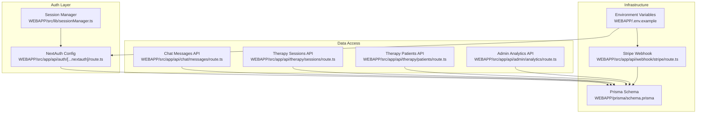
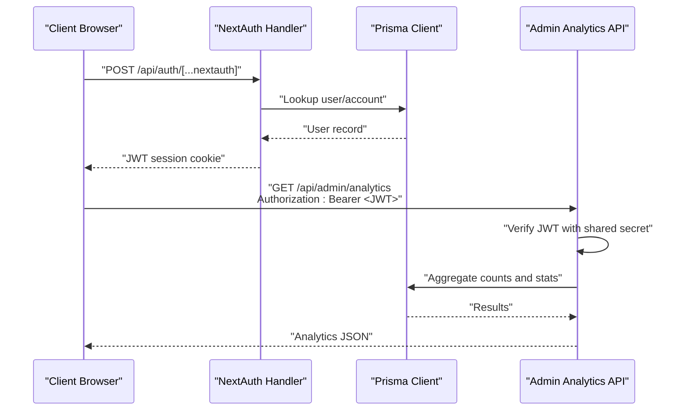
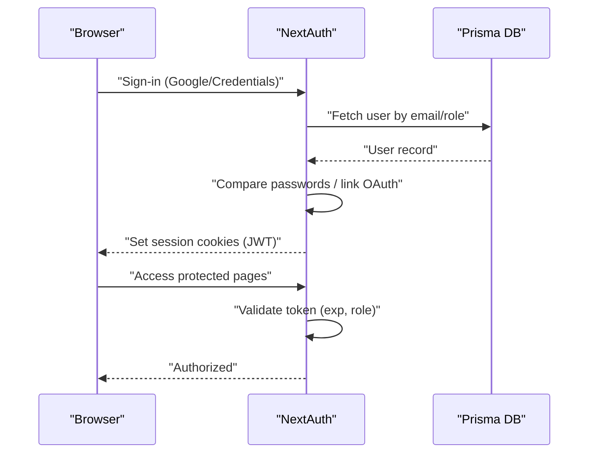
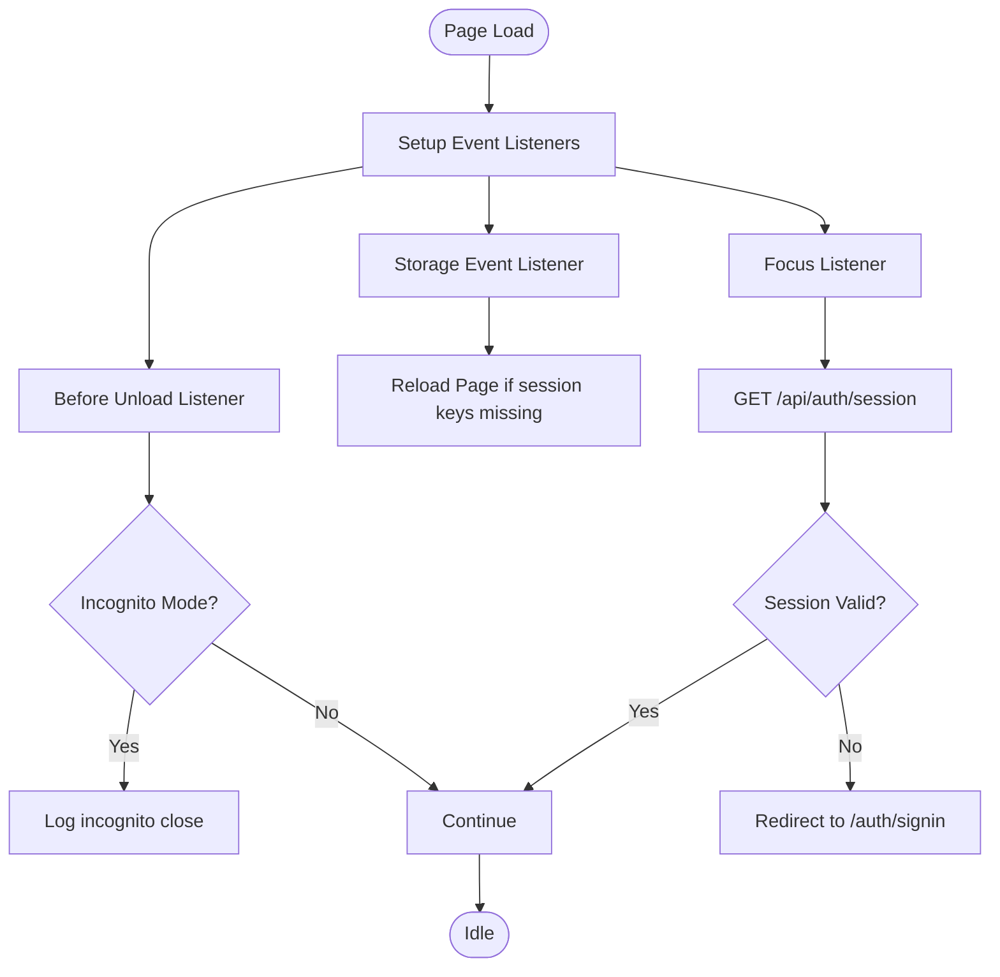
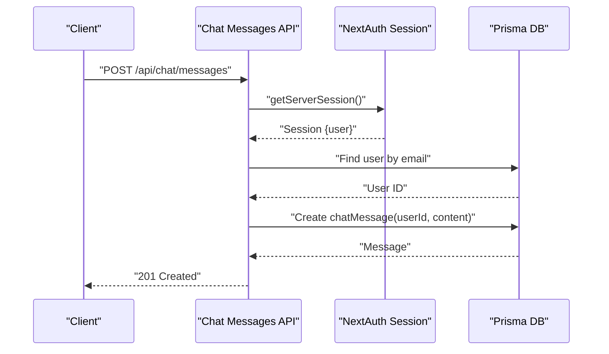
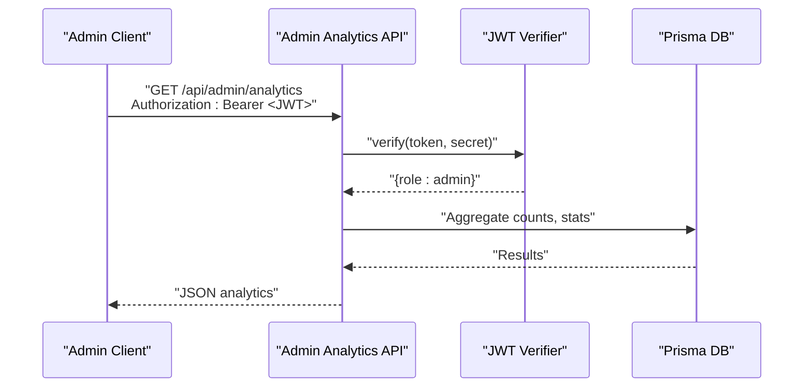
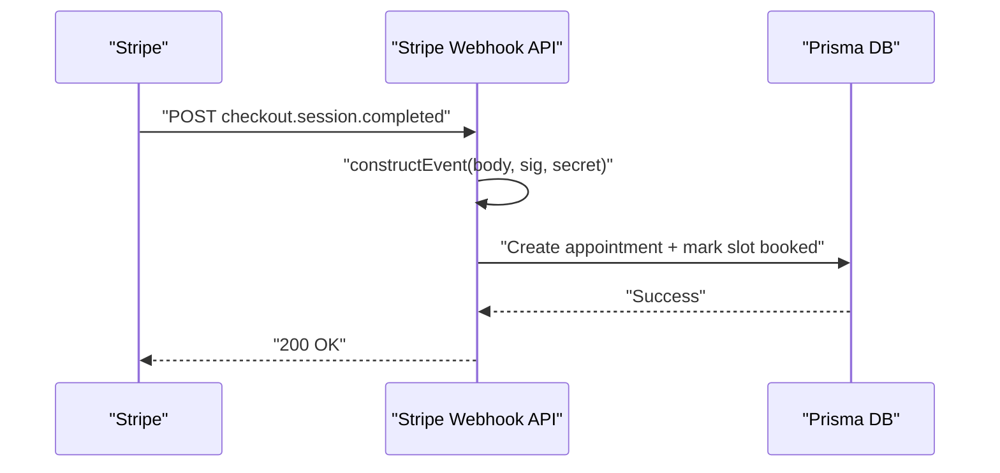
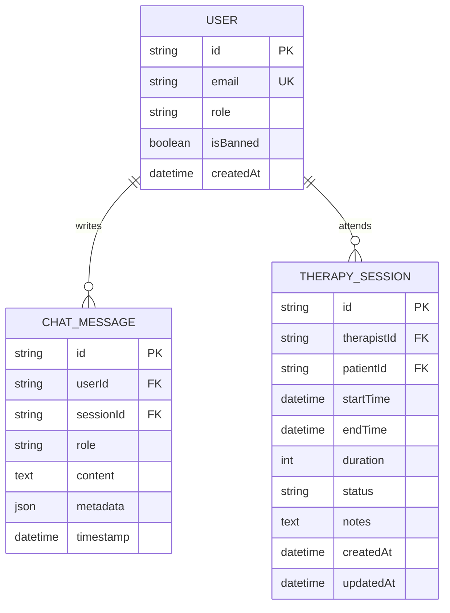
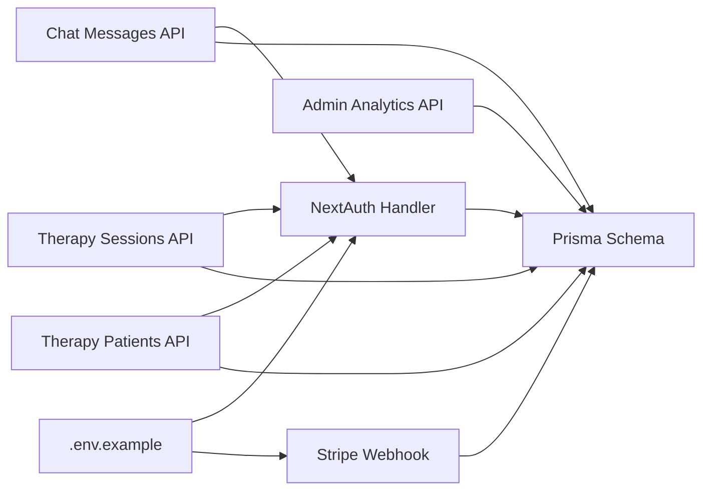

# Security & Compliance

<cite>
**Referenced Files in This Document**
- [route.ts](file://WEBAPP/src/app/api/auth/[...nextauth]/route.ts)
- [route.ts](file://WEBAPP/src/app/api/auth/register/route.ts)
- [route.ts](file://WEBAPP/src/app/api/chat/messages/route.ts)
- [route.ts](file://WEBAPP/src/app/api/admin/analytics/route.ts)
- [route.ts](file://WEBAPP/src/app/api/therapy/patients/route.ts)
- [route.ts](file://WEBAPP/src/app/api/therapy/sessions/route.ts)
- [route.ts](file://WEBAPP/src/app/api/webhook/stripe/route.ts)
- [sessionManager.ts](file://WEBAPP/src/lib/sessionManager.ts)
- [schema.prisma](file://WEBAPP/prisma/schema.prisma)
- [.env.example](file://WEBAPP/.env.example)
</cite>

## Table of Contents
1. [Introduction](#introduction)
2. [Project Structure](#project-structure)
3. [Core Components](#core-components)
4. [Architecture Overview](#architecture-overview)
5. [Detailed Component Analysis](#detailed-component-analysis)
6. [Dependency Analysis](#dependency-analysis)
7. [Performance Considerations](#performance-considerations)
8. [Troubleshooting Guide](#troubleshooting-guide)
9. [Conclusion](#conclusion)
10. [Appendices](#appendices)

## Introduction
This document explains the current security posture and compliance-related capabilities in the MindBridge codebase with a focus on healthcare data handling. It covers authentication and session management, access control, audit logging, secure transmission, storage considerations, and administrative oversight. It also outlines areas requiring attention to meet HIPAA and related regulatory expectations, including encryption at rest and in transit, data minimization, and robust incident response.

## Project Structure
Security-relevant components are primarily located under:
- Authentication and session management: WEBAPP/src/app/api/auth/[...nextauth]/route.ts
- Client-side session helpers: WEBAPP/src/lib/sessionManager.ts
- Healthcare data APIs: WEBAPP/src/app/api/chat/messages/route.ts, WEBAPP/src/app/api/therapy/sessions/route.ts, WEBAPP/src/app/api/therapy/patients/route.ts
- Administrative analytics: WEBAPP/src/app/api/admin/analytics/route.ts
- Payments and webhooks: WEBAPP/src/app/api/webhook/stripe/route.ts
- Data model and schema: WEBAPP/prisma/schema.prisma
- Environment configuration: WEBAPP/.env.example

**Diagram sources**
- [route.ts](file://WEBAPP/src/app/api/auth/[...nextauth]/route.ts#L1-L240)
- [sessionManager.ts](file://WEBAPP/src/lib/sessionManager.ts#L1-L78)
- [route.ts](file://WEBAPP/src/app/api/chat/messages/route.ts#L1-L91)
- [route.ts](file://WEBAPP/src/app/api/therapy/sessions/route.ts#L1-L80)
- [route.ts](file://WEBAPP/src/app/api/therapy/patients/route.ts#L1-L61)
- [route.ts](file://WEBAPP/src/app/api/admin/analytics/route.ts#L1-L109)
- [route.ts](file://WEBAPP/src/app/api/webhook/stripe/route.ts#L1-L67)
- [schema.prisma](file://WEBAPP/prisma/schema.prisma#L1-L330)
- [.env.example](file://WEBAPP/.env.example#L1-L16)

**Section sources**
- [route.ts](file://WEBAPP/src/app/api/auth/[...nextauth]/route.ts#L1-L240)
- [sessionManager.ts](file://WEBAPP/src/lib/sessionManager.ts#L1-L78)
- [route.ts](file://WEBAPP/src/app/api/chat/messages/route.ts#L1-L91)
- [route.ts](file://WEBAPP/src/app/api/therapy/sessions/route.ts#L1-L80)
- [route.ts](file://WEBAPP/src/app/api/therapy/patients/route.ts#L1-L61)
- [route.ts](file://WEBAPP/src/app/api/admin/analytics/route.ts#L1-L109)
- [route.ts](file://WEBAPP/src/app/api/webhook/stripe/route.ts#L1-L67)
- [schema.prisma](file://WEBAPP/prisma/schema.prisma#L1-L330)
- [.env.example](file://WEBAPP/.env.example#L1-L16)

## Core Components
- Authentication and session management: NextAuth with JWT strategy, cookie configuration, and callbacks for role propagation and session validation.
- Client-side session helpers: Utilities to detect near-expiry sessions, compute remaining time, detect incognito mode, and synchronize session state across browser tabs.
- Healthcare data access: Chat messages and therapy session APIs gated by server-side session checks.
- Administrative analytics: Admin-only analytics endpoint protected by a shared secret JWT.
- Payments and webhooks: Stripe webhook verification and event-driven appointment creation.
- Data model: Prisma schema defines user roles, chat and therapy entities, and indices supporting access control and audit queries.

**Section sources**
- [route.ts](file://WEBAPP/src/app/api/auth/[...nextauth]/route.ts#L8-L49)
- [sessionManager.ts](file://WEBAPP/src/lib/sessionManager.ts#L3-L75)
- [route.ts](file://WEBAPP/src/app/api/chat/messages/route.ts#L6-L46)
- [route.ts](file://WEBAPP/src/app/api/admin/analytics/route.ts#L7-L17)
- [route.ts](file://WEBAPP/src/app/api/webhook/stripe/route.ts#L11-L22)
- [schema.prisma](file://WEBAPP/prisma/schema.prisma#L39-L69)

## Architecture Overview
The system enforces authentication and session-based access control at the API boundary. NextAuth manages identity and JWT issuance, while client-side helpers monitor session health. Healthcare data is stored in relational tables with indexed fields enabling efficient filtering and auditing. Administrative analytics are protected by a dedicated JWT secret.

**Diagram sources**
- [route.ts](file://WEBAPP/src/app/api/auth/[...nextauth]/route.ts#L1-L240)
- [route.ts](file://WEBAPP/src/app/api/admin/analytics/route.ts#L1-L109)
- [schema.prisma](file://WEBAPP/prisma/schema.prisma#L1-L330)

## Detailed Component Analysis

### Authentication and Session Management
- Strategy: JWT-based session with configurable max age and update age for refresh-on-use.
- Cookies: HttpOnly, SameSite lax, path "/", and secure flag toggled based on NEXTAUTH_URL scheme.
- Providers: Google OAuth with consent prompt and offline access; Credentials provider with bcrypt comparison and ban checks.
- Callbacks: Role and profile flags propagated to tokens and sessions; server-side token expiry check.
- Events: Logging for sign-in, session access (dev), and sign-out for monitoring.

**Diagram sources**
- [route.ts](file://WEBAPP/src/app/api/auth/[...nextauth]/route.ts#L8-L49)
- [route.ts](file://WEBAPP/src/app/api/auth/[...nextauth]/route.ts#L99-L214)

**Section sources**
- [route.ts](file://WEBAPP/src/app/api/auth/[...nextauth]/route.ts#L8-L49)
- [route.ts](file://WEBAPP/src/app/api/auth/[...nextauth]/route.ts#L99-L214)

### Client-Side Session Monitoring
- Detects sessions expiring within 24 hours and computes remaining time in human-readable format.
- Detects incognito/private browsing mode via storage quota estimation.
- Listens to storage, beforeunload, and focus events to keep session state synchronized and to detect logout scenarios.

**Diagram sources**
- [sessionManager.ts](file://WEBAPP/src/lib/sessionManager.ts#L43-L75)

**Section sources**
- [sessionManager.ts](file://WEBAPP/src/lib/sessionManager.ts#L3-L75)

### Healthcare Data Access Controls
- Chat messages: POST and GET endpoints require a valid server session; messages are associated with the authenticated user’s ID.
- Therapy sessions: GET and POST endpoints require a valid server session; filtering supports therapistId and patientId.
- Therapy patients: GET endpoint requires a valid server session and filters by therapistId to return associated patients.

**Diagram sources**
- [route.ts](file://WEBAPP/src/app/api/chat/messages/route.ts#L6-L46)
- [route.ts](file://WEBAPP/src/app/api/therapy/sessions/route.ts#L24-L37)
- [route.ts](file://WEBAPP/src/app/api/therapy/patients/route.ts#L19-L43)

**Section sources**
- [route.ts](file://WEBAPP/src/app/api/chat/messages/route.ts#L6-L46)
- [route.ts](file://WEBAPP/src/app/api/therapy/sessions/route.ts#L5-L42)
- [route.ts](file://WEBAPP/src/app/api/therapy/patients/route.ts#L5-L31)

### Administrative Analytics and Audit Logging
- Admin-only endpoint protected by a Bearer JWT verified against a shared secret.
- Logs sign-in, session access (in development), and sign-out events for monitoring.

**Diagram sources**
- [route.ts](file://WEBAPP/src/app/api/admin/analytics/route.ts#L7-L17)
- [route.ts](file://WEBAPP/src/app/api/auth/[...nextauth]/route.ts#L215-L233)

**Section sources**
- [route.ts](file://WEBAPP/src/app/api/admin/analytics/route.ts#L7-L17)
- [route.ts](file://WEBAPP/src/app/api/auth/[...nextauth]/route.ts#L215-L233)

### Secure Transmission and Payment Webhooks
- Stripe webhook verification using a signing secret; only verified events trigger downstream actions.
- Payment completion triggers appointment creation and slot booking updates.

**Diagram sources**
- [route.ts](file://WEBAPP/src/app/api/webhook/stripe/route.ts#L11-L63)

**Section sources**
- [route.ts](file://WEBAPP/src/app/api/webhook/stripe/route.ts#L11-L63)

### Data Model and Access Control Implications
- Users have roles (patient, therapist, admin) and are linked to chat sessions and therapy sessions.
- Chat messages are indexed by userId and timestamp; therapy sessions indexed by therapistId, patientId, status, and startTime.
- Administrative analytics rely on these indices to compute counts and trends efficiently.

**Diagram sources**
- [schema.prisma](file://WEBAPP/prisma/schema.prisma#L39-L69)
- [schema.prisma](file://WEBAPP/prisma/schema.prisma#L124-L138)
- [schema.prisma](file://WEBAPP/prisma/schema.prisma#L141-L161)

**Section sources**
- [schema.prisma](file://WEBAPP/prisma/schema.prisma#L39-L69)
- [schema.prisma](file://WEBAPP/prisma/schema.prisma#L124-L138)
- [schema.prisma](file://WEBAPP/prisma/schema.prisma#L141-L161)

## Dependency Analysis
- Authentication depends on Prisma for user and session persistence and on environment variables for secrets and URLs.
- Healthcare data APIs depend on NextAuth session validation and Prisma models.
- Admin analytics depend on Prisma aggregates and JWT verification.
- Stripe webhook depends on environment variables for secrets and on Prisma for database updates.

**Diagram sources**
- [route.ts](file://WEBAPP/src/app/api/auth/[...nextauth]/route.ts#L1-L240)
- [route.ts](file://WEBAPP/src/app/api/chat/messages/route.ts#L1-L91)
- [route.ts](file://WEBAPP/src/app/api/therapy/sessions/route.ts#L1-L80)
- [route.ts](file://WEBAPP/src/app/api/therapy/patients/route.ts#L1-L61)
- [route.ts](file://WEBAPP/src/app/api/admin/analytics/route.ts#L1-L109)
- [route.ts](file://WEBAPP/src/app/api/webhook/stripe/route.ts#L1-L67)
- [schema.prisma](file://WEBAPP/prisma/schema.prisma#L1-L330)
- [.env.example](file://WEBAPP/.env.example#L1-L16)

**Section sources**
- [route.ts](file://WEBAPP/src/app/api/auth/[...nextauth]/route.ts#L1-L240)
- [route.ts](file://WEBAPP/src/app/api/chat/messages/route.ts#L1-L91)
- [route.ts](file://WEBAPP/src/app/api/therapy/sessions/route.ts#L1-L80)
- [route.ts](file://WEBAPP/src/app/api/therapy/patients/route.ts#L1-L61)
- [route.ts](file://WEBAPP/src/app/api/admin/analytics/route.ts#L1-L109)
- [route.ts](file://WEBAPP/src/app/api/webhook/stripe/route.ts#L1-L67)
- [schema.prisma](file://WEBAPP/prisma/schema.prisma#L1-L330)
- [.env.example](file://WEBAPP/.env.example#L1-L16)

## Performance Considerations
- Session validation occurs on focus and on-demand; consider caching validated session state client-side to reduce repeated network calls.
- Aggregation queries in admin analytics use grouped counts and date ranges; ensure appropriate database indexing for large datasets.
- Stripe webhook processing should be idempotent and leverage database constraints to avoid duplicates.

[No sources needed since this section provides general guidance]

## Troubleshooting Guide
- Authentication failures: Verify NEXTAUTH_URL and NEXTAUTH_SECRET; ensure cookies are not blocked by SameSite/Lax policies.
- Session expiration: Confirm maxAge/updateAge settings and client-side focus validation logic.
- Admin analytics unauthorized: Check Authorization header and shared secret JWT validity.
- Stripe webhook errors: Validate signature verification and endpoint secret; confirm event type handling.

**Section sources**
- [route.ts](file://WEBAPP/src/app/api/auth/[...nextauth]/route.ts#L16-L48)
- [sessionManager.ts](file://WEBAPP/src/lib/sessionManager.ts#L61-L74)
- [route.ts](file://WEBAPP/src/app/api/admin/analytics/route.ts#L7-L17)
- [route.ts](file://WEBAPP/src/app/api/webhook/stripe/route.ts#L17-L22)

## Conclusion
The codebase implements strong authentication and session management with NextAuth, enforces access control at the API boundary, and logs key events for monitoring. Administrative oversight is supported by a JWT-protected analytics endpoint. To achieve HIPAA compliance, additional controls are required: enforce TLS termination at the edge/load balancer, implement encryption at rest for sensitive data, adopt data minimization and retention policies, and establish formal incident response and breach notification procedures.

[No sources needed since this section summarizes without analyzing specific files]

## Appendices

### HIPAA Implementation Checklist (Current Status vs. Requirements)
- Secure transmission
  - Current: Cookies configured with secure flag based on URL scheme.
  - Recommendation: Enforce HTTPS/TLS termination at load balancer and origin; configure HSTS.
- Access controls
  - Current: Session-based access checks on APIs; role propagation via JWT.
  - Recommendation: Add RBAC policies and authorization checks per resource ownership; enforce least privilege.
- Audit logging
  - Current: Sign-in, session access (dev), and sign-out events logged.
  - Recommendation: Expand to include data access, modification, and administrative actions; retain logs securely.
- Storage encryption
  - Current: No explicit encryption-at-rest in schema.
  - Recommendation: Enable Transparent Data Encryption (TDE) or equivalent; encrypt sensitive attributes.
- Data anonymization
  - Current: No automated anonymization pipeline.
  - Recommendation: Implement de-identification for analytics and research; define data minimization rules.
- Vulnerability assessment and penetration testing
  - Current: Not evident in codebase.
  - Recommendation: Establish recurring assessments and remediation process.
- Security monitoring
  - Current: Basic console logs.
  - Recommendation: Centralized SIEM, real-time alerts, and anomaly detection.
- Incident response and breach notification
  - Current: Not evident in codebase.
  - Recommendation: Define RTO/RPO, escalation procedures, and communication plans.

[No sources needed since this section provides general guidance]