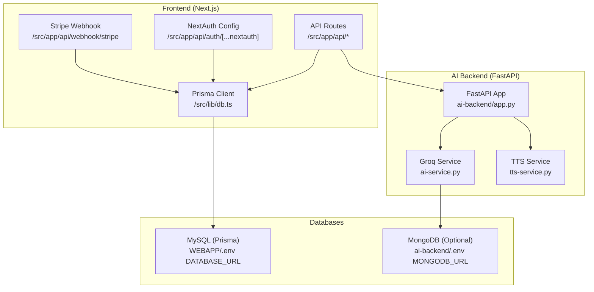
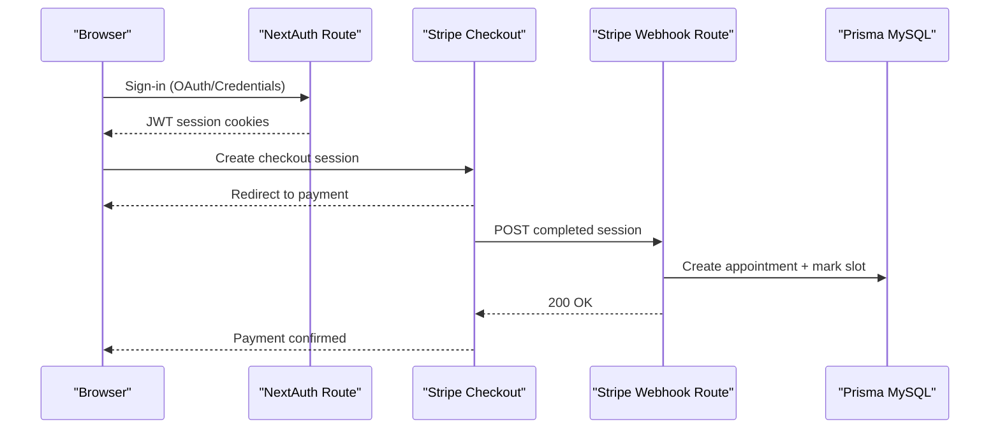
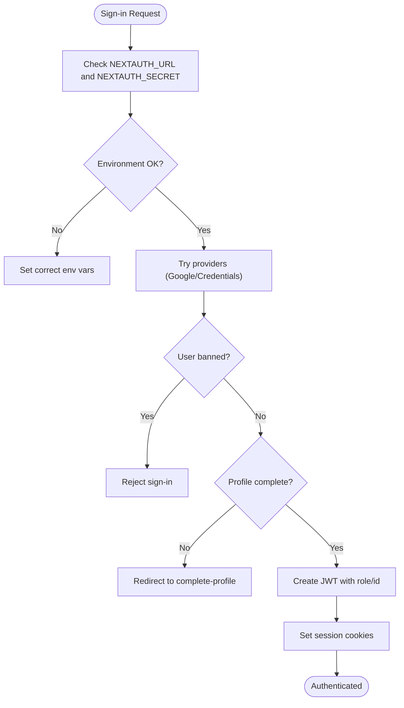
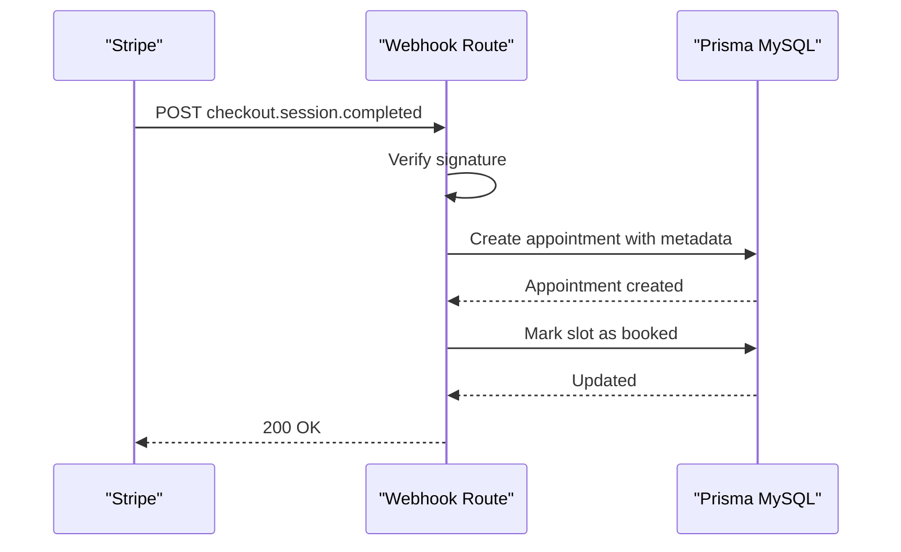
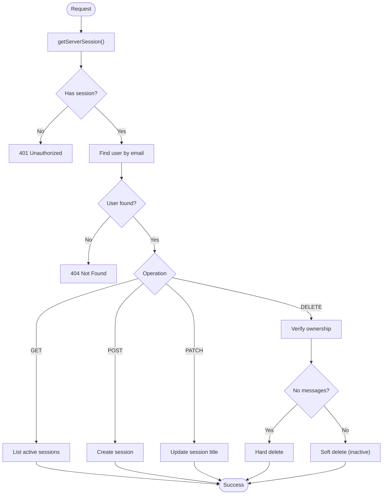
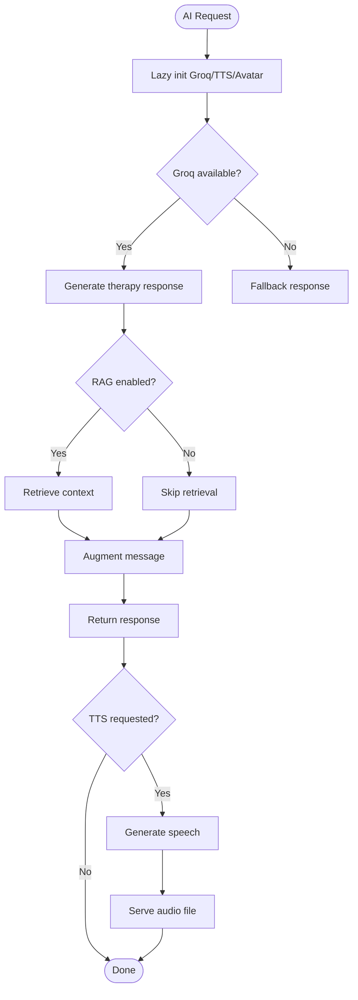
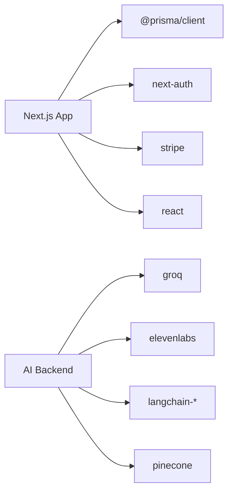

# Troubleshooting & FAQ

<cite>
**Referenced Files in This Document**
- [package.json](file://WEBAPP/package.json)
- [.env.example (WEBAPP)](file://WEBAPP/.env.example)
- [db.ts](file://WEBAPP/src/lib/db.ts)
- [route.ts (auth/[...nextauth])](file://WEBAPP/src/app/api/auth/[...nextauth]/route.ts)
- [route.ts (webhook/stripe)](file://WEBAPP/src/app/api/webhook/stripe/route.ts)
- [route.ts (chat/sessions)](file://WEBAPP/src/app/api/chat/sessions/route.ts)
- [route.ts (admin/analytics)](file://WEBAPP/src/app/api/admin/analytics/route.ts)
- [requirements.txt (ai-backend)](file://ai-backend/requirements.txt)
- [.env.example (ai-backend)](file://ai-backend/.env.example)
- [app.py (ai-backend)](file://ai-backend/app.py)
- [ai_service.py](file://ai-backend/services/ai_service.py)
- [tts_service.py](file://ai-backend/services/tts_service.py)
</cite>

## Table of Contents
1. [Introduction](#introduction)
2. [Project Structure](#project-structure)
3. [Core Components](#core-components)
4. [Architecture Overview](#architecture-overview)
5. [Detailed Component Analysis](#detailed-component-analysis)
6. [Dependency Analysis](#dependency-analysis)
7. [Performance Considerations](#performance-considerations)
8. [Troubleshooting Guide](#troubleshooting-guide)
9. [FAQ](#faq)
10. [Conclusion](#conclusion)
11. [Appendices](#appendices)

## Introduction
This document provides comprehensive troubleshooting guidance and FAQs for the MindBridge platform. It covers installation and configuration issues, runtime diagnostics for frontend, backend, and database connectivity, and specialized troubleshooting for AI services, payments, and authentication. It also includes performance tuning advice and escalation procedures.

## Project Structure
MindBridge consists of:
- Frontend Next.js application (WEBAPP) with TypeScript, Prisma ORM, NextAuth, and Stripe integration
- AI backend (FastAPI) with Groq, ElevenLabs TTS, and optional RAG
- ML backend (Flask) for mental health analytics
- Prisma schema and seed for database initialization

**Diagram sources**
- [app.py (ai-backend)](file://ai-backend/app.py#L1-L154)
- [ai_service.py](file://ai-backend/services/ai_service.py#L1-L293)
- [tts_service.py](file://ai-backend/services/tts_service.py#L1-L280)
- [db.ts](file://WEBAPP/src/lib/db.ts#L1-L15)
- [.env.example (WEBAPP)](file://WEBAPP/.env.example#L1-L16)
- [.env.example (ai-backend)](file://ai-backend/.env.example#L1-L20)

**Section sources**
- [package.json](file://WEBAPP/package.json#L1-L88)
- [requirements.txt (ai-backend)](file://ai-backend/requirements.txt#L1-L81)
- [.env.example (WEBAPP)](file://WEBAPP/.env.example#L1-L16)
- [.env.example (ai-backend)](file://ai-backend/.env.example#L1-L20)

## Core Components
- Authentication and session management powered by NextAuth with Prisma adapter and JWT strategy
- Stripe checkout session webhook for payment confirmation and appointment creation
- Chat session management with Prisma-backed persistence
- AI backend with Groq for therapy responses and ElevenLabs for TTS
- Database connectivity via Prisma (MySQL) and optional MongoDB

Key configuration touchpoints:
- Environment variables for databases, auth, AI backends, and Stripe
- Prisma client initialization and logging behavior
- NextAuth cookie and secure cookie settings
- Stripe webhook secret and event handling

**Section sources**
- [route.ts (auth/[...nextauth])](file://WEBAPP/src/app/api/auth/[...nextauth]/route.ts#L1-L240)
- [route.ts (webhook/stripe)](file://WEBAPP/src/app/api/webhook/stripe/route.ts#L1-L67)
- [route.ts (chat/sessions)](file://WEBAPP/src/app/api/chat/sessions/route.ts#L1-L187)
- [db.ts](file://WEBAPP/src/lib/db.ts#L1-L15)
- [.env.example (WEBAPP)](file://WEBAPP/.env.example#L1-L16)
- [.env.example (ai-backend)](file://ai-backend/.env.example#L1-L20)

## Architecture Overview
The system integrates frontend API routes with backend services and external APIs. The AI backend exposes endpoints for chat, TTS, and avatar generation. Payments are processed via Stripe with a webhook that updates the database.

**Diagram sources**
- [route.ts (auth/[...nextauth])](file://WEBAPP/src/app/api/auth/[...nextauth]/route.ts#L1-L240)
- [route.ts (webhook/stripe)](file://WEBAPP/src/app/api/webhook/stripe/route.ts#L1-L67)
- [db.ts](file://WEBAPP/src/lib/db.ts#L1-L15)

## Detailed Component Analysis

### Authentication and Session Management
Common issues:
- Missing or incorrect NEXTAUTH_URL or secrets
- Cookie security mismatch behind proxies or ngrok
- User banned or profile not complete blocking sign-in
- JWT expiration or malformed tokens

Debugging steps:
- Verify NEXTAUTH_URL and NEXTAUTH_SECRET in environment
- Confirm cookie secure flag aligns with protocol (HTTPS vs HTTP)
- Check user.isBanned and isProfileComplete fields in the database
- Inspect session access logs in development mode

**Diagram sources**
- [route.ts (auth/[...nextauth])](file://WEBAPP/src/app/api/auth/[...nextauth]/route.ts#L1-L240)

**Section sources**
- [route.ts (auth/[...nextauth])](file://WEBAPP/src/app/api/auth/[...nextauth]/route.ts#L1-L240)
- [.env.example (WEBAPP)](file://WEBAPP/.env.example#L6-L9)

### Stripe Payment Webhook
Common issues:
- Invalid webhook signature
- Missing STRIPE_WEBHOOK_SECRET or STRIPE_SECRET_KEY
- Missing metadata in checkout session
- Database write failures during appointment creation

Debugging steps:
- Validate webhook secret and signature verification
- Ensure metadata includes required keys (therapistId, patientId, scheduledTime, etc.)
- Check appointment creation and slot booking logic
- Review error logs for webhook processing failures

**Diagram sources**
- [route.ts (webhook/stripe)](file://WEBAPP/src/app/api/webhook/stripe/route.ts#L1-L67)

**Section sources**
- [route.ts (webhook/stripe)](file://WEBAPP/src/app/api/webhook/stripe/route.ts#L1-L67)
- [.env.example (WEBAPP)](file://WEBAPP/.env.example#L1-L16)

### Chat Sessions API
Common issues:
- Unauthorized access due to missing or invalid session
- User not found in database
- Session ownership validation failures
- Soft vs hard deletion semantics

Debugging steps:
- Confirm getServerSession returns a valid user
- Verify user lookup by email
- Check sessionId ownership and presence
- Distinguish between soft delete (set inactive) and hard delete

**Diagram sources**
- [route.ts (chat/sessions)](file://WEBAPP/src/app/api/chat/sessions/route.ts#L1-L187)

**Section sources**
- [route.ts (chat/sessions)](file://WEBAPP/src/app/api/chat/sessions/route.ts#L1-L187)

### AI Backend Services
Common issues:
- Missing GROQ_API_KEY or invalid configuration
- RAG initialization failures (Pinecone key or dependencies)
- ElevenLabs API key missing or quota exceeded
- Audio file cleanup and serving issues

Debugging steps:
- Confirm GROQ_API_KEY and model selection
- Check PINECONE_API_KEY and index existence for RAG
- Validate ElevenLabs API key and voice ID
- Monitor temporary audio file creation and cleanup

**Diagram sources**
- [app.py (ai-backend)](file://ai-backend/app.py#L1-L154)
- [ai_service.py](file://ai-backend/services/ai_service.py#L1-L293)
- [tts_service.py](file://ai-backend/services/tts_service.py#L1-L280)

**Section sources**
- [app.py (ai-backend)](file://ai-backend/app.py#L1-L154)
- [ai_service.py](file://ai-backend/services/ai_service.py#L1-L293)
- [tts_service.py](file://ai-backend/services/tts_service.py#L1-L280)
- [.env.example (ai-backend)](file://ai-backend/.env.example#L1-L20)

## Dependency Analysis
External dependencies and integrations:
- Frontend depends on Prisma client, NextAuth, Stripe SDK, and React
- AI backend depends on Groq, ElevenLabs, Pinecone (optional), and LangChain
- Environment variables drive configuration for all services

**Diagram sources**
- [package.json](file://WEBAPP/package.json#L15-L72)
- [requirements.txt (ai-backend)](file://ai-backend/requirements.txt#L70-L81)

**Section sources**
- [package.json](file://WEBAPP/package.json#L15-L72)
- [requirements.txt (ai-backend)](file://ai-backend/requirements.txt#L70-L81)

## Performance Considerations
- Database queries
  - Use Prisma query logging in development to identify slow queries
  - Add indexes for frequent filters (e.g., user email, session ownership)
  - Batch operations where possible (e.g., analytics aggregations)
- API latency
  - Enable CDN and optimize image/video assets
  - Minimize payload sizes for chat and analytics
- AI service performance
  - Cache conversation history judiciously
  - Use streaming responses if supported by downstream services
- Memory management
  - Ensure temporary audio files are cleaned up regularly
  - Avoid retaining large in-memory buffers

[No sources needed since this section provides general guidance]

## Troubleshooting Guide

### Installation and Setup
Symptoms:
- Cannot connect to MySQL
- NextAuth cookies rejected
- Stripe webhook not triggered

Resolutions:
- Verify DATABASE_URL format and credentials
- Ensure NEXTAUTH_URL matches deployment URL and secure flag is correct
- Confirm webhook signing secret and endpoint registration in Stripe dashboard

**Section sources**
- [.env.example (WEBAPP)](file://WEBAPP/.env.example#L1-L16)
- [route.ts (auth/[...nextauth])](file://WEBAPP/src/app/api/auth/[...nextauth]/route.ts#L47-L49)
- [route.ts (webhook/stripe)](file://WEBAPP/src/app/api/webhook/stripe/route.ts#L9-L10)

### Configuration Errors
Symptoms:
- 500 error on AI chat endpoint
- TTS returns placeholder audio
- Analytics endpoint unauthorized

Resolutions:
- Set GROQ_API_KEY and verify model availability
- Configure ELEVENLABS_API_KEY and VOICE_ID
- Ensure admin JWT secret matches for analytics

**Section sources**
- [.env.example (ai-backend)](file://ai-backend/.env.example#L1-L20)
- [ai_service.py](file://ai-backend/services/ai_service.py#L10-L16)
- [tts_service.py](file://ai-backend/services/tts_service.py#L10-L21)
- [route.ts (admin/analytics)](file://WEBAPP/src/app/api/admin/analytics/route.ts#L5-L17)

### Runtime Issues
Symptoms:
- Unauthorized access to protected routes
- Session not persisting across refreshes
- Stripe payment succeeds but no appointment created

Resolutions:
- Confirm cookie domain/path and secure flags
- Check JWT callbacks and session storage
- Validate webhook signature verification and metadata completeness

**Section sources**
- [route.ts (auth/[...nextauth])](file://WEBAPP/src/app/api/auth/[...nextauth]/route.ts#L16-L46)
- [route.ts (webhook/stripe)](file://WEBAPP/src/app/api/webhook/stripe/route.ts#L17-L22)

### AI Service Integration Failures
Symptoms:
- Groq API errors or timeouts
- RAG retrieval failures
- TTS quota exceeded or API key missing

Resolutions:
- Test Groq connection and retry logic
- Install RAG dependencies and configure Pinecone
- Upgrade ElevenLabs plan or use fallback audio

**Section sources**
- [ai_service.py](file://ai-backend/services/ai_service.py#L120-L129)
- [ai_service.py](file://ai-backend/services/ai_service.py#L108-L118)
- [tts_service.py](file://ai-backend/services/tts_service.py#L107-L136)

### Payment Processing Issues
Symptoms:
- Webhook signature verification fails
- Missing appointment after payment
- Slot not marked as booked

Resolutions:
- Recheck webhook secret and signature construction
- Ensure metadata is passed from checkout session
- Validate database writes and error handling

**Section sources**
- [route.ts (webhook/stripe)](file://WEBAPP/src/app/api/webhook/stripe/route.ts#L17-L22)
- [route.ts (webhook/stripe)](file://WEBAPP/src/app/api/webhook/stripe/route.ts#L24-L63)

### Authentication Problems
Symptoms:
- Users cannot sign in with Google
- Credentials provider rejects login
- JWT token appears expired

Resolutions:
- Verify Google OAuth client credentials and consent prompts
- Ensure user exists and is not banned
- Check token expiration and server-side validation logs

**Section sources**
- [route.ts (auth/[...nextauth])](file://WEBAPP/src/app/api/auth/[...nextauth]/route.ts#L50-L61)
- [route.ts (auth/[...nextauth])](file://WEBAPP/src/app/api/auth/[...nextauth]/route.ts#L69-L96)
- [route.ts (auth/[...nextauth])](file://WEBAPP/src/app/api/auth/[...nextauth]/route.ts#L196-L201)

### Database Connectivity
Symptoms:
- Prisma client logs errors
- Migration lock issues
- Slow queries in development

Resolutions:
- Confirm DATABASE_URL and network accessibility
- Resolve migration conflicts and remove stale locks
- Enable Prisma query logging and add indexes

**Section sources**
- [db.ts](file://WEBAPP/src/lib/db.ts#L8-L10)
- [db.ts](file://WEBAPP/src/lib/db.ts#L1-L15)

### Performance Troubleshooting
Symptoms:
- Slow API responses
- Memory growth over time
- Long-running analytics queries

Resolutions:
- Profile queries and add indexes
- Implement pagination and caching
- Monitor and prune temporary audio files

**Section sources**
- [db.ts](file://WEBAPP/src/lib/db.ts#L8-L10)
- [tts_service.py](file://ai-backend/services/tts_service.py#L193-L207)

## FAQ

Q1: How do I fix “Invalid signature” errors from Stripe webhook?
- Ensure STRIPE_WEBHOOK_SECRET matches the webhook secret configured in Stripe.
- Verify the request signature header is present and correct.

Q2: Why am I getting “Unauthorized” on analytics?
- Confirm Authorization header includes a valid Bearer token signed with the admin secret.
- Ensure the token role is admin.

Q3: My chat sessions are not loading. What should I check?
- Confirm the user is authenticated and session is valid.
- Verify user exists in the database by email.
- Check permissions for session ownership.

Q4: How do I resolve “Missing GROQ_API_KEY” errors?
- Set GROQ_API_KEY in the AI backend environment.
- Restart the AI backend service.

Q5: TTS returns placeholder audio. How to enable real audio?
- Set ELEVENLABS_API_KEY and VOICE_ID.
- Ensure the temp directory is writable.

Q6: Stripe payment completes but no appointment is created.
- Confirm checkout session includes required metadata.
- Check webhook logs for processing errors.

Q7: How do I configure NextAuth for HTTPS deployments?
- Set NEXTAUTH_URL to HTTPS and ensure secure cookies are enabled.
- Adjust cookie options for production.

Q8: How do I initialize the database?
- Run Prisma migrations and seed script as defined in package.json.

Q9: How do I enable RAG in the AI backend?
- Install langchain and pinecone dependencies.
- Set PINECONE_API_KEY and ensure the index exists.

Q10: How do I monitor session activity?
- Development logs show session access events.
- Use analytics endpoints for aggregated metrics.

**Section sources**
- [route.ts (webhook/stripe)](file://WEBAPP/src/app/api/webhook/stripe/route.ts#L17-L22)
- [route.ts (admin/analytics)](file://WEBAPP/src/app/api/admin/analytics/route.ts#L5-L17)
- [route.ts (chat/sessions)](file://WEBAPP/src/app/api/chat/sessions/route.ts#L7-L40)
- [ai_service.py](file://ai-backend/services/ai_service.py#L10-L16)
- [tts_service.py](file://ai-backend/services/tts_service.py#L10-L21)
- [route.ts (auth/[...nextauth])](file://WEBAPP/src/app/api/auth/[...nextauth]/route.ts#L47-L49)
- [package.json](file://WEBAPP/package.json#L12-L14)
- [ai_service.py](file://ai-backend/services/ai_service.py#L95-L118)

## Conclusion
This guide consolidates actionable troubleshooting steps and FAQs for MindBridge across installation, configuration, runtime, AI services, payments, and performance. Use the provided sequences and flows to diagnose issues systematically and escalate when environment-specific or third-party integration problems persist.

## Appendices

### Escalation Procedures
- For Stripe issues: verify webhook signatures, confirm endpoint configuration, and review event logs.
- For AI backend issues: validate API keys, test service connectivity, and inspect logs for RAG/TTS failures.
- For authentication issues: confirm provider credentials, cookie settings, and token validation.
- For database issues: check connection strings, migrations, and query performance.

Support Contact
- Internal team: Platform Engineering
- External vendor support: Stripe, ElevenLabs, Groq

[No sources needed since this section summarizes without analyzing specific files]