# Component Library

<cite>
**Referenced Files in This Document**
- [button.tsx](file://WEBAPP/src/components/ui/button.tsx)
- [input.tsx](file://WEBAPP/src/components/ui/input.tsx)
- [dialog.tsx](file://WEBAPP/src/components/ui/dialog.tsx)
- [card.tsx](file://WEBAPP/src/components/ui/card.tsx)
- [form.tsx](file://WEBAPP/src/components/ui/form.tsx)
- [select.tsx](file://WEBAPP/src/components/ui/select.tsx)
- [textarea.tsx](file://WEBAPP/src/components/ui/textarea.tsx)
- [calendar.tsx](file://WEBAPP/src/components/ui/calendar.tsx)
- [navigation-menu.tsx](file://WEBAPP/src/components/ui/navigation-menu.tsx)
- [dropdown-menu.tsx](file://WEBAPP/src/components/ui/dropdown-menu.tsx)
- [label.tsx](file://WEBAPP/src/components/ui/label.tsx)
- [utils.ts](file://WEBAPP/src/lib/utils.ts)
- [globals.css](file://WEBAPP/src/app/globals.css)
- [package.json](file://WEBAPP/package.json)
</cite>

## Table of Contents
1. [Introduction](#introduction)
2. [Project Structure](#project-structure)
3. [Core Components](#core-components)
4. [Architecture Overview](#architecture-overview)
5. [Detailed Component Analysis](#detailed-component-analysis)
6. [Dependency Analysis](#dependency-analysis)
7. [Performance Considerations](#performance-considerations)
8. [Accessibility and UX](#accessibility-and-ux)
9. [Extensibility and Design Consistency](#extensibility-and-design-consistency)
10. [Troubleshooting Guide](#troubleshooting-guide)
11. [Conclusion](#conclusion)

## Introduction
This document describes the custom UI component library built with Radix UI primitives and Tailwind CSS for the therapeutic application. It covers base components (Button, Input, Dialog, Card, Form, Select, Textarea, Calendar, NavigationMenu, DropdownMenu), their variants, sizes, styling options, composition patterns, prop interfaces, defaults, and accessibility. It also provides guidance for extending components while maintaining design consistency.

## Project Structure
The UI components live under a dedicated folder and leverage:
- Radix UI for accessible, unstyled primitives
- class-variance-authority (CVA) for variant management
- Tailwind CSS for styling and responsive utilities
- A shared cn() utility for merging Tailwind classes

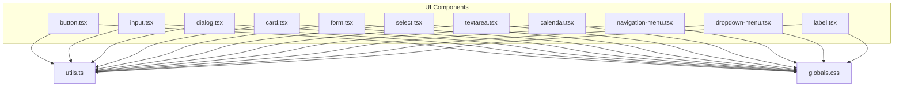

**Diagram sources**
- [button.tsx](file://WEBAPP/src/components/ui/button.tsx#L1-L60)
- [input.tsx](file://WEBAPP/src/components/ui/input.tsx#L1-L22)
- [dialog.tsx](file://WEBAPP/src/components/ui/dialog.tsx#L1-L144)
- [card.tsx](file://WEBAPP/src/components/ui/card.tsx#L1-L93)
- [form.tsx](file://WEBAPP/src/components/ui/form.tsx#L1-L168)
- [select.tsx](file://WEBAPP/src/components/ui/select.tsx#L1-L186)
- [textarea.tsx](file://WEBAPP/src/components/ui/textarea.tsx#L1-L19)
- [calendar.tsx](file://WEBAPP/src/components/ui/calendar.tsx#L1-L216)
- [navigation-menu.tsx](file://WEBAPP/src/components/ui/navigation-menu.tsx#L1-L169)
- [dropdown-menu.tsx](file://WEBAPP/src/components/ui/dropdown-menu.tsx#L1-L258)
- [label.tsx](file://WEBAPP/src/components/ui/label.tsx#L1-L25)
- [utils.ts](file://WEBAPP/src/lib/utils.ts#L1-L7)
- [globals.css](file://WEBAPP/src/app/globals.css#L1-L132)

**Section sources**
- [button.tsx](file://WEBAPP/src/components/ui/button.tsx#L1-L60)
- [input.tsx](file://WEBAPP/src/components/ui/input.tsx#L1-L22)
- [dialog.tsx](file://WEBAPP/src/components/ui/dialog.tsx#L1-L144)
- [card.tsx](file://WEBAPP/src/components/ui/card.tsx#L1-L93)
- [form.tsx](file://WEBAPP/src/components/ui/form.tsx#L1-L168)
- [select.tsx](file://WEBAPP/src/components/ui/select.tsx#L1-L186)
- [textarea.tsx](file://WEBAPP/src/components/ui/textarea.tsx#L1-L19)
- [calendar.tsx](file://WEBAPP/src/components/ui/calendar.tsx#L1-L216)
- [navigation-menu.tsx](file://WEBAPP/src/components/ui/navigation-menu.tsx#L1-L169)
- [dropdown-menu.tsx](file://WEBAPP/src/components/ui/dropdown-menu.tsx#L1-L258)
- [label.tsx](file://WEBAPP/src/components/ui/label.tsx#L1-L25)
- [utils.ts](file://WEBAPP/src/lib/utils.ts#L1-L7)
- [globals.css](file://WEBAPP/src/app/globals.css#L1-L132)

## Core Components
This section summarizes each component’s purpose, variants/sizes, and key styling patterns.

- Button
  - Variants: default, destructive, outline, secondary, ghost, link
  - Sizes: default, sm, lg, icon
  - Composition: Uses Radix Slot to optionally render as any element; CVA manages variant and size; supports SVG icons inside
  - Defaults: variant default, size default
  - Accessibility: Inherits focus-visible ring and aria-invalid integration
  - Reference: [button.tsx](file://WEBAPP/src/components/ui/button.tsx#L7-L36)

- Input
  - Purpose: Text input with consistent focus states and invalid state styling
  - Defaults: standard HTML input props; integrates focus-visible ring and aria-invalid
  - Reference: [input.tsx](file://WEBAPP/src/components/ui/input.tsx#L5-L19)

- Dialog
  - Composition: Root, Trigger, Portal, Overlay, Content, Header/Footer, Title, Description; optional close button
  - Defaults: showCloseButton true; overlay fade and zoom animations
  - Accessibility: Uses Radix Dialog primitives; close button includes screen-reader text
  - Reference: [dialog.tsx](file://WEBAPP/src/components/ui/dialog.tsx#L9-L143)

- Card
  - Composition: Card, CardHeader, CardTitle, CardDescription, CardAction, CardContent, CardFooter
  - Defaults: grid-based header layout with optional action column
  - Reference: [card.tsx](file://WEBAPP/src/components/ui/card.tsx#L5-L92)

- Form
  - Composition: FormProvider, FormField, FormItem, FormLabel, FormControl, FormDescription, FormMessage
  - Defaults: Uses react-hook-form; aria-invalid and aria-describedby wiring via FormControl
  - Accessibility: Connects labels, controls, and error messages for assistive tech
  - Reference: [form.tsx](file://WEBAPP/src/components/ui/form.tsx#L19-L167)

- Select
  - Composition: Root, Group, Value, Trigger (with size), Content (with position), Label, Item, Separator, ScrollUp/Down buttons
  - Defaults: size default; popper positioning; scroll buttons included
  - Accessibility: Integrates with Radix Select; keyboard navigation supported by primitive
  - Reference: [select.tsx](file://WEBAPP/src/components/ui/select.tsx#L9-L185)

- Textarea
  - Purpose: Multi-line text area with consistent focus and invalid state styling
  - Defaults: standard textarea props; focus-visible ring and aria-invalid
  - Reference: [textarea.tsx](file://WEBAPP/src/components/ui/textarea.tsx#L5-L18)

- Calendar
  - Composition: Calendar wrapper around react-day-picker; custom DayButton using Button variant
  - Defaults: showOutsideDays true; captionLayout label; buttonVariant ghost
  - Accessibility: Focus management for selected day; semantic month navigation
  - Reference: [calendar.tsx](file://WEBAPP/src/components/ui/calendar.tsx#L16-L215)

- NavigationMenu
  - Composition: Root, List, Item, Trigger, Content, Viewport, Link, Indicator
  - Defaults: viewport enabled; trigger uses CVA; indicator rotation on open
  - Accessibility: Uses Radix NavigationMenu; focus and motion-aware animations
  - Reference: [navigation-menu.tsx](file://WEBAPP/src/components/ui/navigation-menu.tsx#L8-L168)

- DropdownMenu
  - Composition: Root, Portal, Trigger, Content, Group, Label, Item (default/destructive), Checkbox/Radio items, Separator, Sub/SubTrigger/SubContent, Shortcut
  - Defaults: sideOffset 4; item variants and inset options
  - Accessibility: Integrates with Radix DropdownMenu; keyboard navigation and focus styles
  - Reference: [dropdown-menu.tsx](file://WEBAPP/src/components/ui/dropdown-menu.tsx#L9-L257)

- Label
  - Purpose: Styled label for form controls; respects disabled states
  - Defaults: standard Radix Label props; disabled handling
  - Reference: [label.tsx](file://WEBAPP/src/components/ui/label.tsx#L8-L24)

**Section sources**
- [button.tsx](file://WEBAPP/src/components/ui/button.tsx#L7-L36)
- [input.tsx](file://WEBAPP/src/components/ui/input.tsx#L5-L19)
- [dialog.tsx](file://WEBAPP/src/components/ui/dialog.tsx#L9-L143)
- [card.tsx](file://WEBAPP/src/components/ui/card.tsx#L5-L92)
- [form.tsx](file://WEBAPP/src/components/ui/form.tsx#L19-L167)
- [select.tsx](file://WEBAPP/src/components/ui/select.tsx#L9-L185)
- [textarea.tsx](file://WEBAPP/src/components/ui/textarea.tsx#L5-L18)
- [calendar.tsx](file://WEBAPP/src/components/ui/calendar.tsx#L16-L215)
- [navigation-menu.tsx](file://WEBAPP/src/components/ui/navigation-menu.tsx#L8-L168)
- [dropdown-menu.tsx](file://WEBAPP/src/components/ui/dropdown-menu.tsx#L9-L257)
- [label.tsx](file://WEBAPP/src/components/ui/label.tsx#L8-L24)

## Architecture Overview
The library follows a layered pattern:
- Base primitives: Radix UI roots and triggers
- Slots and composition: Radix Slot enables flexible rendering
- Variant management: CVA for Button and NavigationMenu trigger
- Styling: Tailwind utilities with a shared cn() utility
- Theming: CSS variables in globals.css for light/dark modes

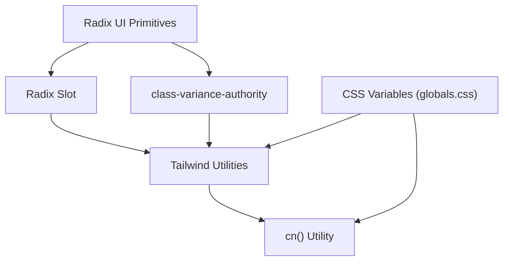

**Diagram sources**
- [button.tsx](file://WEBAPP/src/components/ui/button.tsx#L2-L3)
- [navigation-menu.tsx](file://WEBAPP/src/components/ui/navigation-menu.tsx#L3)
- [utils.ts](file://WEBAPP/src/lib/utils.ts#L4-L6)
- [globals.css](file://WEBAPP/src/app/globals.css#L2-L49)

**Section sources**
- [button.tsx](file://WEBAPP/src/components/ui/button.tsx#L2-L3)
- [navigation-menu.tsx](file://WEBAPP/src/components/ui/navigation-menu.tsx#L3)
- [utils.ts](file://WEBAPP/src/lib/utils.ts#L4-L6)
- [globals.css](file://WEBAPP/src/app/globals.css#L2-L49)

## Detailed Component Analysis

### Button
- Composition: Accepts asChild to render any element; merges variant and size classes via CVA; forwards all props
- Variants and sizes: Defined in buttonVariants; supports SVG sizing and focus-visible ring
- Defaults: variant default, size default
- Accessibility: Focus-visible ring and aria-invalid integration for form feedback

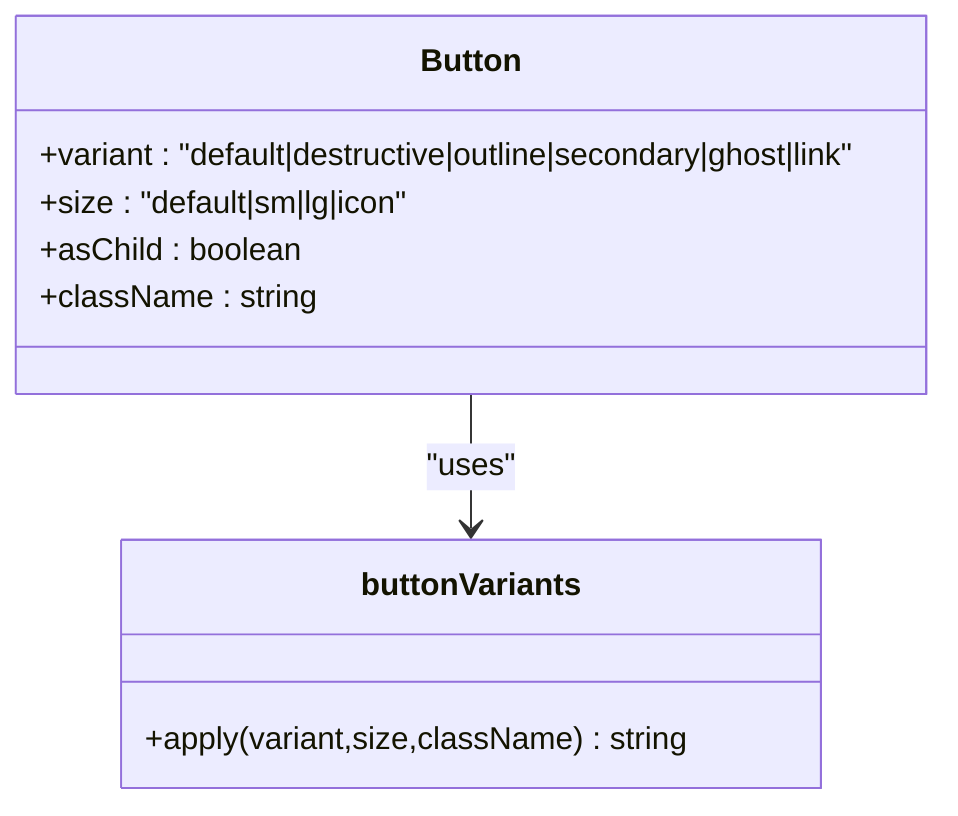

**Diagram sources**
- [button.tsx](file://WEBAPP/src/components/ui/button.tsx#L7-L36)

**Section sources**
- [button.tsx](file://WEBAPP/src/components/ui/button.tsx#L7-L36)

### Dialog
- Composition: Exposes Root, Trigger, Portal, Overlay, Content, Header/Footer, Title, Description
- Defaults: showCloseButton true; animated overlay and content; close button includes sr-only text
- Accessibility: Uses Radix Dialog; close button labeled for screen readers

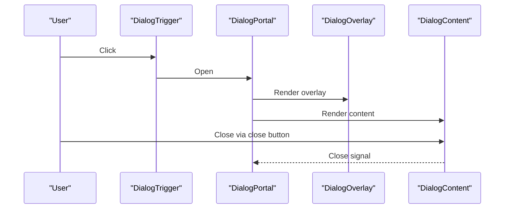

**Diagram sources**
- [dialog.tsx](file://WEBAPP/src/components/ui/dialog.tsx#L9-L81)

**Section sources**
- [dialog.tsx](file://WEBAPP/src/components/ui/dialog.tsx#L9-L81)

### Form
- Composition: Provides FormProvider, FormField, FormItem, FormLabel, FormControl, FormDescription, FormMessage
- Defaults: FormControl sets aria-invalid and aria-describedby; FormLabel wired to field id
- Accessibility: Ensures labels, controls, and messages are connected for assistive technologies

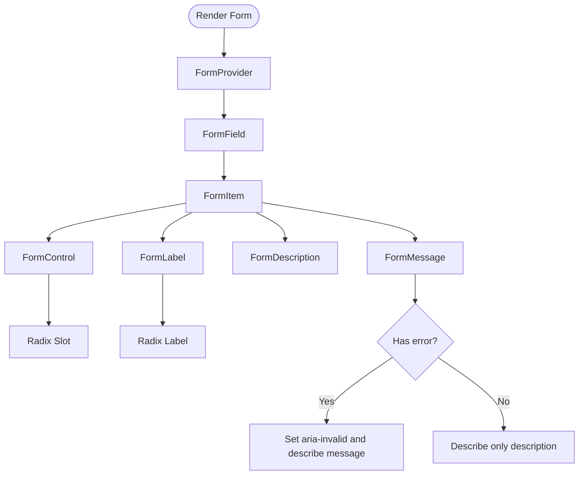

**Diagram sources**
- [form.tsx](file://WEBAPP/src/components/ui/form.tsx#L19-L167)

**Section sources**
- [form.tsx](file://WEBAPP/src/components/ui/form.tsx#L19-L167)

### Select
- Composition: Root, Trigger (supports size), Content (position), Item, Label, Separator, Scroll buttons
- Defaults: size default; popper positioning; scroll buttons included
- Accessibility: Integrates with Radix Select; keyboard navigation handled by primitive

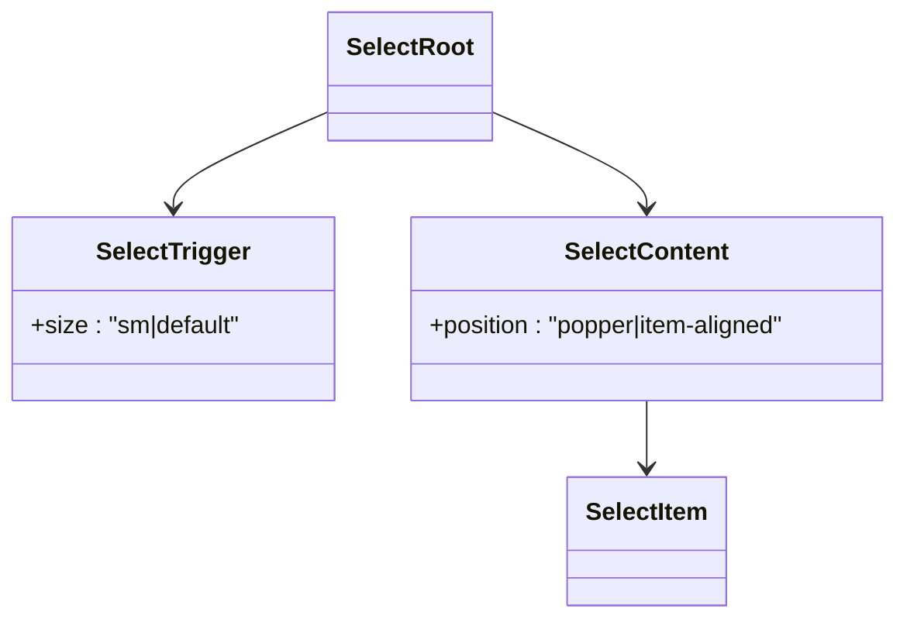

**Diagram sources**
- [select.tsx](file://WEBAPP/src/components/ui/select.tsx#L9-L185)

**Section sources**
- [select.tsx](file://WEBAPP/src/components/ui/select.tsx#L9-L185)

### Calendar
- Composition: Wraps react-day-picker; custom DayButton renders Button with variant ghost and icon size
- Defaults: showOutsideDays true; captionLayout label; buttonVariant ghost
- Accessibility: Focus management for focused day; semantic month navigation

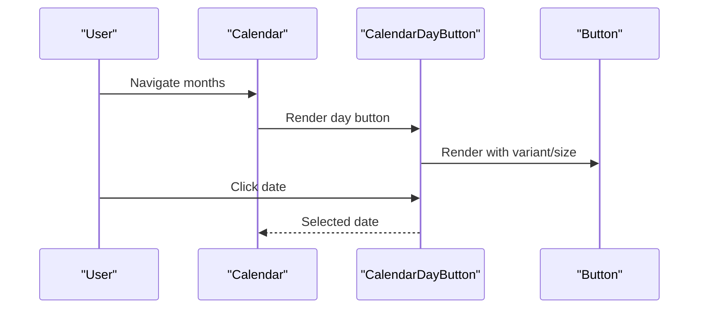

**Diagram sources**
- [calendar.tsx](file://WEBAPP/src/components/ui/calendar.tsx#L16-L215)

**Section sources**
- [calendar.tsx](file://WEBAPP/src/components/ui/calendar.tsx#L16-L215)

### NavigationMenu
- Composition: Root, List, Item, Trigger (CVA), Content, Viewport, Link, Indicator
- Defaults: viewport enabled; trigger rotation on open; motion-aware animations
- Accessibility: Uses Radix NavigationMenu; focus and motion-aware animations

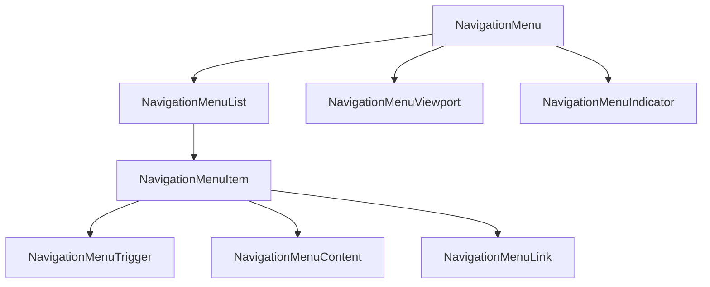

**Diagram sources**
- [navigation-menu.tsx](file://WEBAPP/src/components/ui/navigation-menu.tsx#L8-L168)

**Section sources**
- [navigation-menu.tsx](file://WEBAPP/src/components/ui/navigation-menu.tsx#L8-L168)

### DropdownMenu
- Composition: Root, Trigger, Content, Group, Label, Item (default/destructive), Checkbox/Radio items, Separator, Sub/SubTrigger/SubContent, Shortcut
- Defaults: sideOffset 4; item variants and inset options
- Accessibility: Integrates with Radix DropdownMenu; keyboard navigation and focus styles

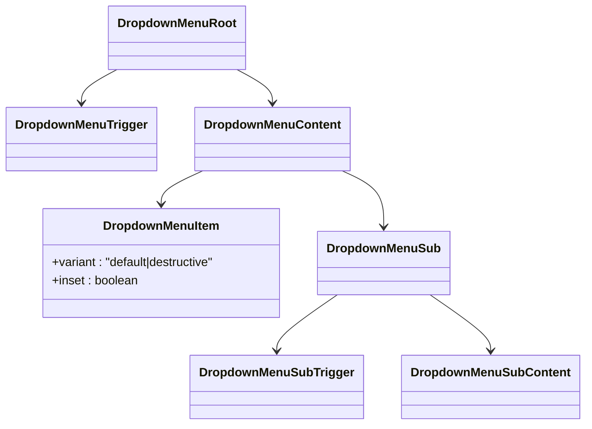

**Diagram sources**
- [dropdown-menu.tsx](file://WEBAPP/src/components/ui/dropdown-menu.tsx#L9-L257)

**Section sources**
- [dropdown-menu.tsx](file://WEBAPP/src/components/ui/dropdown-menu.tsx#L9-L257)

### Card
- Composition: Card, CardHeader, CardTitle, CardDescription, CardAction, CardContent, CardFooter
- Defaults: grid-based header layout with optional action column
- Accessibility: Structural semantics via divs and headings

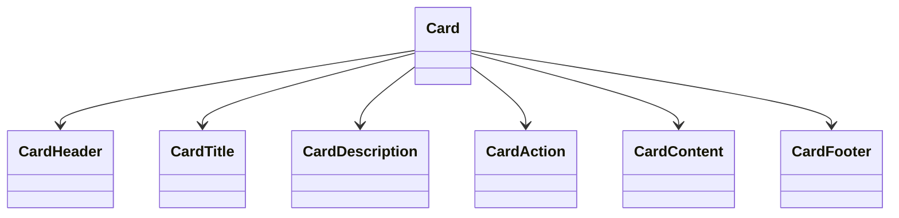

**Diagram sources**
- [card.tsx](file://WEBAPP/src/components/ui/card.tsx#L5-L92)

**Section sources**
- [card.tsx](file://WEBAPP/src/components/ui/card.tsx#L5-L92)

### Input and Textarea
- Composition: Forward refs and props to native inputs; consistent focus-visible ring and aria-invalid integration
- Defaults: standard HTML input/textarea props; Tailwind utilities applied
- Accessibility: Focus-visible ring and aria-invalid for error states

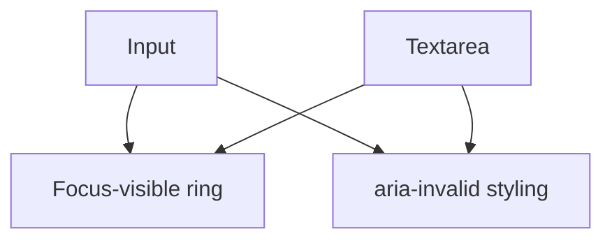

**Diagram sources**
- [input.tsx](file://WEBAPP/src/components/ui/input.tsx#L5-L19)
- [textarea.tsx](file://WEBAPP/src/components/ui/textarea.tsx#L5-L18)

**Section sources**
- [input.tsx](file://WEBAPP/src/components/ui/input.tsx#L5-L19)
- [textarea.tsx](file://WEBAPP/src/components/ui/textarea.tsx#L5-L18)

## Dependency Analysis
External dependencies relevant to the UI library:
- Radix UI packages for primitives
- class-variance-authority for variants
- lucide-react for icons
- react-day-picker for Calendar
- tailwind-merge and clsx for class merging
- next-themes for theme switching

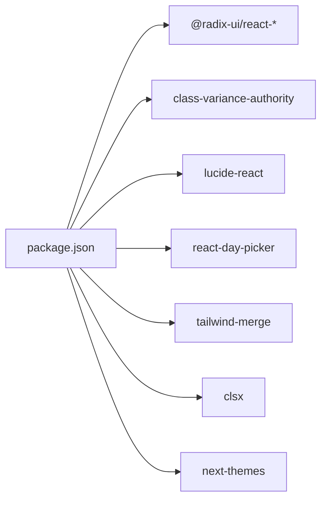

**Diagram sources**
- [package.json](file://WEBAPP/package.json#L15-L72)

**Section sources**
- [package.json](file://WEBAPP/package.json#L15-L72)

## Performance Considerations
- Prefer CVA for variant composition to avoid runtime conditionals and reduce re-renders
- Use Radix Slot sparingly; only when you must change the underlying element type
- Keep Tailwind utilities concise; avoid excessive nesting and conditional classes
- Calendar leverages Button variants; reuse Button’s variant system to minimize custom CSS
- Use globals.css variables to centralize theme tokens and reduce duplication

[No sources needed since this section provides general guidance]

## Accessibility and UX
- Focus management
  - Buttons and form controls apply focus-visible rings and ring offsets
  - Calendar focuses the selected day programmatically
  - NavigationMenu and DropdownMenu rely on Radix focus management
- Screen reader support
  - Dialog close button includes a screen-reader-only label
  - Form components wire aria-describedby and aria-invalid to connect labels and errors
  - Select and DropdownMenu integrate with Radix primitives that manage roles and ARIA attributes
- Keyboard navigation
  - Select, DropdownMenu, NavigationMenu, and Calendar are built on Radix primitives that provide robust keyboard handling
- Color and contrast
  - globals.css defines CSS variables for light/dark themes; ensure sufficient contrast in custom overrides

**Section sources**
- [dialog.tsx](file://WEBAPP/src/components/ui/dialog.tsx#L69-L77)
- [form.tsx](file://WEBAPP/src/components/ui/form.tsx#L107-L122)
- [calendar.tsx](file://WEBAPP/src/components/ui/calendar.tsx#L186-L188)
- [globals.css](file://WEBAPP/src/app/globals.css#L2-L49)

## Extensibility and Design Consistency
Guidelines for extending components while preserving consistency:
- Variant system
  - Use CVA for new components to keep variants centralized and composable
  - Reuse existing tokens (colors, shadows, spacing) from globals.css
- Composition patterns
  - Wrap Radix roots and expose small, focused subcomponents (e.g., DialogContent, DropdownMenuContent)
  - Use Radix Slot when you must change the rendered element type
- Styling
  - Centralize shared utilities in cn() and globals.css
  - Prefer Tailwind utilities; avoid ad-hoc CSS
- Accessibility
  - Always forward aria attributes and ids where primitives require them
  - Include visible focus styles and consider screen-reader-only text for icon buttons
- Naming and structure
  - Keep component names aligned with Radix primitives (e.g., DialogTrigger, DropdownMenuTrigger)
  - Use data-slot attributes consistently for testing and debugging

[No sources needed since this section provides general guidance]

## Troubleshooting Guide
- Dialog does not close or overlay not visible
  - Ensure Portal is wrapping Content and Overlay
  - Verify showCloseButton and close button markup
  - Reference: [dialog.tsx](file://WEBAPP/src/components/ui/dialog.tsx#L58-L80)
- Form label not associated with input
  - Use FormLabel with htmlFor bound to formItemId
  - FormControl must set aria-describedby and aria-invalid
  - Reference: [form.tsx](file://WEBAPP/src/components/ui/form.tsx#L90-L123)
- Select item not styled or icon missing
  - Confirm SelectTrigger size and icon placement
  - Ensure SelectItem renders ItemIndicator and ItemText
  - Reference: [select.tsx](file://WEBAPP/src/components/ui/select.tsx#L101-L123)
- Calendar day not focused or wrong variant
  - CalendarDayButton uses Button with variant ghost and size icon
  - Focus is applied when modifiers.focused is true
  - Reference: [calendar.tsx](file://WEBAPP/src/components/ui/calendar.tsx#L176-L213)
- Dropdown item variant or inset not applying
  - Use data-variant and data-inset attributes on items
  - Confirm sideOffset and portal usage
  - Reference: [dropdown-menu.tsx](file://WEBAPP/src/components/ui/dropdown-menu.tsx#L62-L83)

**Section sources**
- [dialog.tsx](file://WEBAPP/src/components/ui/dialog.tsx#L58-L80)
- [form.tsx](file://WEBAPP/src/components/ui/form.tsx#L90-L123)
- [select.tsx](file://WEBAPP/src/components/ui/select.tsx#L101-L123)
- [calendar.tsx](file://WEBAPP/src/components/ui/calendar.tsx#L176-L213)
- [dropdown-menu.tsx](file://WEBAPP/src/components/ui/dropdown-menu.tsx#L62-L83)

## Conclusion
This UI library combines Radix UI primitives with Tailwind CSS and CVA to deliver accessible, consistent, and extensible components. By centralizing styling in cn() and globals.css, and managing variants with CVA, teams can maintain design consistency across the therapeutic application while enabling easy extension and customization.