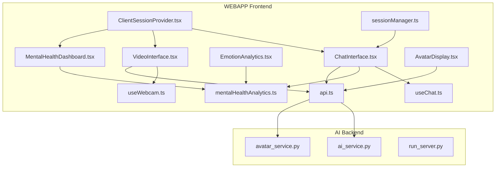
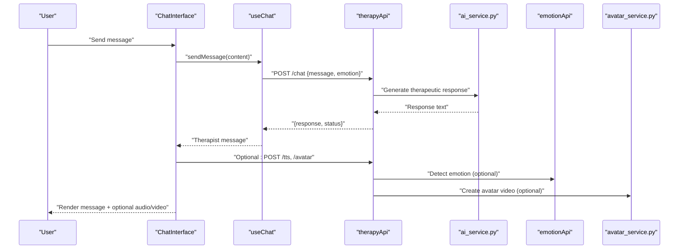
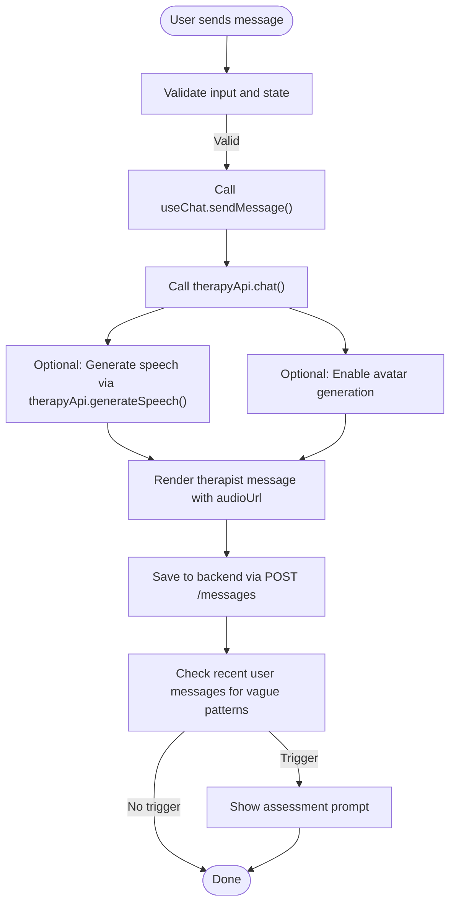
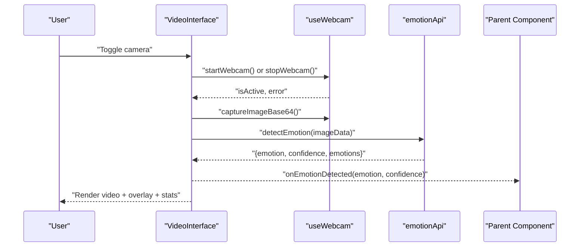
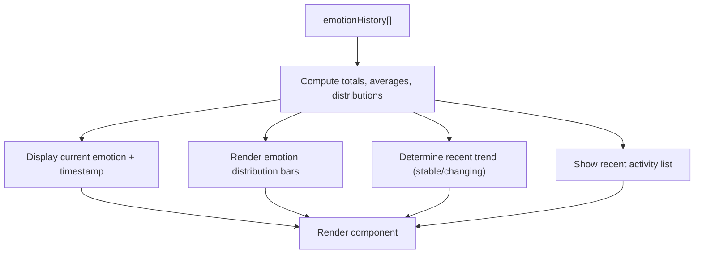
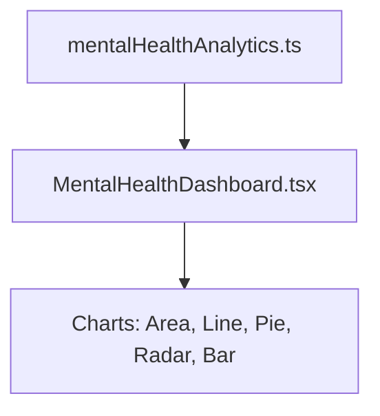
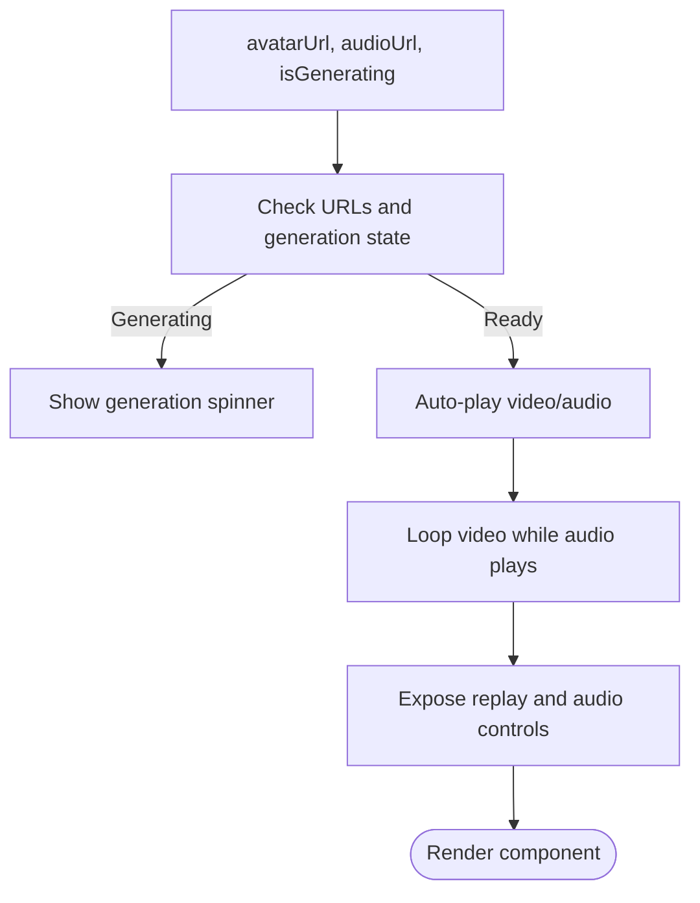
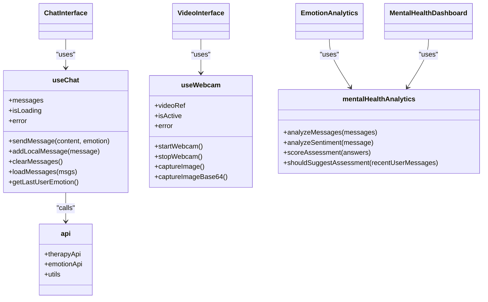
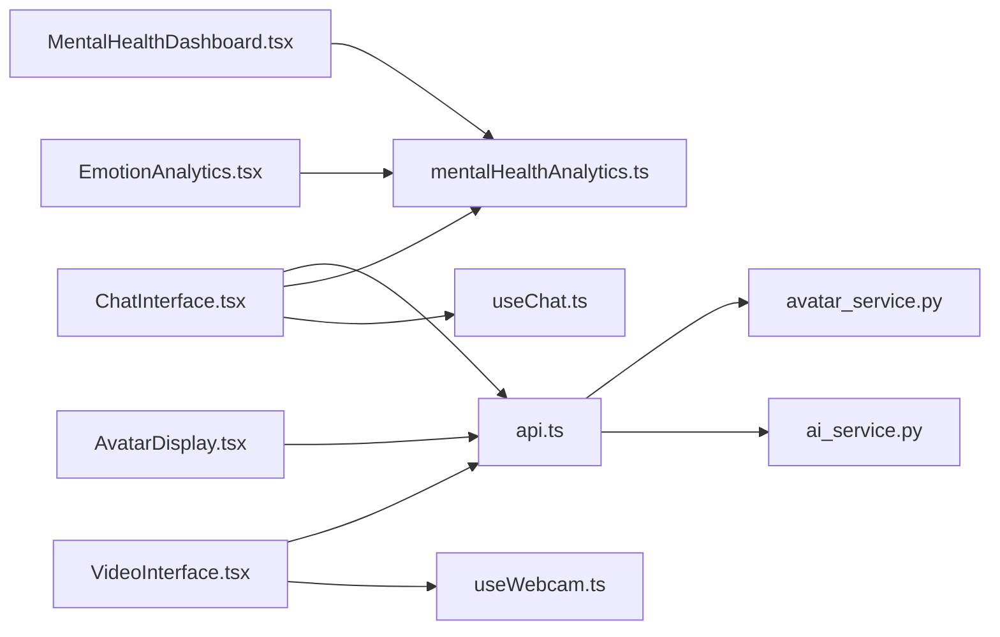

# Specialized Therapeutic Components

<cite>
**Referenced Files in This Document**
- [ChatInterface.tsx](file://WEBAPP/src/components/ChatInterface.tsx)
- [VideoInterface.tsx](file://WEBAPP/src/components/VideoInterface.tsx)
- [EmotionAnalytics.tsx](file://WEBAPP/src/components/EmotionAnalytics.tsx)
- [MentalHealthDashboard.tsx](file://WEBAPP/src/components/analytics/MentalHealthDashboard.tsx)
- [AvatarDisplay.tsx](file://WEBAPP/src/components/AvatarDisplay.tsx)
- [useChat.ts](file://WEBAPP/src/hooks/useChat.ts)
- [useWebcam.ts](file://WEBAPP/src/hooks/useWebcam.ts)
- [mentalHealthAnalytics.ts](file://WEBAPP/src/lib/mentalHealthAnalytics.ts)
- [api.ts](file://WEBAPP/src/lib/api.ts)
- [ClientSessionProvider.tsx](file://WEBAPP/src/components/ClientSessionProvider.tsx)
- [sessionManager.ts](file://WEBAPP/src/lib/sessionManager.ts)
- [ai_service.py](file://ai-backend/services/ai_service.py)
- [avatar_service.py](file://ai-backend/services/avatar_service.py)
- [run_server.py](file://ai-backend/run_server.py)
</cite>

## Table of Contents
1. [Introduction](#introduction)
2. [Project Structure](#project-structure)
3. [Core Components](#core-components)
4. [Architecture Overview](#architecture-overview)
5. [Detailed Component Analysis](#detailed-component-analysis)
6. [Dependency Analysis](#dependency-analysis)
7. [Performance Considerations](#performance-considerations)
8. [Troubleshooting Guide](#troubleshooting-guide)
9. [Conclusion](#conclusion)

## Introduction
This document provides comprehensive technical documentation for specialized therapeutic UI components designed for mental health applications. It focuses on four primary components:
- ChatInterface: Real-time messaging with emotion-aware responses, assessment prompts, and therapeutic safeguards.
- VideoInterface: Telehealth session camera controls, emotion detection overlay, and real-time analytics display.
- EmotionAnalytics: Sentiment and emotion distribution visualization for progress tracking.
- MentalHealthDashboard: Advanced analytics visualization for comprehensive mental wellness insights.
It also covers supporting components such as AvatarDisplay for AI-generated therapeutic avatars, state management via hooks, and integration with backend services. Healthcare-specific considerations including data privacy, accessibility, and therapeutic safety are addressed throughout.

## Project Structure
The therapeutic UI components are organized under the Next.js application in the WEBAPP directory, with hooks, analytics utilities, and API clients supporting cross-cutting concerns. Backend services for AI therapy, avatar generation, and emotion detection reside in the ai-backend directory.

**Diagram sources**
- [ChatInterface.tsx](file://WEBAPP/src/components/ChatInterface.tsx#L1-L567)
- [VideoInterface.tsx](file://WEBAPP/src/components/VideoInterface.tsx#L1-L207)
- [EmotionAnalytics.tsx](file://WEBAPP/src/components/EmotionAnalytics.tsx#L1-L212)
- [MentalHealthDashboard.tsx](file://WEBAPP/src/components/analytics/MentalHealthDashboard.tsx#L1-L541)
- [AvatarDisplay.tsx](file://WEBAPP/src/components/AvatarDisplay.tsx#L1-L210)
- [useChat.ts](file://WEBAPP/src/hooks/useChat.ts#L1-L150)
- [useWebcam.ts](file://WEBAPP/src/hooks/useWebcam.ts#L1-L89)
- [mentalHealthAnalytics.ts](file://WEBAPP/src/lib/mentalHealthAnalytics.ts#L1-L884)
- [api.ts](file://WEBAPP/src/lib/api.ts#L1-L142)
- [ClientSessionProvider.tsx](file://WEBAPP/src/components/ClientSessionProvider.tsx#L1-L12)
- [sessionManager.ts](file://WEBAPP/src/lib/sessionManager.ts#L1-L78)
- [ai_service.py](file://ai-backend/services/ai_service.py#L1-L293)
- [avatar_service.py](file://ai-backend/services/avatar_service.py#L1-L237)
- [run_server.py](file://ai-backend/run_server.py#L1-L21)

**Section sources**
- [ChatInterface.tsx](file://WEBAPP/src/components/ChatInterface.tsx#L1-L567)
- [VideoInterface.tsx](file://WEBAPP/src/components/VideoInterface.tsx#L1-L207)
- [EmotionAnalytics.tsx](file://WEBAPP/src/components/EmotionAnalytics.tsx#L1-L212)
- [MentalHealthDashboard.tsx](file://WEBAPP/src/components/analytics/MentalHealthDashboard.tsx#L1-L541)
- [AvatarDisplay.tsx](file://WEBAPP/src/components/AvatarDisplay.tsx#L1-L210)
- [useChat.ts](file://WEBAPP/src/hooks/useChat.ts#L1-L150)
- [useWebcam.ts](file://WEBAPP/src/hooks/useWebcam.ts#L1-L89)
- [mentalHealthAnalytics.ts](file://WEBAPP/src/lib/mentalHealthAnalytics.ts#L1-L884)
- [api.ts](file://WEBAPP/src/lib/api.ts#L1-L142)
- [ClientSessionProvider.tsx](file://WEBAPP/src/components/ClientSessionProvider.tsx#L1-L12)
- [sessionManager.ts](file://WEBAPP/src/lib/sessionManager.ts#L1-L78)
- [ai_service.py](file://ai-backend/services/ai_service.py#L1-L293)
- [avatar_service.py](file://ai-backend/services/avatar_service.py#L1-L237)
- [run_server.py](file://ai-backend/run_server.py#L1-L21)

## Core Components
This section outlines the primary therapeutic components and their responsibilities:
- ChatInterface: Manages real-time chat, assessment flows, emotion-aware responses, and integration with backend APIs for therapy, speech synthesis, and avatar generation.
- VideoInterface: Controls camera activation, captures frames, triggers emotion detection, displays overlays, and presents emotion statistics.
- EmotionAnalytics: Aggregates emotion metrics, computes distributions, and renders progress-oriented analytics.
- MentalHealthDashboard: Provides comprehensive analytics visualizations including sentiment timelines, emotion distributions, radar charts, and keyword breakdowns.
- AvatarDisplay: Renders AI-generated avatar videos and synchronized audio, with playback controls and status indicators.
- Supporting hooks and libraries: useChat encapsulates chat state and API interactions; useWebcam manages camera lifecycle; mentalHealthAnalytics provides keyword categorization, sentiment analysis, and assessment scoring; api.ts centralizes backend communication; ClientSessionProvider and sessionManager manage session lifecycle and security.

**Section sources**
- [ChatInterface.tsx](file://WEBAPP/src/components/ChatInterface.tsx#L42-L567)
- [VideoInterface.tsx](file://WEBAPP/src/components/VideoInterface.tsx#L18-L207)
- [EmotionAnalytics.tsx](file://WEBAPP/src/components/EmotionAnalytics.tsx#L18-L212)
- [MentalHealthDashboard.tsx](file://WEBAPP/src/components/analytics/MentalHealthDashboard.tsx#L47-L541)
- [AvatarDisplay.tsx](file://WEBAPP/src/components/AvatarDisplay.tsx#L12-L210)
- [useChat.ts](file://WEBAPP/src/hooks/useChat.ts#L33-L150)
- [useWebcam.ts](file://WEBAPP/src/hooks/useWebcam.ts#L9-L89)
- [mentalHealthAnalytics.ts](file://WEBAPP/src/lib/mentalHealthAnalytics.ts#L199-L350)
- [api.ts](file://WEBAPP/src/lib/api.ts#L76-L113)
- [ClientSessionProvider.tsx](file://WEBAPP/src/components/ClientSessionProvider.tsx#L10-L12)
- [sessionManager.ts](file://WEBAPP/src/lib/sessionManager.ts#L3-L78)

## Architecture Overview
The therapeutic UI components integrate tightly with backend services for AI therapy, emotion detection, and avatar generation. The frontend communicates with Next.js API routes and external services via centralized API clients. Hooks encapsulate state and side effects, while analytics utilities provide robust mental health insights.

**Diagram sources**
- [ChatInterface.tsx](file://WEBAPP/src/components/ChatInterface.tsx#L255-L310)
- [useChat.ts](file://WEBAPP/src/hooks/useChat.ts#L40-L116)
- [api.ts](file://WEBAPP/src/lib/api.ts#L76-L113)
- [ai_service.py](file://ai-backend/services/ai_service.py#L131-L192)
- [avatar_service.py](file://ai-backend/services/avatar_service.py#L19-L67)

## Detailed Component Analysis

### ChatInterface Component
ChatInterface orchestrates real-time messaging with the following capabilities:
- Real-time message rendering with timestamps and role-based styling.
- Assessment flow: automatic suggestion of a brief mental health check-in based on vague user messages, sequential question presentation, and submission handling with backend scoring.
- Emotion-aware responses: integrates emotion context into therapy requests and supports TTS and avatar generation when enabled.
- Persistence: loads session messages from backend and saves outgoing messages with metadata.
- Safety: displays risk flags and escalation guidance when assessment indicates significant distress.

**Diagram sources**
- [ChatInterface.tsx](file://WEBAPP/src/components/ChatInterface.tsx#L255-L310)
- [useChat.ts](file://WEBAPP/src/hooks/useChat.ts#L40-L116)
- [api.ts](file://WEBAPP/src/lib/api.ts#L76-L98)

**Section sources**
- [ChatInterface.tsx](file://WEBAPP/src/components/ChatInterface.tsx#L42-L567)
- [useChat.ts](file://WEBAPP/src/hooks/useChat.ts#L33-L150)
- [mentalHealthAnalytics.ts](file://WEBAPP/src/lib/mentalHealthAnalytics.ts#L404-L425)
- [api.ts](file://WEBAPP/src/lib/api.ts#L76-L113)

### VideoInterface Component
VideoInterface manages camera and emotion detection during telehealth sessions:
- Camera lifecycle: start/stop webcam with error handling and loading states.
- Emotion detection: captures frames periodically, invokes emotion detection API, and displays current emotion with confidence.
- Overlay and controls: toggles emotion overlay visibility, shows emotion statistics grid, and provides user feedback on errors.
- Integration: emits detected emotions to parent components for broader analytics.

**Diagram sources**
- [VideoInterface.tsx](file://WEBAPP/src/components/VideoInterface.tsx#L53-L68)
- [useWebcam.ts](file://WEBAPP/src/hooks/useWebcam.ts#L17-L52)
- [api.ts](file://WEBAPP/src/lib/api.ts#L54-L73)

**Section sources**
- [VideoInterface.tsx](file://WEBAPP/src/components/VideoInterface.tsx#L18-L207)
- [useWebcam.ts](file://WEBAPP/src/hooks/useWebcam.ts#L9-L89)
- [api.ts](file://WEBAPP/src/lib/api.ts#L54-L73)

### EmotionAnalytics Component
EmotionAnalytics aggregates and visualizes emotion metrics:
- Computes totals, averages, and distributions from emotion history.
- Displays current emotion with emoji and confidence, recent trends, and recent activity logs.
- Provides responsive grid layouts for emotion statistics and readability-friendly formatting.

**Diagram sources**
- [EmotionAnalytics.tsx](file://WEBAPP/src/components/EmotionAnalytics.tsx#L23-L88)

**Section sources**
- [EmotionAnalytics.tsx](file://WEBAPP/src/components/EmotionAnalytics.tsx#L18-L212)

### MentalHealthDashboard Component
MentalHealthDashboard delivers comprehensive analytics:
- Severity level cards, sentiment overview, dominant emotion, and lexical diversity.
- Interactive charts: sentiment timeline (area + line), emotion pie chart, mental health radar, category bar chart, keyword breakdown cards.
- Severity gauge with labeled levels and descriptions.
- N-gram analysis (bigrams/trigrams) and summary statistics.

**Diagram sources**
- [MentalHealthDashboard.tsx](file://WEBAPP/src/components/analytics/MentalHealthDashboard.tsx#L47-L541)
- [mentalHealthAnalytics.ts](file://WEBAPP/src/lib/mentalHealthAnalytics.ts#L199-L350)

**Section sources**
- [MentalHealthDashboard.tsx](file://WEBAPP/src/components/analytics/MentalHealthDashboard.tsx#L47-L541)
- [mentalHealthAnalytics.ts](file://WEBAPP/src/lib/mentalHealthAnalytics.ts#L199-L350)

### AvatarDisplay Component
AvatarDisplay renders AI-generated avatar responses:
- Handles video and audio playback, with synchronization and looping behavior.
- Shows generation status and error messaging.
- Provides manual controls for replay and audio-only playback.

**Diagram sources**
- [AvatarDisplay.tsx](file://WEBAPP/src/components/AvatarDisplay.tsx#L12-L210)

**Section sources**
- [AvatarDisplay.tsx](file://WEBAPP/src/components/AvatarDisplay.tsx#L12-L210)

### State Management and Integration
- useChat: Centralizes chat state, loading/error states, and API interactions for therapy, TTS, and avatar generation. Supports adding local messages for assessment flows and retrieving last user emotion for context.
- useWebcam: Manages camera lifecycle, capturing frames, and error reporting.
- mentalHealthAnalytics: Provides keyword categorization, sentiment analysis, assessment scoring, and temporal decay weighting for historical messages.
- api: Encapsulates AI backend and ML backend endpoints for chat, TTS, avatar, and emotion detection.
- ClientSessionProvider and sessionManager: Manage NextAuth session lifecycle, expiration checks, and incognito detection.

**Diagram sources**
- [useChat.ts](file://WEBAPP/src/hooks/useChat.ts#L33-L150)
- [useWebcam.ts](file://WEBAPP/src/hooks/useWebcam.ts#L9-L89)
- [mentalHealthAnalytics.ts](file://WEBAPP/src/lib/mentalHealthAnalytics.ts#L199-L350)
- [api.ts](file://WEBAPP/src/lib/api.ts#L76-L141)

**Section sources**
- [useChat.ts](file://WEBAPP/src/hooks/useChat.ts#L33-L150)
- [useWebcam.ts](file://WEBAPP/src/hooks/useWebcam.ts#L9-L89)
- [mentalHealthAnalytics.ts](file://WEBAPP/src/lib/mentalHealthAnalytics.ts#L199-L350)
- [api.ts](file://WEBAPP/src/lib/api.ts#L76-L141)
- [ClientSessionProvider.tsx](file://WEBAPP/src/components/ClientSessionProvider.tsx#L10-L12)
- [sessionManager.ts](file://WEBAPP/src/lib/sessionManager.ts#L3-L78)

## Dependency Analysis
The components exhibit clear separation of concerns:
- UI components depend on hooks for state and on api.ts for backend integration.
- mentalHealthAnalytics is a shared utility consumed by UI components and dashboards.
- Backend services are accessed via api.ts and run independently, with ai_service.py providing therapy responses and avatar_service.py managing avatar creation.

**Diagram sources**
- [ChatInterface.tsx](file://WEBAPP/src/components/ChatInterface.tsx#L66-L79)
- [VideoInterface.tsx](file://WEBAPP/src/components/VideoInterface.tsx#L25-L43)
- [EmotionAnalytics.tsx](file://WEBAPP/src/components/EmotionAnalytics.tsx#L1-L212)
- [MentalHealthDashboard.tsx](file://WEBAPP/src/components/analytics/MentalHealthDashboard.tsx#L26-L30)
- [AvatarDisplay.tsx](file://WEBAPP/src/components/AvatarDisplay.tsx#L1-L210)
- [useChat.ts](file://WEBAPP/src/hooks/useChat.ts#L1-L150)
- [useWebcam.ts](file://WEBAPP/src/hooks/useWebcam.ts#L1-L89)
- [mentalHealthAnalytics.ts](file://WEBAPP/src/lib/mentalHealthAnalytics.ts#L1-L884)
- [api.ts](file://WEBAPP/src/lib/api.ts#L1-L142)
- [ai_service.py](file://ai-backend/services/ai_service.py#L1-L293)
- [avatar_service.py](file://ai-backend/services/avatar_service.py#L1-L237)

**Section sources**
- [api.ts](file://WEBAPP/src/lib/api.ts#L1-L142)
- [ai_service.py](file://ai-backend/services/ai_service.py#L1-L293)
- [avatar_service.py](file://ai-backend/services/avatar_service.py#L1-L237)

## Performance Considerations
- Debounce and throttle UI updates: VideoInterface detects emotions at intervals to balance responsiveness and resource usage.
- Lazy initialization: useWebcam starts streams only when needed; useChat defers TTS/avatar generation until explicitly requested.
- Efficient rendering: ChatInterface uses memoization and minimal re-renders; MentalHealthDashboard leverages responsive chart containers.
- Backend latency awareness: useChat and VideoInterface surface loading states and errors to prevent blocking the UI.
- Data minimization: EmotionAnalytics and MentalHealthDashboard compute aggregated metrics client-side to reduce payload sizes.

[No sources needed since this section provides general guidance]

## Troubleshooting Guide
Common issues and resolutions:
- Camera errors: VideoInterface surfaces webcam errors; ensure permissions and device availability. useWebcam handles MediaDevices constraints and cleanup.
- Emotion detection failures: Verify emotionApi endpoints and network connectivity; display fallback UI when errors occur.
- Chat failures: useChat sets error state and prevents concurrent requests; inspect therapyApi responses for status and messages.
- Session invalidation: sessionManager monitors expiration and incognito modes; redirect unauthenticated users to sign-in.
- Backend connectivity: ai_service.py and avatar_service.py handle API key configuration and graceful fallbacks; confirm environment variables and service availability.

**Section sources**
- [VideoInterface.tsx](file://WEBAPP/src/components/VideoInterface.tsx#L131-L140)
- [useWebcam.ts](file://WEBAPP/src/hooks/useWebcam.ts#L37-L40)
- [useChat.ts](file://WEBAPP/src/hooks/useChat.ts#L109-L115)
- [sessionManager.ts](file://WEBAPP/src/lib/sessionManager.ts#L5-L27)
- [ai_service.py](file://ai-backend/services/ai_service.py#L11-L16)
- [avatar_service.py](file://ai-backend/services/avatar_service.py#L12-L26)

## Conclusion
The specialized therapeutic components deliver a cohesive, secure, and accessible mental health experience. They combine real-time chat, emotion-aware AI responses, live emotion detection, and comprehensive analytics to support continuous care. Robust state management, modular hooks, and clear backend integration ensure scalability and maintainability. Healthcare-specific safeguards, including assessment prompts, risk flagging, and session lifecycle management, align with therapeutic safety requirements.