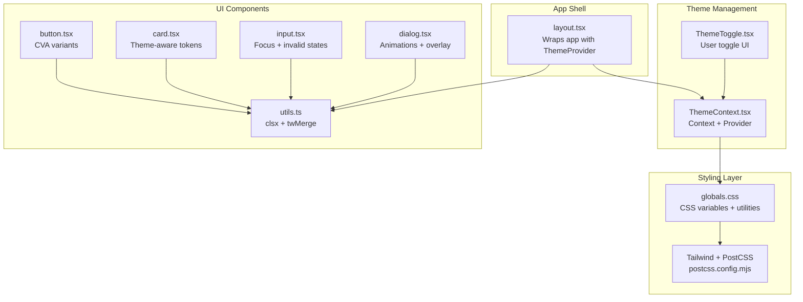
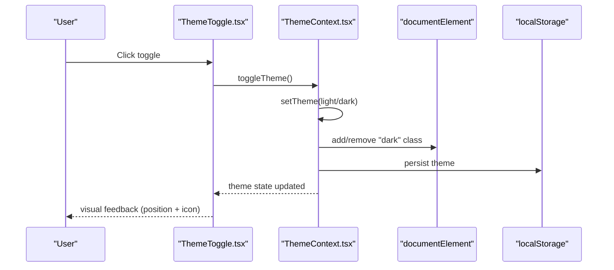
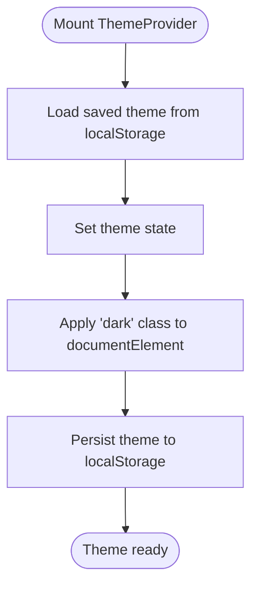
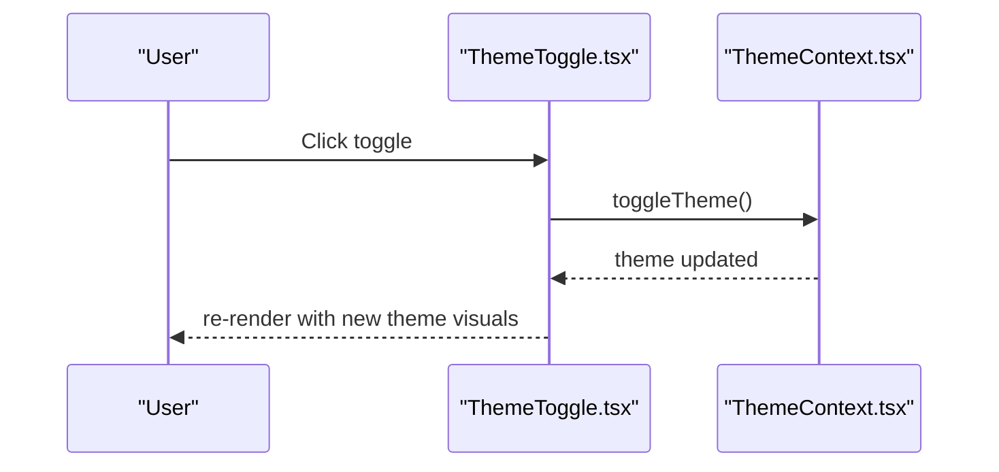
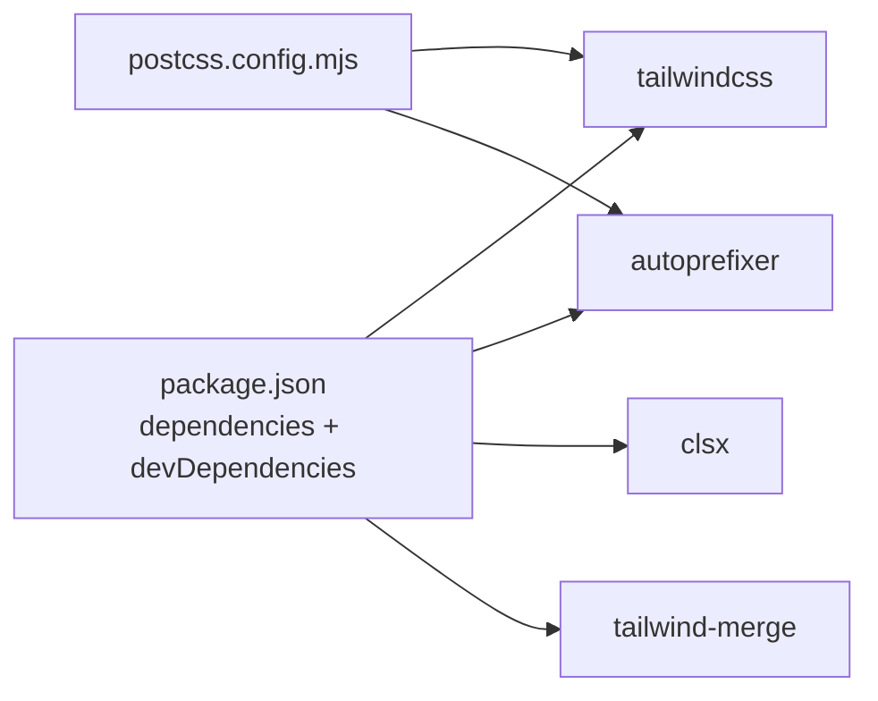

# Theming and Styling

<cite>
**Referenced Files in This Document**
- [ThemeContext.tsx](file://WEBAPP/src/contexts/ThemeContext.tsx)
- [ThemeToggle.tsx](file://WEBAPP/src/components/ThemeToggle.tsx)
- [globals.css](file://WEBAPP/src/app/globals.css)
- [layout.tsx](file://WEBAPP/src/app/layout.tsx)
- [button.tsx](file://WEBAPP/src/components/ui/button.tsx)
- [card.tsx](file://WEBAPP/src/components/ui/card.tsx)
- [input.tsx](file://WEBAPP/src/components/ui/input.tsx)
- [dialog.tsx](file://WEBAPP/src/components/ui/dialog.tsx)
- [utils.ts](file://WEBAPP/src/lib/utils.ts)
- [postcss.config.mjs](file://WEBAPP/postcss.config.mjs)
- [package.json](file://WEBAPP/package.json)
</cite>

## Table of Contents
1. [Introduction](#introduction)
2. [Project Structure](#project-structure)
3. [Core Components](#core-components)
4. [Architecture Overview](#architecture-overview)
5. [Detailed Component Analysis](#detailed-component-analysis)
6. [Dependency Analysis](#dependency-analysis)
7. [Performance Considerations](#performance-considerations)
8. [Troubleshooting Guide](#troubleshooting-guide)
9. [Conclusion](#conclusion)
10. [Appendices](#appendices)

## Introduction
This document explains the theming and styling system used across the therapeutic application. It covers how light/dark mode is managed via ThemeContext, how users can toggle themes with ThemeToggle, and how global styles are structured using Tailwind CSS and custom CSS variables. It also documents color schemes suitable for healthcare environments, accessibility considerations for color contrast, responsive design patterns, animation systems for smooth transitions, and performance optimization strategies tailored for medical applications. Finally, it outlines customization options and brand identity guidelines for maintaining visual consistency.

## Project Structure
The theming system is composed of:
- A provider and hook that manage theme state and persistence
- A toggle component for user-controlled theme switching
- Global CSS that defines theme-aware tokens and utilities
- UI components that consume theme tokens and variants
- Build configuration that integrates Tailwind and PostCSS

**Diagram sources**
- [layout.tsx](file://WEBAPP/src/app/layout.tsx#L42-L52)
- [ThemeContext.tsx](file://WEBAPP/src/contexts/ThemeContext.tsx#L23-L66)
- [ThemeToggle.tsx](file://WEBAPP/src/components/ThemeToggle.tsx#L10-L51)
- [globals.css](file://WEBAPP/src/app/globals.css#L1-L132)
- [button.tsx](file://WEBAPP/src/components/ui/button.tsx#L7-L36)
- [card.tsx](file://WEBAPP/src/components/ui/card.tsx#L5-L16)
- [input.tsx](file://WEBAPP/src/components/ui/input.tsx#L5-L19)
- [dialog.tsx](file://WEBAPP/src/components/ui/dialog.tsx#L33-L47)
- [utils.ts](file://WEBAPP/src/lib/utils.ts#L4-L6)
- [postcss.config.mjs](file://WEBAPP/postcss.config.mjs#L1-L7)

**Section sources**
- [layout.tsx](file://WEBAPP/src/app/layout.tsx#L42-L52)
- [globals.css](file://WEBAPP/src/app/globals.css#L1-L132)
- [postcss.config.mjs](file://WEBAPP/postcss.config.mjs#L1-L7)

## Core Components
- ThemeContext: Provides theme state (light/dark), a toggle function, and an initial loading state. Applies the theme to the document element and persists it in localStorage.
- ThemeToggle: A compact, accessible toggle that reflects the current theme and triggers theme switching.
- Global CSS: Defines CSS variables for theme tokens, base styles, and Tailwind utilities mapped to those tokens.
- UI Components: Buttons, cards, inputs, dialogs, and shared utilities that consistently use theme tokens and variants.

Key behaviors:
- Theme persistence: localStorage keys store the selected theme.
- Dark variant activation: Adds/removes a class on the root element to drive dark styles.
- Smooth transitions: Base typography and backgrounds transition with short durations.
- Accessibility: Focus rings, ARIA labels, and semantic markup are integrated into components.

**Section sources**
- [ThemeContext.tsx](file://WEBAPP/src/contexts/ThemeContext.tsx#L23-L66)
- [ThemeToggle.tsx](file://WEBAPP/src/components/ThemeToggle.tsx#L10-L51)
- [globals.css](file://WEBAPP/src/app/globals.css#L55-L61)
- [button.tsx](file://WEBAPP/src/components/ui/button.tsx#L7-L36)
- [card.tsx](file://WEBAPP/src/components/ui/card.tsx#L5-L16)
- [input.tsx](file://WEBAPP/src/components/ui/input.tsx#L5-L19)
- [dialog.tsx](file://WEBAPP/src/components/ui/dialog.tsx#L33-L47)
- [utils.ts](file://WEBAPP/src/lib/utils.ts#L4-L6)

## Architecture Overview
The theming pipeline connects the UI shell, theme provider, and styled components through a cohesive token-driven system.

**Diagram sources**
- [ThemeToggle.tsx](file://WEBAPP/src/components/ThemeToggle.tsx#L22-L32)
- [ThemeContext.tsx](file://WEBAPP/src/contexts/ThemeContext.tsx#L57-L59)
- [ThemeContext.tsx](file://WEBAPP/src/contexts/ThemeContext.tsx#L41-L55)

## Detailed Component Analysis

### ThemeContext Implementation
Responsibilities:
- Manage theme state and loading state
- Load persisted theme on mount
- Apply theme to the document root
- Persist theme changes to storage
- Provide a hook for consuming theme state

Design highlights:
- Uses a React Context with a dedicated hook to enforce provider usage
- Applies a class to the root element to activate dark mode
- Stores theme under a stable key in localStorage
- Guards against storage errors during load/save

**Diagram sources**
- [ThemeContext.tsx](file://WEBAPP/src/contexts/ThemeContext.tsx#L28-L38)
- [ThemeContext.tsx](file://WEBAPP/src/contexts/ThemeContext.tsx#L41-L55)

**Section sources**
- [ThemeContext.tsx](file://WEBAPP/src/contexts/ThemeContext.tsx#L23-L66)

### ThemeToggle Component
Responsibilities:
- Render a toggle switch reflecting the current theme
- Trigger theme toggling on click
- Provide accessible labeling and focus states
- Show a loading indicator while theme is initializing

Design highlights:
- Uses theme-aware background and ring classes
- Animates the handle position and background color
- Includes sun/moon icons appropriate to the current theme
- Integrates focus-visible rings for keyboard accessibility

**Diagram sources**
- [ThemeToggle.tsx](file://WEBAPP/src/components/ThemeToggle.tsx#L22-L32)
- [ThemeContext.tsx](file://WEBAPP/src/contexts/ThemeContext.tsx#L57-L59)

**Section sources**
- [ThemeToggle.tsx](file://WEBAPP/src/components/ThemeToggle.tsx#L10-L51)

### Global CSS Architecture
Structure:
- Custom dark variant selector for Tailwind
- CSS variables for theme tokens in :root and .dark
- Base layer styles for body and borders
- Utilities mapped to tokens for background/text/border/ring
- Scrollbar utilities for mobile-friendly scrolling

Token mapping:
- Background tokens: background, card, popover
- Foreground tokens: foreground, primary, secondary, muted, accent
- Input and ring tokens for focus states
- Border token applied globally for all components

Transitions:
- Body background and color transition for smooth theme changes

Accessibility and responsiveness:
- Focus rings and visible outlines for keyboard navigation
- Responsive utilities and container queries in components

**Section sources**
- [globals.css](file://WEBAPP/src/app/globals.css#L1-L132)

### UI Component Styling Patterns
Shared patterns across components:
- Use of theme tokens via Tailwind utilities (e.g., bg-background, text-foreground)
- Consistent focus-visible rings and ring color mapping
- Semantic data-slot attributes for testing and maintainability
- Utility-first composition with clsx and twMerge for class merging

Examples:
- Button variants leverage primary/secondary/accent tokens and shadow utilities
- Card composes background, border, and shadow tokens
- Input applies focus, invalid, and selection tokens consistently
- Dialog overlays and content use background and ring tokens with animations

**Section sources**
- [button.tsx](file://WEBAPP/src/components/ui/button.tsx#L7-L36)
- [card.tsx](file://WEBAPP/src/components/ui/card.tsx#L5-L16)
- [input.tsx](file://WEBAPP/src/components/ui/input.tsx#L5-L19)
- [dialog.tsx](file://WEBAPP/src/components/ui/dialog.tsx#L33-L47)
- [utils.ts](file://WEBAPP/src/lib/utils.ts#L4-L6)

## Dependency Analysis
External libraries and build configuration:
- Tailwind CSS v4 and PostCSS integration
- Autoprefixer for cross-browser compatibility
- Class composition utilities (clsx, tailwind-merge)
- Radix UI primitives for accessible UI patterns

**Diagram sources**
- [package.json](file://WEBAPP/package.json#L47-L85)
- [postcss.config.mjs](file://WEBAPP/postcss.config.mjs#L1-L7)

**Section sources**
- [package.json](file://WEBAPP/package.json#L47-L85)
- [postcss.config.mjs](file://WEBAPP/postcss.config.mjs#L1-L7)

## Performance Considerations
- Minimize layout thrashing by batching DOM writes and reads
- Prefer transform/opacity for animations to avoid forced synchronous layouts
- Keep CSS variables scoped to reduce cascade complexity
- Use container queries and responsive utilities to avoid heavy media queries
- Limit heavy effects (e.g., blur, shadows) on low-power devices
- Defer non-critical animations until after initial paint
- Cache theme preference in localStorage to avoid repeated reads
- Use efficient class composition with clsx/tailwind-merge to avoid redundant styles

## Troubleshooting Guide
Common issues and resolutions:
- Theme not persisting: Verify localStorage availability and permissions; confirm the provider wraps the app root
- Dark mode not applying: Ensure the root element receives the "dark" class; check for conflicting CSS specificity
- Focus rings not visible: Confirm focus-visible utilities are included; verify keyboard navigation expectations
- Animation jank: Reduce expensive filters; prefer transform-based transitions; throttle frequent updates
- Token mismatches: Ensure all components use theme utilities (bg-*, text-*, border-*) instead of hardcoded values

**Section sources**
- [ThemeContext.tsx](file://WEBAPP/src/contexts/ThemeContext.tsx#L41-L55)
- [globals.css](file://WEBAPP/src/app/globals.css#L55-L61)
- [button.tsx](file://WEBAPP/src/components/ui/button.tsx#L7-L36)

## Conclusion
The application’s theming and styling system centers on a lightweight, persistent theme provider, an accessible toggle, and a robust token-driven CSS architecture. By leveraging Tailwind utilities mapped to CSS variables, the system ensures consistent, accessible, and performant visuals across therapeutic interfaces. The patterns documented here provide a foundation for maintaining visual coherence, optimizing for healthcare environments, and scaling theme customization while preserving usability and performance.

## Appendices

### Color Schemes for Healthcare Environments
- Primary: Calming tones aligned with trust and safety
- Secondary: Subtle accents for emphasis and actionable elements
- Destructive: Reserved for warnings and critical actions; ensure sufficient contrast
- Muted/Accent: Used for neutral backgrounds and subtle interactive states
- Foreground/Background: Prioritize readability and reduced eye strain

Accessibility checklist:
- Contrast ratios meet WCAG AA level for normal and large text
- Avoid color-only indicators; pair icons and labels
- Provide high-contrast alternatives for sensitive users
- Test animations for vestibular sensitivity

Responsive design patterns:
- Use container queries for adaptive component layouts
- Favor touch-friendly targets and spacing
- Ensure readable font sizes across breakpoints
- Maintain consistent spacing scales across devices

Animation systems:
- Use short-duration transitions for theme changes
- Prefer fade/slide for modals and overlays
- Avoid unnecessary motion for critical tasks
- Respect user preferences for reduced motion

Brand identity guidelines:
- Align color tokens with brand guidelines while preserving accessibility
- Standardize typography tokens and spacing scales
- Define component variant families for consistent UI language
- Document exceptions and overrides with rationale