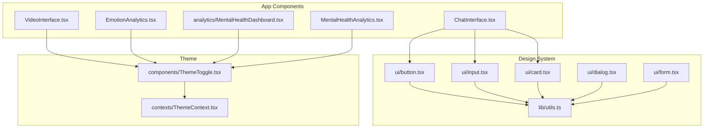
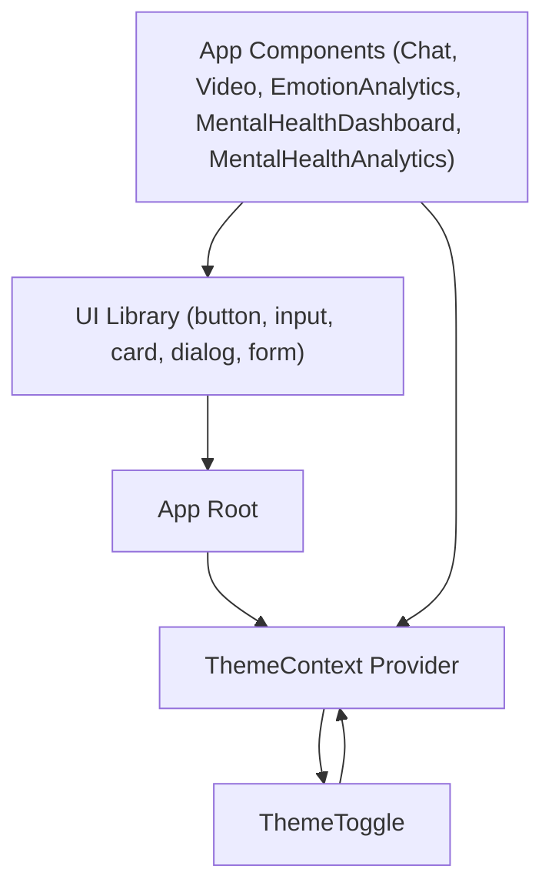
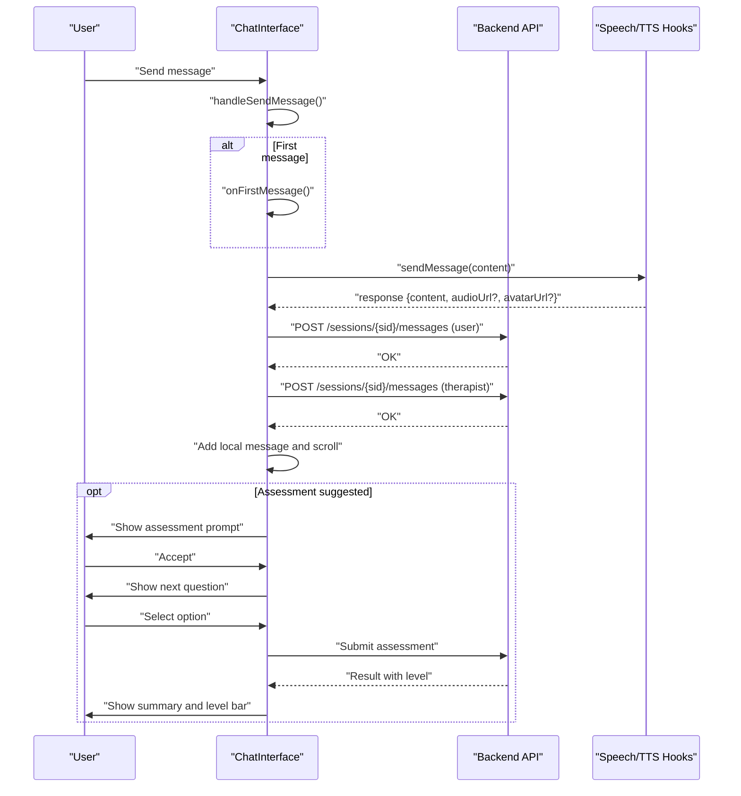
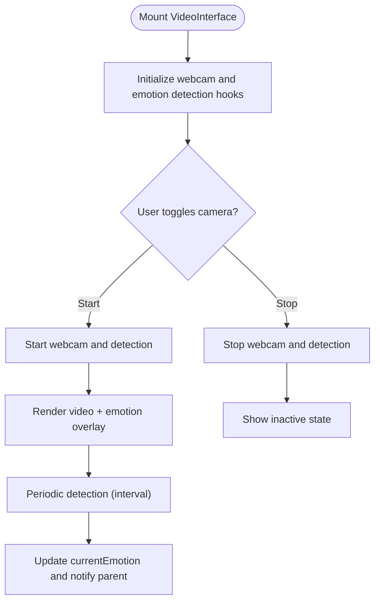
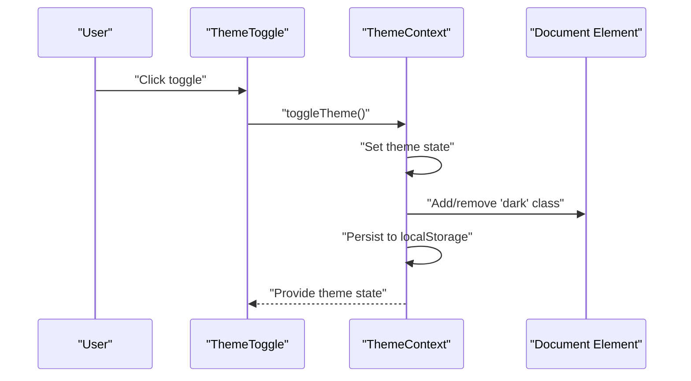
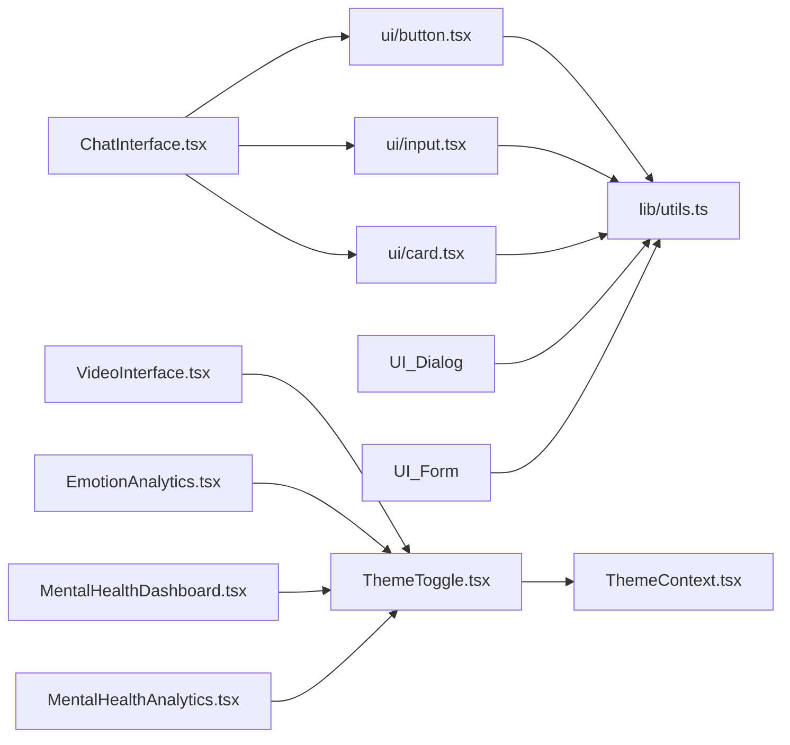

# User Interface Components

<cite>
**Referenced Files in This Document**
- [button.tsx](file://WEBAPP/src/components/ui/button.tsx)
- [input.tsx](file://WEBAPP/src/components/ui/input.tsx)
- [card.tsx](file://WEBAPP/src/components/ui/card.tsx)
- [dialog.tsx](file://WEBAPP/src/components/ui/dialog.tsx)
- [form.tsx](file://WEBAPP/src/components/ui/form.tsx)
- [ChatInterface.tsx](file://WEBAPP/src/components/ChatInterface.tsx)
- [VideoInterface.tsx](file://WEBAPP/src/components/VideoInterface.tsx)
- [EmotionAnalytics.tsx](file://WEBAPP/src/components/EmotionAnalytics.tsx)
- [MentalHealthDashboard.tsx](file://WEBAPP/src/components/analytics/MentalHealthDashboard.tsx)
- [MentalHealthAnalytics.tsx](file://WEBAPP/src/components/MentalHealthAnalytics.tsx)
- [ThemeContext.tsx](file://WEBAPP/src/contexts/ThemeContext.tsx)
- [ThemeToggle.tsx](file://WEBAPP/src/components/ThemeToggle.tsx)
- [utils.ts](file://WEBAPP/src/lib/utils.ts)
</cite>

## Table of Contents
1. [Introduction](#introduction)
2. [Project Structure](#project-structure)
3. [Core Components](#core-components)
4. [Architecture Overview](#architecture-overview)
5. [Detailed Component Analysis](#detailed-component-analysis)
6. [Dependency Analysis](#dependency-analysis)
7. [Performance Considerations](#performance-considerations)
8. [Troubleshooting Guide](#troubleshooting-guide)
9. [Conclusion](#conclusion)
10. [Appendices](#appendices)

## Introduction
This document describes the UI components and design system for the MindBridge web application. The system is built with Radix UI primitives and Tailwind CSS, providing accessible, composable, and theme-aware components. It covers the custom component library, specialized components for chat, video sessions, emotion analytics, and therapeutic dashboards, along with usage patterns, accessibility, responsiveness, theming, and performance guidance tailored for healthcare applications.

## Project Structure
The UI system is organized around:
- A base component library under src/components/ui implementing Radix UI wrappers and styled primitives.
- Specialized application components under src/components for chat, video, emotion analytics, and dashboards.
- A theme system under src/contexts and a small utility for class merging under src/lib.

**Diagram sources**
- [button.tsx](file://WEBAPP/src/components/ui/button.tsx#L1-L60)
- [input.tsx](file://WEBAPP/src/components/ui/input.tsx#L1-L22)
- [card.tsx](file://WEBAPP/src/components/ui/card.tsx#L1-L93)
- [dialog.tsx](file://WEBAPP/src/components/ui/dialog.tsx#L1-L144)
- [form.tsx](file://WEBAPP/src/components/ui/form.tsx#L1-L168)
- [ChatInterface.tsx](file://WEBAPP/src/components/ChatInterface.tsx#L1-L567)
- [VideoInterface.tsx](file://WEBAPP/src/components/VideoInterface.tsx#L1-L207)
- [EmotionAnalytics.tsx](file://WEBAPP/src/components/EmotionAnalytics.tsx#L1-L212)
- [MentalHealthDashboard.tsx](file://WEBAPP/src/components/analytics/MentalHealthDashboard.tsx#L1-L541)
- [MentalHealthAnalytics.tsx](file://WEBAPP/src/components/MentalHealthAnalytics.tsx#L1-L800)
- [ThemeContext.tsx](file://WEBAPP/src/contexts/ThemeContext.tsx#L1-L67)
- [ThemeToggle.tsx](file://WEBAPP/src/components/ThemeToggle.tsx#L1-L55)
- [utils.ts](file://WEBAPP/src/lib/utils.ts#L1-L7)

**Section sources**
- [button.tsx](file://WEBAPP/src/components/ui/button.tsx#L1-L60)
- [input.tsx](file://WEBAPP/src/components/ui/input.tsx#L1-L22)
- [card.tsx](file://WEBAPP/src/components/ui/card.tsx#L1-L93)
- [dialog.tsx](file://WEBAPP/src/components/ui/dialog.tsx#L1-L144)
- [form.tsx](file://WEBAPP/src/components/ui/form.tsx#L1-L168)
- [ChatInterface.tsx](file://WEBAPP/src/components/ChatInterface.tsx#L1-L567)
- [VideoInterface.tsx](file://WEBAPP/src/components/VideoInterface.tsx#L1-L207)
- [EmotionAnalytics.tsx](file://WEBAPP/src/components/EmotionAnalytics.tsx#L1-L212)
- [MentalHealthDashboard.tsx](file://WEBAPP/src/components/analytics/MentalHealthDashboard.tsx#L1-L541)
- [MentalHealthAnalytics.tsx](file://WEBAPP/src/components/MentalHealthAnalytics.tsx#L1-L800)
- [ThemeContext.tsx](file://WEBAPP/src/contexts/ThemeContext.tsx#L1-L67)
- [ThemeToggle.tsx](file://WEBAPP/src/components/ThemeToggle.tsx#L1-L55)
- [utils.ts](file://WEBAPP/src/lib/utils.ts#L1-L7)

## Core Components
This section documents the base design system components and their props/events/customization.

- Button
  - Purpose: Primary action with variants and sizes.
  - Props:
    - variant: default | destructive | outline | secondary | ghost | link
    - size: default | sm | lg | icon
    - asChild: boolean (wraps children via Slot)
    - className: string
    - Other native button props
  - Events: Inherits standard button events.
  - Accessibility: Focus-visible ring, disabled states, aria-invalid integration.
  - Customization: Uses class variance authority (cva) with Tailwind utilities; supports slot wrapping.

- Input
  - Purpose: Text input with consistent focus states and validation styling.
  - Props:
    - type: string (native input type)
    - className: string
    - Other native input props
  - Accessibility: Focus-visible ring, disabled states, aria-invalid integration.
  - Customization: Unified base styles for file inputs, placeholders, selection colors.

- Card
  - Purpose: Layout container with header/title/description/content/footer/action slots.
  - Slots:
    - CardHeader/CardTitle/CardDescription/CardContent/CardFooter/CardAction
  - Props: All accept className and pass-through attributes.
  - Accessibility: No special roles; relies on semantic HTML and screen reader-friendly structure.

- Dialog
  - Purpose: Modal overlay with portal, trigger, close, and content area.
  - Props:
    - Root: All Radix DialogRoot props
    - Trigger: All Radix DialogTrigger props
    - Portal: All Radix DialogPortal props
    - Close: All Radix DialogClose props
    - Overlay: className + props
    - Content: className + showCloseButton:boolean + children
    - Header/Footer/Title/Description: className + props
  - Accessibility: Uses Radix UI semantics; includes close button with sr-only label.
  - Customization: Optional close button toggle; animation classes applied conditionally.

- Form
  - Purpose: Integration with react-hook-form using Radix primitives and accessible labeling.
  - Contexts: FormProvider, FormField, FormItem, useFormField hook.
  - Components:
    - Form/FormProvider
    - FormField(Controller wrapper)
    - FormItem
    - FormLabel (inherits error state)
    - FormControl (Slot with aria-describedby and aria-invalid)
    - FormDescription
    - FormMessage (renders error message)
  - Accessibility: Associates labels with controls, manages aria states, and generates ids.

**Section sources**
- [button.tsx](file://WEBAPP/src/components/ui/button.tsx#L7-L59)
- [input.tsx](file://WEBAPP/src/components/ui/input.tsx#L5-L19)
- [card.tsx](file://WEBAPP/src/components/ui/card.tsx#L5-L92)
- [dialog.tsx](file://WEBAPP/src/components/ui/dialog.tsx#L9-L143)
- [form.tsx](file://WEBAPP/src/components/ui/form.tsx#L19-L167)

## Architecture Overview
The UI architecture follows a layered pattern:
- Base primitives (Radix + Tailwind) in ui/
- Composition via shared utilities (cn)
- Application-specific components that orchestrate state and integrate with APIs
- Theme provider and toggle for global theme control

**Diagram sources**
- [ThemeContext.tsx](file://WEBAPP/src/contexts/ThemeContext.tsx#L23-L66)
- [ThemeToggle.tsx](file://WEBAPP/src/components/ThemeToggle.tsx#L10-L54)
- [button.tsx](file://WEBAPP/src/components/ui/button.tsx#L38-L57)
- [input.tsx](file://WEBAPP/src/components/ui/input.tsx#L5-L19)
- [card.tsx](file://WEBAPP/src/components/ui/card.tsx#L5-L92)
- [dialog.tsx](file://WEBAPP/src/components/ui/dialog.tsx#L9-L143)
- [form.tsx](file://WEBAPP/src/components/ui/form.tsx#L19-L167)
- [ChatInterface.tsx](file://WEBAPP/src/components/ChatInterface.tsx#L42-L566)
- [VideoInterface.tsx](file://WEBAPP/src/components/VideoInterface.tsx#L18-L206)
- [EmotionAnalytics.tsx](file://WEBAPP/src/components/EmotionAnalytics.tsx#L18-L211)
- [MentalHealthDashboard.tsx](file://WEBAPP/src/components/analytics/MentalHealthDashboard.tsx#L47-L540)
- [MentalHealthAnalytics.tsx](file://WEBAPP/src/components/MentalHealthAnalytics.tsx#L135-L679)

## Detailed Component Analysis

### Chat Interface
Purpose: Interactive chat with AI therapist, integrated assessment prompts, and optional avatar/audio generation. Supports session-based message loading and saving.

Key props:
- userId?: string
- sessionId?: string
- enableTTS?: boolean
- enableAvatar?: boolean
- onAvatarResponse?: (avatarUrl?: string, audioUrl?: string) => void
- onAvatarGenerationStart?: () => void
- onMessagesLoad?: (messages: Message[]) => void
- onFirstMessage?: () => void
- className?: string

Behavior highlights:
- Loads historical messages per session via API.
- Saves outgoing/incoming messages to the backend.
- Assessment flow:
  - Detects confusion triggers and suggests a brief assessment.
  - Presents questions with MCQ options and records answers.
  - Submits answers and displays a summarized result with severity level and progress visualization.
- Real-time rendering of assessment prompts/questions/results and loading indicators.

Accessibility and UX:
- Focus management during send and assessment.
- Disabled states during loading/submitting.
- Clear visual hierarchy for user vs therapist messages.

**Diagram sources**
- [ChatInterface.tsx](file://WEBAPP/src/components/ChatInterface.tsx#L154-L344)

**Section sources**
- [ChatInterface.tsx](file://WEBAPP/src/components/ChatInterface.tsx#L25-L566)

### Video Session Interface
Purpose: Webcam capture and real-time emotion detection with overlay and statistics.

Key props:
- onEmotionDetected?: (emotion: string, confidence: number) => void
- className?: string

Behavior highlights:
- Starts/stops webcam and detection loop.
- Displays current emotion with confidence and a detection spinner.
- Toggle to show/hide emotion overlay.
- Renders a grid of emotion confidences with bars.

**Diagram sources**
- [VideoInterface.tsx](file://WEBAPP/src/components/VideoInterface.tsx#L18-L206)

**Section sources**
- [VideoInterface.tsx](file://WEBAPP/src/components/VideoInterface.tsx#L13-L206)

### Emotion Analytics Display
Purpose: Visualizes current emotion state, distribution, trends, and recent activity.

Key props:
- currentEmotion?: EmotionData
- emotionHistory: EmotionData[]
- className?: string

Behavior highlights:
- Computes totals, averages, and distribution.
- Shows recent trend (stable/changing).
- Renders current emotion with emoji and confidence.
- Provides recent activity list and empty-state guidance.

**Section sources**
- [EmotionAnalytics.tsx](file://WEBAPP/src/components/EmotionAnalytics.tsx#L12-L211)

### Mental Health Dashboard (Recharts-based)
Purpose: Comprehensive analytics dashboard for chat-derived insights, including sentiment timelines, emotion distributions, radar charts, keyword categories, and severity gauges.

Key props:
- messages: string[]
- className?: string

Highlights:
- Top cards for severity level, sentiment, dominant emotion, lexical diversity.
- Risk flags banner when detected.
- Responsive charts: Area + Line for sentiment over time, Pie for Plutchik wheel emotions, Radar for keyword categories, Bar for category breakdowns.
- Severity gauge with labeled segments.
- N-gram phrase charts (bigrams/trigrams) when present.
- Keyword category lists with colored badges.
- Summary grid with counts.

**Section sources**
- [MentalHealthDashboard.tsx](file://WEBAPP/src/components/analytics/MentalHealthDashboard.tsx#L42-L540)

### Mental Health Analytics Dashboard (Tabular + Timeline)
Purpose: A tabular, card-based dashboard summarizing mental health metrics, keyword categories, level history, and assessment results.

Key props: None (consumes data via API and internal state).

Highlights:
- Header with refresh and assessment actions.
- Empty state guidance.
- Level overview cards, trend visualization, and data sources.
- Risk alerts with categorized flags.
- Keyword breakdown bars and level timeline visualization.
- Latest analysis and assessment summary cards.
- Level guide with icons and descriptions.

**Section sources**
- [MentalHealthAnalytics.tsx](file://WEBAPP/src/components/MentalHealthAnalytics.tsx#L135-L679)

### Theme System
Purpose: Global light/dark theme with persistence and toggle.

Components:
- ThemeProvider: Manages theme state, persists to localStorage, applies class to documentElement.
- useTheme: Hook to access theme and toggle.
- ThemeToggle: Accessible toggle button with icons and focus styles.

**Diagram sources**
- [ThemeToggle.tsx](file://WEBAPP/src/components/ThemeToggle.tsx#L10-L54)
- [ThemeContext.tsx](file://WEBAPP/src/contexts/ThemeContext.tsx#L23-L66)

**Section sources**
- [ThemeContext.tsx](file://WEBAPP/src/contexts/ThemeContext.tsx#L5-L66)
- [ThemeToggle.tsx](file://WEBAPP/src/components/ThemeToggle.tsx#L6-L54)

## Dependency Analysis
- Component composition:
  - ChatInterface composes UI primitives and integrates with hooks for speech/video and analytics.
  - VideoInterface composes webcam and emotion detection hooks and renders emotion overlays.
  - EmotionAnalytics consumes emotion history and current state to render summaries.
  - MentalHealthDashboard composes Recharts components and consumes analysis data.
  - MentalHealthAnalytics composes cards, buttons, progress bars, and assessment flow.
- Theming:
  - ThemeToggle depends on ThemeContext; ThemeContext updates documentElement and localStorage.
- Utilities:
  - cn merges Tailwind classes safely across components.

**Diagram sources**
- [ChatInterface.tsx](file://WEBAPP/src/components/ChatInterface.tsx#L1-L567)
- [VideoInterface.tsx](file://WEBAPP/src/components/VideoInterface.tsx#L1-L207)
- [EmotionAnalytics.tsx](file://WEBAPP/src/components/EmotionAnalytics.tsx#L1-L212)
- [MentalHealthDashboard.tsx](file://WEBAPP/src/components/analytics/MentalHealthDashboard.tsx#L1-L541)
- [MentalHealthAnalytics.tsx](file://WEBAPP/src/components/MentalHealthAnalytics.tsx#L1-L800)
- [ThemeToggle.tsx](file://WEBAPP/src/components/ThemeToggle.tsx#L1-L55)
- [ThemeContext.tsx](file://WEBAPP/src/contexts/ThemeContext.tsx#L1-L67)
- [button.tsx](file://WEBAPP/src/components/ui/button.tsx#L1-L60)
- [input.tsx](file://WEBAPP/src/components/ui/input.tsx#L1-L22)
- [card.tsx](file://WEBAPP/src/components/ui/card.tsx#L1-L93)
- [dialog.tsx](file://WEBAPP/src/components/ui/dialog.tsx#L1-L144)
- [form.tsx](file://WEBAPP/src/components/ui/form.tsx#L1-L168)
- [utils.ts](file://WEBAPP/src/lib/utils.ts#L1-L7)

**Section sources**
- [ChatInterface.tsx](file://WEBAPP/src/components/ChatInterface.tsx#L1-L567)
- [VideoInterface.tsx](file://WEBAPP/src/components/VideoInterface.tsx#L1-L207)
- [EmotionAnalytics.tsx](file://WEBAPP/src/components/EmotionAnalytics.tsx#L1-L212)
- [MentalHealthDashboard.tsx](file://WEBAPP/src/components/analytics/MentalHealthDashboard.tsx#L1-L541)
- [MentalHealthAnalytics.tsx](file://WEBAPP/src/components/MentalHealthAnalytics.tsx#L1-L800)
- [ThemeToggle.tsx](file://WEBAPP/src/components/ThemeToggle.tsx#L1-L55)
- [ThemeContext.tsx](file://WEBAPP/src/contexts/ThemeContext.tsx#L1-L67)
- [button.tsx](file://WEBAPP/src/components/ui/button.tsx#L1-L60)
- [input.tsx](file://WEBAPP/src/components/ui/input.tsx#L1-L22)
- [card.tsx](file://WEBAPP/src/components/ui/card.tsx#L1-L93)
- [dialog.tsx](file://WEBAPP/src/components/ui/dialog.tsx#L1-L144)
- [form.tsx](file://WEBAPP/src/components/ui/form.tsx#L1-L168)
- [utils.ts](file://WEBAPP/src/lib/utils.ts#L1-L7)

## Performance Considerations
- Prefer lightweight base components (button, input) and avoid unnecessary re-renders by passing memoized callbacks and stable references.
- Debounce or throttle frequent DOM updates (e.g., emotion overlay updates) to reduce layout thrashing.
- Lazy-load heavy chart libraries (Recharts) only when dashboards are visible.
- Use virtualization for long chat histories or emotion timelines when data grows large.
- Minimize Tailwind class churn by composing classes via cn and avoiding dynamic class concatenation in tight loops.
- For healthcare apps, ensure smooth animations and transitions; disable motion preferences where appropriate using CSS prefers-reduced-motion checks.

## Troubleshooting Guide
Common issues and remedies:
- Dialog not closing or focus not trapped:
  - Ensure DialogPortal wraps DialogContent and that Close button is inside Content.
  - Verify showCloseButton prop is set appropriately.
- Form validation not announced:
  - Confirm FormLabel associates with the control via htmlFor and that FormControl sets aria-describedby and aria-invalid.
- Theme toggle not persisting:
  - Check localStorage availability and browser privacy settings; fallback to default theme when unavailable.
- Webcam/emotion detection errors:
  - Inspect error states and surface user-friendly messages; ensure permissions are granted and intervals are reasonable.

**Section sources**
- [dialog.tsx](file://WEBAPP/src/components/ui/dialog.tsx#L56-L80)
- [form.tsx](file://WEBAPP/src/components/ui/form.tsx#L90-L123)
- [ThemeContext.tsx](file://WEBAPP/src/contexts/ThemeContext.tsx#L27-L55)
- [VideoInterface.tsx](file://WEBAPP/src/components/VideoInterface.tsx#L130-L140)

## Conclusion
MindBridge’s UI system combines accessible Radix primitives with Tailwind-driven styling to deliver a cohesive, theme-aware design. The specialized components for chat, video, emotion analytics, and mental health dashboards demonstrate robust composition patterns, strong accessibility, and responsive layouts. The theme system ensures consistent user experience across environments, while the base component library provides extensibility and maintainability.

## Appendices

### Accessibility Compliance Checklist
- Keyboard navigation: All interactive elements reachable via Tab; focus outlines visible.
- ARIA: Proper roles and attributes for dialogs, forms, and controls; aria-invalid and aria-describedby set where applicable.
- Labels: All form controls have associated labels; hidden labels for assistive text.
- Contrast: Sufficient contrast for text and interactive elements in both light and dark themes.
- Reduced motion: Respect reduced motion preferences; avoid excessive animations.

### Responsive Design Approaches
- Mobile-first Tailwind utilities for spacing, typography, and grid layouts.
- Adaptive grids (single column on small screens, multiple columns on larger screens).
- Flexible chart containers using ResponsiveContainer for optimal scaling.

### Theming System Details
- ThemeContext stores theme in localStorage and applies a class to documentElement for cascading styles.
- ThemeToggle provides an accessible switch with icons indicating current mode and focus styles.
- Base components adapt to dark mode via Tailwind’s dark: prefix and contextual variants.

**Section sources**
- [ThemeContext.tsx](file://WEBAPP/src/contexts/ThemeContext.tsx#L23-L66)
- [ThemeToggle.tsx](file://WEBAPP/src/components/ThemeToggle.tsx#L10-L54)
- [button.tsx](file://WEBAPP/src/components/ui/button.tsx#L7-L36)
- [input.tsx](file://WEBAPP/src/components/ui/input.tsx#L10-L16)
- [card.tsx](file://WEBAPP/src/components/ui/card.tsx#L9-L12)